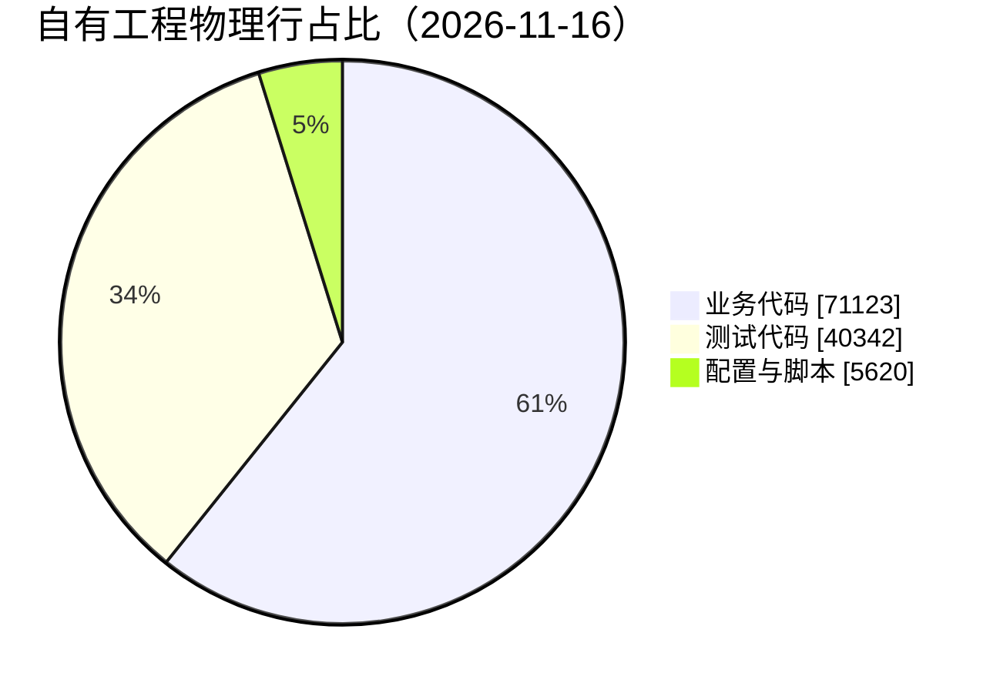
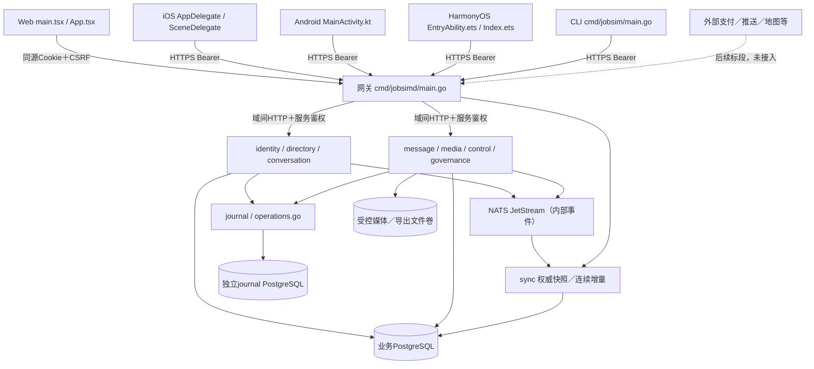
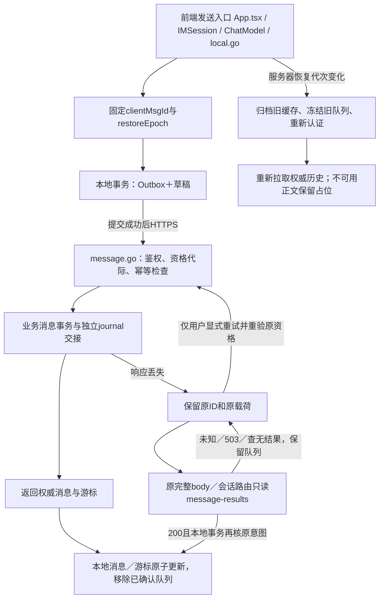
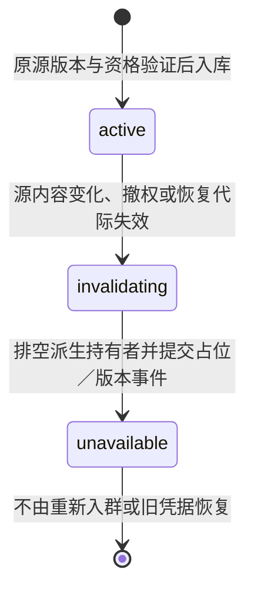

# JobsIM

<!-- jobs-toc:start -->
<!-- jobs-toc:source {"v":2,"token":"[toc]"} -->

📚 目录（点击展开 / 收起）

- [🔥 前言](#%E5%89%8D%E8%A8%80)
- [一、工程入口](#engineering)
- [二、运行与验证](#run)
- [三、维护边界](#ownership)
- [四、工具与运行条件](#toolchains)
- [五、项目统计](#statistics)
  - [5.1、历史与页面](#jobs-toc-heading-7)
  - [5.2、后端与运行规模](#jobs-toc-heading-8)
  - [5.3、自有代码行数](#jobs-toc-heading-9)
- [六、模块与核心流程](#flows)
- [七、功能与工程边界](#feature-boundaries)
- [八、依赖与许可](#dependencies)

<!-- jobs-toc:end -->

---

## 🔥 前言

JobsIM 是面向个人和小团队的自托管即时通讯软件，目前在研，由 Jobs 维护。第一阶段先打通基础聊天和部署闭环。iOS、Android、HarmonyOS分别采用原生工程，Web为标准React/TypeScript应用，CLI与后端使用Go。已有需求统一归入[需求目录](./需求/README.md)，不复制第二套版本。

## 一、工程入口 <a href="#前言">🔼</a> <a href="#🔚">🔽</a>

| 目录 | 内容 |
| --- | --- |
| [代码](./代码/README.md) | 五端与后端独立工程、接口契约和各单元代码地图 |
| [测试](./测试/README.md) | 按端组织的外置测试源码与固定执行入口 |
| [项目相关报告](./项目相关报告/README.md) | 资产盘点、各端实际证据、实现进度、项目统计及迁移校验 |
| [五端资产盘点](./项目相关报告/资产盘点/README.md) | 功能对齐与每次 App 修改前必读，区分源码、默认行为、生命周期及实际已验 |
| [需求](./需求/README.md) | 编码前的全部需求、架构、数据库、验收、原始xlsx和配图 |
| [部署](./部署/README.md) | 按操作系统组织的运行、停止、备份与资源归属说明 |
| [当前实现状态](./项目相关报告/实现进度/README.md) | 已实现范围、未完成项与后续接续位置 |

## 二、运行与验证 <a href="#前言">🔼</a> <a href="#🔚">🔽</a>

优先阅读[资产盘点](./项目相关报告/资产盘点/README.md)和对应工程README。可重建开发缓存与持久运行状态分开，工程只维护声明、锁和受控链接；业务数据、实例 CA／密钥在工程外 Application Support，备份另置 Documents。正式前端使用同源HttpOnly会话，原生使用系统秘密存储，独立演示不会回放给真实用户。

Web已提供可运行界面；后端采用真实PostgreSQL及按域HTTP角色，开发入口可组合启动。完整平台构建、集成、恢复和第一阶段验收仍按实际测试结果更新，不把源码存在视为全部完成。支付／钱包、SDK产品化、地图、RTC与E2EE专项按需求留在后续标段。

当前S2与后续源码以[资产盘点](./项目相关报告/资产盘点/README.md)为准：Android5774真服务、旧Web D5和CLI15a4真服务分别留证，Harmony为host／双HAP编译边界。iOS固定30原生已过，新31原S2与10导出共41已在本轮冻结包本地通过；最新完整UI未通过，六family实际撤销。云草稿与正式本人导出后端已有独立验证；Web正式导出有18组注入／类型／构建，CLI附件准备80组及正式导出88组／Mac构建通过；iOS导出App／测试包编译及41本地通过，Android导出16 JVM及主／测试APK通过、5原生仅编译，均未真接口联调。主动改密后端4纯／12真PG及构建、CLI97本地／Mac构建通过，其余客户端待接；注销普通门禁续写4纯／25PG事件及两个cmd已过，完整注销仍未实现。磁盘低于4GiB时暂停新构建，继续写代码并保留数据。基础版仍在开发，完整收讫目标／累计ACK／保留清理、注销／迁移及其余I尚未交付。历史认证与S1原件见[中央测试证据](./项目相关报告/测试/README.md)，不追认当前新源。

## 三、维护边界 <a href="#前言">🔼</a> <a href="#🔚">🔽</a>

保留全部既有需求内容、图片和原始表格；未改本人模板或第三方源码。当前不提交或推送。Apache-2.0为自有源码发行基线，第三方许可与资源出处由各工程说明维护。

## 四、工具与运行条件 <a href="#前言">🔼</a> <a href="#🔚">🔽</a>

下表为2026-11-15本次源码声明／本机验证基线，不代表各平台已完成发布验收。锁文件均在工作树中，本轮未创建Git提交。

| 单元 | 语言／构建工具 | 最低支持与锁定依据 |
| --- | --- | --- |
| 后端／CLI | Go 1.27.4，PostgreSQL 18.7 | `go.mod`声明Go 1.27，`go.sum`锁模块；CLI真实SQLite实现见自身依赖清单 |
| Web | Node.js ≥22.12、React19.3.1、TypeScript7.0.2、Vite8.3.8 | `package-lock.json`；现代浏览器须支持IndexedDB、AbortSignal.any／timeout；旧浏览器未验 |
| iOS | Xcode27.2、Swift6、CocoaPods | iOS16+，`Podfile.lock`；真实模拟器测试与签名边界见iOS测试报告 |
| Android | Kotlin2.4.20、AGP9.3.1、Gradle9.5.0、Java17目标 | minSdk26、compile／target37；Gradle wrapper固定版本，依赖在构建声明中显式指定 |
| HarmonyOS | 镜像CLT6.1.1.280、Hvigor6.24.2、ArkTS／ArkUI | API24配套构建、兼容目标以当前build-profile为准；[libsdl镜像](https://libsdl.org/harmonyos-devtools/)实际取源与构建记录见鸿蒙README |

开发、集成测试、部署实例使用各自独立数据目录与配置；测试夹具不随源码分发。正式部署采用HTTPS、独立秘密文件及按域数据库权限。自建CA需显式配置，不能关闭校验。网页离线预览执行Web环境准备及 `npm run dev`，无需先部署服务器；接口失败会保留演示，恢复后的真实响应自动覆盖真实空间。

启动问题按端排查：Node缺失先检查准备脚本；HTTPS失败先核CA／SAN／端口；iOS模板缺失显式设置 `JOBS_SWIFT_TEMPLATE`；鸿蒙工具缺件按固定镜像补齐；数据库端口占用由部署入口停止并报告，不接管外部进程。

## 五、项目统计 <a href="#前言">🔼</a> <a href="#🔚">🔽</a>

统计日期统一为2026-11-16，含当前未提交代码；与历史Git提交分开。源码规模由[统计入口](./工具/统计项目.mjs/README.md)读取实际文件，逐文件依据见[中央报告](./项目相关报告/项目统计/报告.json)与[统计说明](./项目相关报告/项目统计/README.md)。

### 5.1、历史与页面<!-- jobs-toc:heading-end -->

| 指标 | 本次读取结果与口径 |
| --- | --- |
| 首次建库 | 远程平台建库时间未核实，不用首提交时间代替 |
| 首次提交 | `git log --reverse`：2026-10-08 22:59:18 +08:00，`cdf750d` |
| 最近提交 | `git log -1`：2026-11-04 17:43:29 +08:00，`18ceb74` |
| 提交／贡献者 | 当前HEAD历史5次提交；`git shortlog -sn --all`计1名，Jobs |

| 端 | 页面数 | 子页面数 | 路由数 | 源码口径 |
| --- | --- | --- | --- | --- |
| iOS | 11 | 已含在11中 | 不使用URL路由 | 具体UIViewController类；排除抽象IMBaseVC、弹层、系统选择器；`JobsIM/UI`，含新导出VC源码 |
| Android | 1 | 0 | 0 | Activity计数；Home／聊天／设置为单Activity状态，弹层不计；`MainActivity.kt` |
| HarmonyOS | 1 | 0 | 1 | `@Entry`页面及main_pages声明；Index内状态与弹层不另计 |
| Web | 1 | 0 | 1个文档入口 | `main.tsx→App`根页面组件；导航状态、对话框不计独立路由，无移动Web容器 |

页面采用各端真实工程单元口径，不能跨端直接比较功能覆盖率；小量页面承载较多IM状态，因此与接口数的比例不按普通表单业务判断。

### 5.2、后端与运行规模<!-- jobs-toc:heading-end -->

| 指标 | 数量／边界 | 统计依据 |
| --- | --- | --- |
| 对外HTTP源码 | 普通99；管理10；实验5；health1 | 当前源码注册115条，默认实验关闭110条；以2b58已执行注册枚举94普通为基线，新增3条对象收讫与2条主动改密公开入口。属于源码登记增量，不是115条真实HTTPS全部覆盖，见[逐条快照](./项目相关报告/项目统计/HTTP路由源码快照.json) |
| 实验接口 | 另5条HTTP，默认关闭 | 仅 `--experimental-exports`，不计正式聊天导出交付 |
| 对外RPC／MQ | 0／0 | 内部按域HTTP不计外部RPC |
| 域与部署角色 | 9个owner＋gateway，10个逻辑HTTP单元 | identity／directory／conversation／message／media／control／journal／governance／sync；identity数据域别名auth。开发all为一个OS进程的10个listener，不冒充10进程生产部署 |
| 核心业务／安全主表 | 原已验主域核心11；实验另2 | 原11表清单见历史报告；新sync及本人状态物理表不包含在此旧口径，S2／云草稿／正式导出／对象有各自隔离迁移证据，不外推其它运行实例 |
| 状态流转对象 | 原业务15类；同步状态另列 | 按业务生命周期计；同步／本人状态／正式导出及收讫按各自合同记录，不按物理表累加 |
| 外部业务系统集成 | 0 | 邮件、支付、地图、推送、RTC均未接入 |
| 周期后台组件 | 不设固定进程数量 | 包含治理／转发清理及sync发布／消费；实际按角色和来源展开。备份／恢复手动执行，不把loop数当OS进程数 |
| 中间件／存储 | PostgreSQL业务与独立journal、NATS JetStream、受控文件卷 | 固定schema1已实测NATS停机HTTP补偿／重连；S2已有独立双PG／NATS／HTTPS限定验证。NATS自托管为I基础设施；无Redis／Elasticsearch运行依赖，完整目标系统部署恢复另验 |
| 峰值QPS／日增／容量 | 未测 | 当前接口与隔离恢复实测不作为容量达标证据 |

当前登记以固定2b58真实Handler注册枚举为基线，比较当前全部生产Go的新增／修改与公开入口，确认新增三条对象收讫与两条主动改密。当前后端86份Go、99普通／10管理／5实验／1 health各自单位分开；对象9f3b的7纯／9真PG、主动改密62d3的4纯／12真PG与构建各自留证，均无新HTTPS专项。固定57普通69、旧7ef普通62与早期schema2普通79保留各自历史快照，不追认当前源码。

状态对象为账户、设备会话、恢复码批次／单码、账号恢复操作、MFA强验证资格、reset-grant、好友申请、入站请求门禁、群、成员资格代际、消息、头像处理／发布、举报、群公告引用／原操作、转发引用及失效清理。运维恢复操作和实验导出生命周期另列，不混入正式业务交付数。

### 5.3、自有代码行数<!-- jobs-toc:heading-end -->

以下为物理行（含空白和注释），范围为代码／测试／部署／工具；排除第三方、符号链接、资源、锁文件、生成物和测试报告。业务与测试分别列示；包含当前未提交／尚未实测的源码，整个中央报告目录排除，不把旧导航备份计入代码。

| 类别 | 文件数 | 行数 | 行占比 |
| --- | --- | --- | --- |
| 业务代码 | 283 | 71123 | 60.74% |
| 测试代码 | 179 | 40342 | 34.46% |
| 配置与脚本 | 47 | 5620 | 4.80% |
| 第三方依赖 | 排除 | 排除 | 不进入分母 |

## 六、模块与核心流程 <a href="#前言">🔼</a> <a href="#🔚">🔽</a>

工程未初始化CodeGraph；下图依据各单元现有代码地图与入口源码。

转发引用另有以下生命周期；临时依赖未知只隐藏投影并重查，不冒充源已永久删除。

## 七、功能与工程边界 <a href="#前言">🔼</a> <a href="#🔚">🔽</a>

| 类别 | 当前实现方式与验收边界 |
| --- | --- |
| 网络与安全 | HTTPS；Web HttpOnly会话／CSRF，原生Bearer；iOS Keychain／Android Keystore；管理员MFA。实例CA与绑定按各端实测。可切换加密协议／E2EE仍按后续专项实施 |
| 数据 | Web IndexedDB、iOS GRDB、Android Room／BundledSQLite、鸿蒙RDB、CLI modernc SQLite；空间、账号和恢复代次隔离；完整同步／收讫资格未全量验收 |
| 消息与治理 | 基础文本／附件、编辑撤回、回复、原引用转发、反应、置顶收藏、好友与群、结构化提及及群公告；头像、举报、账户封禁墓碑服务已实测；各端UI覆盖程度见实现进度 |
| 端能力 | 文件／图片选择及iOS原生录音已有实测；通知为本地能力，第三方推送未接入；蓝牙、定位、扫码、NFC、生物识别、支付、钱包暂未接入 |
| 工程 | 十语言、白天／黑夜／系统主题、字号、演示回退；没有热更新／外部崩溃收集／生产CI/CD交付声明；诊断和测试日志在各自报告目录 |
| 后端 | 原操作幂等、版本比较、资格围栏、限流、事务交接与能力开关；正式本人导出后端已验，端侧全链路未齐；强保护／after_receipt关闭，未宣称全局分布式锁或完整链路追踪 |
| 隐私与权限 | 真实秘密在项目外；报告不存Token；麦克风／文件／通知由用户动作申请。跨平台隐私清单及商店发布还需对应平台验收 |

## 八、依赖与许可 <a href="#前言">🔼</a> <a href="#🔚">🔽</a>

2026-11-15按直接运行依赖列示；测试／编译工具和传递依赖不混入直接运行总数。无新增私有商业SDK；Jobs本人基础模板属于独立自有复用，按iOS来源清单定位。

| 直接依赖 | 版本 | 来源 | 许可 | 用途／仍使用 |
| --- | --- | --- | --- | --- |
| pgx/v5 | 5.13.0 | 公库Go模块 | MIT | 后端PostgreSQL／是 |
| x/crypto、x/text、x/sys | 0.59.0／0.44.0／0.50.0 | Go官方公库 | BSD-3-Clause | 后端密码、文本、文件锁／是 |
| x/term | 0.48.0 | Go官方公库 | BSD-3-Clause | CLI秘密输入／是 |
| modernc.org/sqlite | 1.62.0 | 公库Go模块 | BSD-3-Clause及所含SQLite公共领域等，见原文 | CLI持久化／是；[含传递许可清单](./代码/前端/CLI/第三方许可/清单.json) |
| React、ReactDOM | 均19.3.1 | npm官方公库 | MIT | Web／是 |
| lucide-react | 1.73.0 | npm官方公库 | ISC／部分Feather MIT | Web图标／是 |
| Activity Compose／Material3／Material Icons Core／Lifecycle Compose | 1.12.4／后两Material按BOM2026.09.00／2.10.0 | AndroidX公库 | Apache-2.0 | Android UI／是 |
| Room Runtime／Room KTX／SQLite Bundled | 2.8.5／2.8.5／2.7.1 | AndroidX公库 | Apache-2.0 | Android持久化／是 |
| kotlinx-coroutines-android | 1.10.2 | Kotlin公库 | Apache-2.0 | Android异步／是 |
| iOS直接第三方Pod | 锁定版本逐项见Podfile.lock及Dependencies来源清单 | 公开上游原文只读复用 | 以各原始podspec／LICENSE为准，不用自有Apache覆盖 | GRDB、Alamofire、SnapKit等；模板附带依赖与业务直接调用区分 |

完整来源／摘要与许可入口见[Web资源出处](./代码/前端/Web/Public/资源出处.md)、[iOS逐项许可清单](./代码/前端/iOS/Dependencies/ThirdPartyLicenses.json)、[Android构建声明](./代码/前端/Android/app/build.gradle.kts)、[Go许可清单](./代码/后端/Go/第三方依赖/README.md)。鸿蒙工具链及Hypium为构建／测试依赖，实际下载固定用户指定镜像；工具许可不随自有代码重新授权。

本次未进行完整漏洞数据库扫描，不能据此声称无已知漏洞。版本显式锁定不等同永久安全；模板附带旧依赖的维护状态与最终发行最小依赖集仍需单独复核。传递许可保留原文，发现GPL／AGPL等约束时须单列处理，不能直接套用项目LICENSE。

<a id="🔚" href="#前言">返回前言</a>
