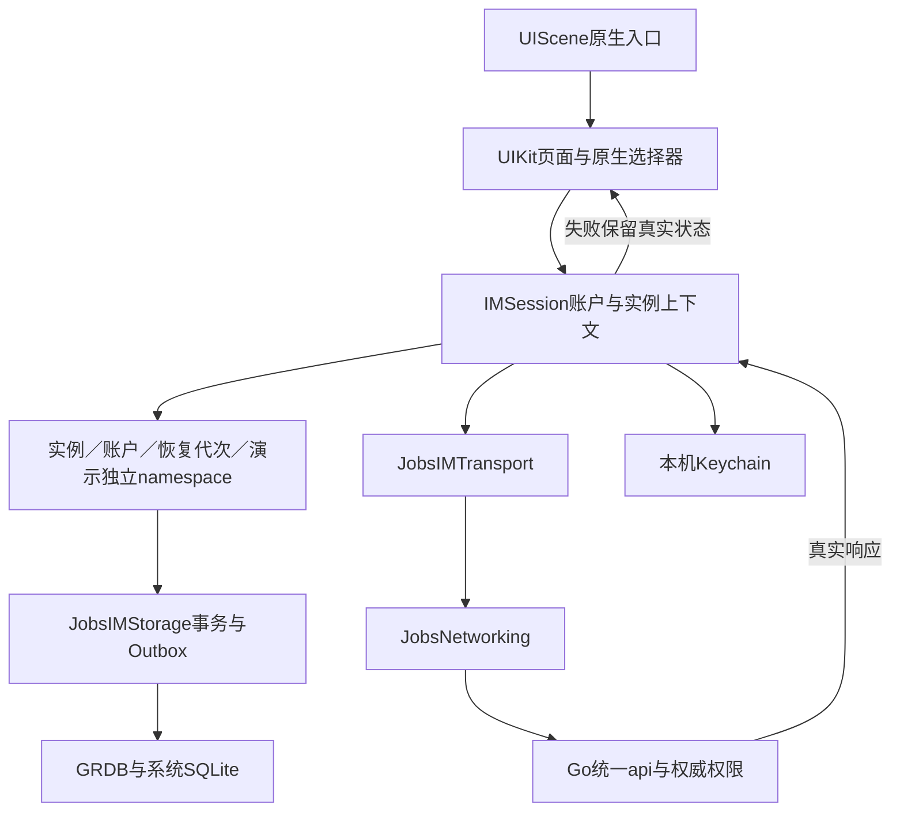

# JobsIM iOS 代码地图

<!-- jobs-toc:start -->
<!-- jobs-toc:source {"v":2,"token":"[toc]"} -->

📚 目录（点击展开 / 收起）

- [🔥 前言](#%E5%89%8D%E8%A8%80)
- [一、模块与入口](#native-boundaries)
- [二、数据与交互路径](#native-flow)
- [三、验证与产物](#native-verification)

<!-- jobs-toc:end -->

## 🔥 前言

> 当前是第一阶段的原生代码切片。完整产品边界见[需求总纲](../../../需求/IM需求明细表.md/IM需求明细表.md)，运行方式见[客户端说明](./README.md)；代码存在不等同验收通过。

## 一、模块与入口 <a href="#前言">🔼</a> <a href="#🔚">🔽</a>

| 位置 | 责任 |
| --- | --- |
| [AppDelegate](./JobsIM/App/AppDelegate/AppDelegate.swift)／[SceneDelegate](./JobsIM/App/SceneDelegate/SceneDelegate.swift) | 原生UIScene入口、Jobs导航配置、账户根页与外观；DEBUG S2档案只读固定UUID公开plist，原凭据仍走Keychain／GRDB |
| [IMSession](./JobsIM/Services/IMSession/IMSession.swift) | 连接／认证、正式与演示上下文、API与本地队列编排；凭据委托Keychain |
| [IMAuthCoordinator](./JobsIM/Services/IMAuthCredentials/IMAuthCoordinator.swift)／[IMCredentialPair](./JobsIM/Services/IMAuthCredentials/IMCredentialPair.swift) | 同设备single-flight刷新、完整AT／RT整对校验与Keychain原子替换、非秘密未知结果门禁、关联本人重新验证、SQLite设备命名空间交接 |
| [IMAuthoritativeSync](./JobsIM/Services/IMAuthoritativeSync/IMAuthoritativeSync.swift)／[IMSyncProtocol](./JobsIM/Services/IMAuthoritativeSync/IMSyncProtocol.swift) | 原登记／快照意图、原envelope字节与版本核验、全manifest、首次权限changes、同GRDB事务安装及只读原Outbox证明；分轮S1／S2原生证据见客户端说明，新源不追认旧包 |
| [JobsIMCore](./JobsByPods/JobsIMCore/Core) | 可编码JSON值、精确字符串ID与隔离命名空间；不依赖UIKit |
| [JobsIMStorage](./JobsByPods/JobsIMStorage/Core/IMLocalStore/IMLocalStore.swift) | GRDB事务、历史／草稿、稳定Outbox与确认原子提交 |
| [JobsIMTransport](./JobsByPods/JobsIMTransport/Core/IMAPIClient/IMAPIClient.swift) | 统一/api请求、上传／下载；业务只通过JobsNetworking |
| [IMAuthVC](./JobsIM/UI/IMAuthVC/IMAuthVC.swift) | 固定实例验真及注册／登录／恢复入口 |
| [IMListVC](./JobsIM/UI/IMListVC/IMListVC.swift)／[IMChatVC](./JobsIM/UI/IMChatVC/IMChatVC.swift) | 会话／联系人／收藏、消息及媒体操作、真实缓存与草稿 |
| [IMMessageListService](./JobsIM/Services/IMMessageListService/IMMessageListService.swift)／[IMMessagePage](./JobsIM/Services/IMMessageListService/IMMessagePage.swift) | 本人收藏和消息搜索的服务端分页、当前来源资格复验及精确消息定位 |
| [IMAnnouncementService](./JobsIM/Services/IMAnnouncementService/IMAnnouncementService.swift) | 公告原操作先落盘、成员／角色代际冻结、原操作纯查询和当前引用重验；不持久保存公告正文副本 |
| [IMForwardService](./JobsIM/Services/IMForwardService/IMForwardService.swift) | 当前源版本重选、原引用及源／目标准入持久化；未知结果纯查和用户明确原body重试；转发缓存逐次投影与失效清理 |
| [IMContactRequestsVC](./JobsIM/UI/IMContactRequestsVC/IMContactRequestsVC.swift)／[IMReportVC](./JobsIM/UI/IMReportVC/IMReportVC.swift)／[IMAvatarVC](./JobsIM/UI/IMAvatarVC/IMAvatarVC.swift) | 好友收件箱、本人举报和静态头像发布／原操作查询 |
| [IMGroupVC](./JobsIM/UI/IMGroupVC/IMGroupVC.swift)／[IMSettingsVC](./JobsIM/UI/IMSettingsVC/IMSettingsVC.swift) | 群成员和管理、语言／主题／字号、账户与设备控制 |
| [IMDataExportService](./JobsIM/Services/IMDataExportService/IMDataExportService.swift)／[协议](./JobsIM/Services/IMDataExportService/IMDataExportProtocol.swift)／[ZIP校验](./JobsIM/Services/IMDataExportService/IMDataExportArchive.swift)／[导出页](./JobsIM/UI/IMDataExportVC/IMDataExportVC.swift) | 正式本人导出原请求／原取消恢复、最小GRDB元数据、RAM短票、完整目录核验与Files保存；App／测试包已编译，41本地已通过，完整UI／真实HTTPS／Files保存未验，不替代旧JSON备份 |
| [IMSyncCoordinator](./JobsIM/Services/IMSyncCoordinator/IMSyncCoordinator.swift)／[IMNotifications](./JobsIM/Services/IMNotifications/IMNotifications.swift) | 前台权威同步编排与独立云投影观察器；本地未读／通知，默认隐藏正文，非远程推送 |
| [实例证书](./JobsByPods/JobsIMTransport/Core/IMInstanceCertificate/IMInstanceCertificate.swift)／[严格信任适配器](./JobsByPods/JobsIMTransport/Core/IMInstanceAgent/IMInstanceAgent.swift) | 每实例CA和独立指纹核实；SecTrust保留主机名／有效期验证，无系统信任修改 |
| [IMDevicesVC](./JobsIM/UI/IMDevicesVC/IMDevicesVC.swift) | 独立原生设备列表、当前设备标识、撤销与本机退出 |
| [IMAvatarView](./JobsIM/UI/IMAvatarView/IMAvatarView.swift)／[IMAvatarLoader](./JobsIM/Services/IMAvatarLoader/IMAvatarLoader.swift) | 打包Logo立即兜底、鉴权异步头像、复用及账户切换防旧图 |
| [IMMediaCache](./JobsIM/Services/IMMediaCache/IMMediaCache.swift)／[IMHistoryExport](./JobsIM/Services/IMHistoryExport/IMHistoryExport.swift) | 消息隔离的鉴权媒体副本、受限离线回读和普通本地历史去敏导出 |
| [IMPersonalStateService](./JobsIM/Services/IMPersonalStateService/IMPersonalStateService.swift)／[IMPersonalStateVC](./JobsIM/UI/IMPersonalStateVC/IMPersonalStateVC.swift) | S2本人view／草稿精确GET、原意图结果恢复、显式采纳与本地编辑CAS；本轮验证单列 |
| [Resource](./JobsIM/Resource) | 十语字符串和应用配置；没有远程占位图依赖 |
| [Dependencies](./Dependencies) | 官方归档及podspec摘要、本人模板源码实际工作树摘要 |
| [外置测试](../../../测试/前端/iOS/README.md) | 原生SQLite/命名空间测试与实际应用UI链路 |

## 二、数据与交互路径 <a href="#前言">🔼</a> <a href="#🔚">🔽</a>

发送先持久化原clientMsgId及正文，再联网；成功确认与本地队列收口同事务。发送准入为本人Conversation下发的opaque字符串，首次意图冻结后不更新；缺旧快照／资格代际变化永久暂停自动发送。人工核对沿原ID和原payload调用只读`message-results`，服务器read ACL仍有效才回已提交事实，404不新建。结构化提及名单也在原意图内冻结；全体提及及公告写额外要求实时角色能力，旧角色快照不补新值。断网不产生真实成功，演示不调用真实写接口。接口丢响应保留待核实身份；现有消息分页的正文与cursor原子落库，保留稳定ID并拒旧版本倒灌；完整同步协议、收讫删除资格和恢复重放等尚需在后续代码切片继续落实。

刷新协议只在实例公开`auth_refresh=true`时接入。普通请求与媒体上传／下载统一进入`IMSession.authorized`，仅`ACCESS_EXPIRED`可触发一次协调刷新；新整对安全存妥、本地绑定完成后才发布。初始认证和刷新未知状态仅保存非秘密原请求／family元数据，不把密码、OTP、RT或其可离线猜测摘要放入普通库。新设备重新验证保留旧Outbox原载荷，并在同一SQLite事务冻结旧设备待发；不搬入新空间。本轮本机12项与新环境HTTPS4项已分别通过；真实请求与故障注入的边界见客户端说明及独立测试摘要。

## 三、验证与产物 <a href="#前言">🔼</a> <a href="#🔚">🔽</a>

`Scripts/Build.rb`输出保存在`build/build.log`或`build/test.log`。模拟器截图、XCTest结果与实际API联调记录应按真实执行范围留证；第三方和本人模板的现有警告不由本工程擅自修改源码消除。

当前权威同步源码位置及边界见[客户端第六节](./README.md#native-authoritative-sync)。登记／阶段／origin／redacted范围／连续游标／scope索引／global终态和普通副本资格都归`JobsIMStorage`同一物理GRDB库；网络不进入事务。forward正文和临时proof只用于当次精确读取，不进入持久历史；公告仅存引用，不存嵌套原文。旧不可归属namespace继续隔离，不推断跨实例删除授权；同当前身份和epoch且有完整安装资格及正文hash的普通副本通过“本地历史（只读）”查看，不允许云附件或群写。新arm64应用／测试包已编译，18条注入测试在自有模拟器／GRDB通过；真实同步HTTPS／UI／真机未验。旧认证及转发结果保持独立。

<a id="🔚" href="#前言">返回前言</a>
