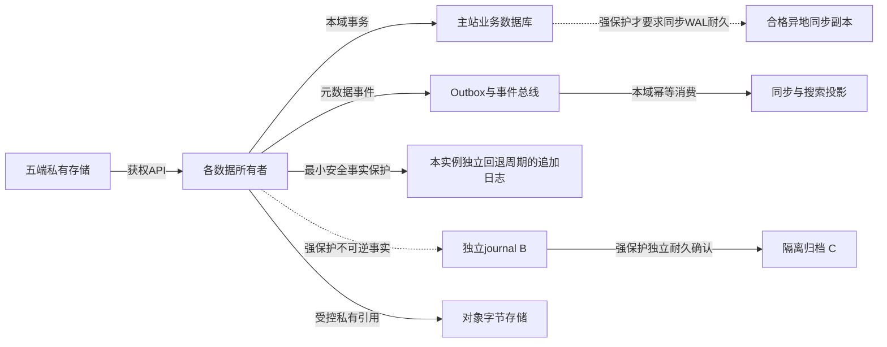
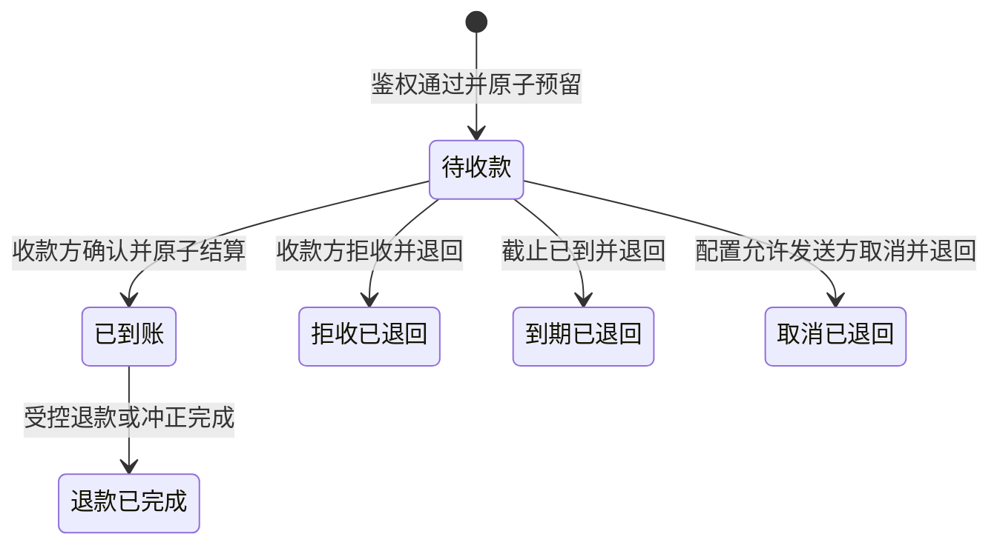
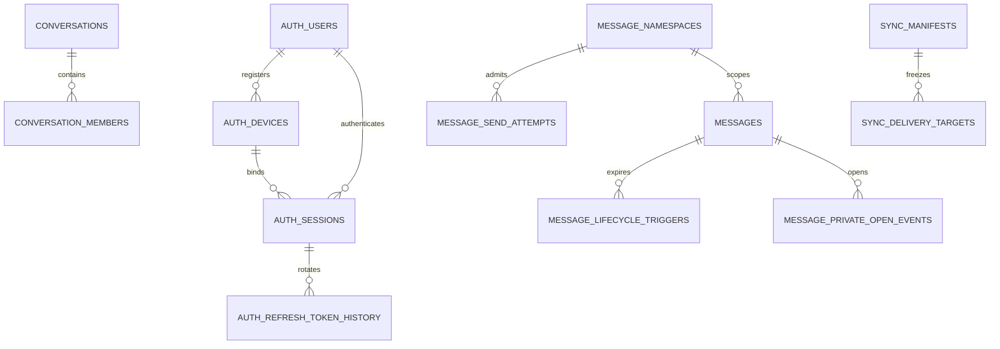
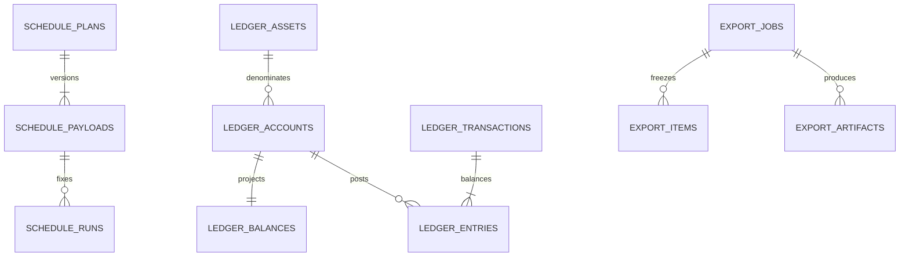

# JobsIM数据库设计

<!-- jobs-toc:start -->
<!-- jobs-toc:source {"v":2,"token":"[toc]"} -->

📚 目录（点击展开 / 收起）

- [🔥 前言](#jobs-toc-heading-1)
- [一、存储边界与三阶段模型](#storage-boundaries)
- [二、作用域、公共字段与类型约定](#schema-conventions)
  - [2.1、精确类型、默认值与枚举](#exact-types)
  - [2.2、数据库权限与来源隔离](#database-access)
- [三、完整服务端字段字典](#data-design)
  - [3.1、身份、认证与资料表](#identity-tables)
  - [3.2、会话、消息、同步和共同事件表](#conversation-message-tables)
  - [3.3、媒体、推送和发信表](#media-notify-tables)
  - [3.4、能力、会员、业务桥接与机器人表](#control-bridge-bot-tables)
  - [3.5、标准聊天扩展表](#standard-module-tables)
    - [3.5.1、位置所有者、授权、坐标与清理表](#location-tables)
  - [3.6、高级场景扩展表](#advanced-module-tables)
    - [3.6.1、高级转账、账单与资金生命周期合同](#money-transfer-billing)
  - [3.7、共享核心与升级降档保护](#tier-data)
- [四、实体关系与必须落库的约束](#relational-constraints)
  - [4.1、核心实体关系](#core-er)
  - [4.2、同域关系、循环创建与初始状态](#structural-constraints)
  - [4.3、复式账本与受控入账](#ledger-posting)
- [五、事务、幂等与并发合同](#transaction-design)
  - [5.1、本域原子边界与锁顺序](#atomic-boundaries)
  - [5.2、幂等键、冲突与保留](#idempotency-retention)
  - [5.3、导出持有者预登记与写入栅栏](#export-holder-fencing)
- [六、查询路径、索引与分区](#query-indexes)
  - [6.1、关键查询索引](#access-paths)
  - [6.2、分区、归档与容量](#partition-policy)
- [七、五端本地库与协议映射](#client-database)
- [八、数据保留、敏感字段与恢复](#data-lifecycle)
- [九、迁移、验证与实施交付](#database-migrations)
  - [9.1、创建顺序与兼容变更](#migration-order)
  - [9.2、数据库专项验收与交付物](#database-test-matrix)

<!-- jobs-toc:end -->

---

## 🔥 前言<!-- jobs-toc:heading-end -->

本文集中定义 JobsIM 的服务端模型、完整字段字典、关系约束、查询索引、端侧类型映射、生命周期和迁移门禁。本文维护唯一现行数据设计；沿用 [**PostgreSQL**](https://www.postgresql.org/) 18 系列与各端存储路线，具体依赖版本仍在架构锁定清单维护。当前没有可执行全量迁移、运行实例或真实数据库验收结果。

产品行为见[需求总纲](../IM需求明细表.md/IM需求明细表.md)，服务、接口、准入和部署见[后端架构](../IM后端架构表.md/IM后端架构表.md)，五端存储适配与耐久事务见[前端架构](../IM前端架构表.md/IM前端架构表.md)。本文是服务端表／字段／约束的维护位置，后端不保留字段副本。业务状态变更须同步需求和验收。

| 阅读入口 | 内容 |
| --- | --- |
| [一、存储边界](#storage-boundaries) | 存储职责、阶段与数据所有者 |
| [二、统一约定](#schema-conventions) | 公共字段、作用域、来源、类型、权限 |
| [三、完整字段字典](#data-design) | 身份、消息、媒体、配置、扩展、账本与独立日志 |
| [四、关系与约束](#relational-constraints) | 实体关系、循环外键、开户、资金平衡 |
| [五、事务与并发](#transaction-design) | 幂等、消息顺序、收讫、删除和入账 |
| [六、查询与分区](#query-indexes) | 索引、游标、分区限制、容量与清理 |
| [七、端侧数据](#client-database) | 五端类型映射、库归属和事务 |
| [八、保留与恢复](#data-lifecycle) | 数据分级、清理、备份、密钥与恢复 |
| [九、迁移与验收](#database-migrations) | 创建顺序、兼容升级、故障验证与交付物 |

## 一、存储边界与三阶段模型 <a href="#前言" style="font-size:17px; color:green;"><b>🔼</b></a> <a href="#🔚" style="font-size:17px; color:green;"><b>🔽</b></a>

| 存储 | 保存什么 | 事实边界 |
| --- | --- | --- |
| 业务PostgreSQL；强保护另有合格异地副本 | 身份、权限、会话、消息、设备进度、任务及各启用模块 | 各服务只写自己的数据；消息接受按[部署保护档](../IM后端架构表.md/IM后端架构表.md#deployment-protection-profiles)取得本实例耐久或[同步耐久合同](../IM后端架构表.md/IM后端架构表.md#dr-durability) |
| 本实例最小安全日志；强保护另配独立journal B/归档C | 删除／撤权／截止／资金／写者栅栏最小恢复事实、资产清单和确认链 | 生命周期独立于业务库备份回退；本地耐久不冒充独立故障域保护，强保护按B/C双确认 |
| 私有对象存储 | 媒体字节、派生资源和获权加密备份对象 | 数据库只存引用与摘要；引用存在不代表字节已经备份 |
| [**Redis**](https://redis.io/) | 缓存、路由、短期协调和限流加速 | 不作权限、历史、余额、删除或唯一幂等事实 |
| 五端私有本地存储 | 消息、Outbox、连续游标、回执意图及必要端侧安全状态 | 通过 API 同步；实际证明耐久能力后才取得收讫资格 |

I迁移本地账号/密码/恢复码、设备会话、文本及图片动图/音视频文件、单聊群聊/群管理、回复编辑反应转发搜索、@/置顶/收藏、静态／GIF动态头像、应用内/本地通知、控制/基础治理和本地最小安全日志。II按模块增加邮件OTP/SMTP、厂商远程推送、地图/位置、RTC、通讯录发现、Bot/复杂调度/会员/频道话题。III增加E2EE/协议切换/阅后即焚/多入口及组织财务AI链等专项；SDK与宿主桥接在代码稳定后归入II-06“后续接入产品化”独立立项。`I/II/III`为同一需求的标段类别，后续继承，不建三套产品数据库；有字段合同不表示能力已启用。

**部署保护档独立于功能阶段。** 基础默认“基本自托管”：本实例PG和对象字节实际耐久、最小安全日志/恢复代际与业务备份回退目标分离、基本备份验真和隔离恢复拒旧必须实现；不强制完整A/D/B/C/E/F，也不声明单机RPO=0。“强保护”沿用全部同步副本、B/C双确认、不可变/离线备份和场景RPO/RTO合同。本表保留完整物理模型；明确B/C、D/E、writer租约双确认和跨域归档字段在强保护专项按需迁移，不能用空表冒充保护。after_receipt/after_object_receipt默认关闭，只有对应独立期限/删除保护、合格端持久副本及清理证明齐全才可启用。

通用journal_seq/intention/result字段在基本档指本实例受控追加日志的真实确认；journal表及restore_epoch使用同机独立本地PostgreSQL集群／数据卷与独立恢复权限，不能放在随业务物理PITR一起回滚的同一集群中，仅分schema不足。安装器自动准备并排除业务卷恢复对它的覆盖；明确B/C证明仅强保护使用。恢复不能因选择基本档跳过当前删除/撤权/绝对期限、旧令牌与旧设备拒绝；最新事实无法核验时限制受影响资料和账号，不从旧备份推断“从未删除/撤权”。本地日志同盘损失时可建立隔离新环境，但不得直接开放旧备份可能已删除的内容。普通备份与强保护备份分别显示实际水位和损失窗口。

服务数据所有者沿用[服务职责表](../IM后端架构表.md/IM后端架构表.md#service-boundaries)。同一服务可拥有多个 schema，其他服务不得直接读写其私表；部署共库不能成为跨服务外键、联表查询或共享事务的理由。以下使用可编辑的 [**Mermaid**](https://mermaid.js.org) 图。

## 二、作用域、公共字段与类型约定 <a href="#前言" style="font-size:17px; color:green;"><b>🔼</b></a> <a href="#🔚" style="font-size:17px; color:green;"><b>🔽</b></a>

一台 PostgreSQL 可承载多个 schema，但每个服务使用仅有本 schema 权限的独立账号，撤销 `public` 默认建表权限，使用显式限定表名/受控 `search_path`。schema 本身不会自动形成安全边界；隔离依赖实际数据库授权。容量增长可迁出独立数据库，接口/事件合同保持一致。[PostgreSQL schema 与权限](https://www.postgresql.org/docs/current/ddl-schemas.html)

下表是可直接细化为迁移 SQL 的字段合同。字段默认 `NOT NULL`；标 `?` 的字段可空。业务表标 **C** 时包含 `scope_id uuid、id uuid、created_at timestamptz、updated_at timestamptz、revision_epoch bigint、row_version bigint DEFAULT 1`，主键 `(scope_id,id)`，约束 `row_version > 0`；无 C 的表已列出主键字段。`scope_id` 是服务端从部署/app授权解析的隔离范围，不能直接采用客户端声称的范围。revision_epoch 来自当前独立恢复代际，普通对象版本用(epoch,version)比较；无 C 的同步/版本表也显式列代际。时间存 UTC，计划任务另存 IANA 时区；内容长度、枚举、金额/次数边界在 API 与数据库双重验证。

`source_context_id`全链路采用**text**，API中的`sourceContextId`为同一个精确字符串：个人上下文为`personal`，宿主为`app:<规范小写appUUID>:mapping:<规范小写mappingUUID>`。identity从已验会话及mapping派生并固定到device/流/缓存/搜索/位置/计划；不得把UUID型来源键当同义列，也不接受空值/省略字段将宿主请求提升为个人权限。grant/授权generation和恢复epoch单独保存、独立校验，不塞入该字符串或只因键相等就授予权限。对象没有自身来源列时，其访问仍按请求当前来源裁剪，禁止跨来源缓存命中。

profiles/contacts、会话个人视图/草稿、成员显示状态、用户级别和可变投影等普通对象均显式记录`revision_epoch`与版本；草稿另用`draft_revision_epoch/draft_version`。恢复owner在门禁内将**可变基线投影**签发为新epoch，普通行、API/CAS、快照、增量与搜索源版本一致；客户端旧epoch/v20不能挡住新epoch/v1的权威基线，源未写也必须纳入覆盖。不可变事件、已发布策略内容、账本分录/入账交易保留原身份/创建epoch并追加新事实，不原地重写账本或“rebase”消除资金、撤权、删除/截止。安全generation与使用过的namespace独立journal对账且不可回退。search索引、RTC参与行等无独立对象版本的附属表使用显式父对象/source版本，不自行发裸版本；派生索引恢复清空重建，不能当真源。

`user_id`、`conversation_id` 等跨服务引用是稳定 ID，通过权威 API 和事件校验，不建立跨服务外键或直接 JOIN 私有表；同服务引用用含 `scope_id` 的复合外键。`jsonb` 仅承载带 schemaVersion 的已验证扩展字段，不能代替成员权限、金额、状态和索引字段。下面每表的唯一键/索引也包含作用域，除特别注明的全局随机凭据查找摘要。可空字段参与业务唯一性时，使用 `NULLS NOT DISTINCT` 或与业务范围一致的部分唯一索引，不能让空值绕过去重；活跃唯一约束明确对应的状态条件。

### 2.1、精确类型、默认值与枚举 <a href="#前言" style="font-size:17px; color:green;"><b>🔼</b></a> <a href="#🔚" style="font-size:17px; color:green;"><b>🔽</b></a>

| 项目 | 服务端与协议 | 端侧与约束 |
| --- | --- | --- |
| 稳定 ID | UUID，不编码业务顺序；API 使用规范小写字符串 | 不把 UUID 变浮点数，不用 ID 推断权限 |
| 序号／版本／代际 | 正 `bigint`；计数／游标可从 0 开始，受每列语义限制；API 一律十进制字符串 | Web 禁用 Number 比较／排序；内部可用 BigInt，存储键按下述映射 |
| 协议 uint64 | `numeric(20,0)`，CHECK 0～18446744073709551615；与产品 key_epoch 分开 | 协议/存储均保留精确字符串，不强塞有符号64位 |
| 金额 | `numeric(38,0)` 整数最小单位，资产精度固定；API 十进制字符串 | 本地缓存字符串，禁止浮点结算、跨币种直接求和 |
| 时间 | UTC `timestamptz`；API RFC 3339；任务另存 IANA 时区／规则版本 | 安全截止取服务端权威值，不能用设备时钟改写 |
| 摘要／密文 | `bytea`；算法、编码、摘要规范与密钥引用随合同锁定 | 请求摘要按版本化规范序列化后计算；不记录秘密原文 |
| 枚举 | `text + CHECK`，使用需求／接口状态机中的明确集合 | 未知格式受控占位，未知安全状态拒绝写入；不自动映射为成功 |
| 默认值 | 除 C 的 row_version=1 外，业务字段不隐式填安全／来源／恢复代际 | UUID、epoch、scope、授权代际由可信服务提供；无条件的数据库默认不能扩大权限 |

所有 C 表加 `revision_epoch > 0`；可变对象每次有效写入 `row_version=row_version+1` 并显式更新时间。不可变事件的 row_version 固定为1；其 `updated_at` 不是追加顺序。计数、额度、租约尝试数和版本的上下界必须落实 CHECK，不能仅依赖前端表单。跨行、跨表、当前授权及时间变化条件不能伪装成普通 CHECK；同域通过外键、锁和受控写入实现。[约束适用边界](https://www.postgresql.org/docs/18/ddl-constraints.html)

### 2.2、数据库权限与来源隔离 <a href="#前言" style="font-size:17px; color:green;"><b>🔼</b></a> <a href="#🔚" style="font-size:17px; color:green;"><b>🔽</b></a>

运行账号为非表owner、非超级用户且无 BYPASSRLS；迁移owner与备份／运维账号独立。按服务授权 schema 使用与所需表／受控函数权限，默认权限须覆盖后续新表。通用运行账号不得修改账本、journal的不可变事实；生产身份不可直连其他服务私表。

多scope业务表启用行级策略作为纵深约束：每个请求事务由服务端认证结果设置事务级 scope，策略同时限定 USING/WITH CHECK；未设置即拒绝。连接池归还后不得残留上下文，不允许客户端自行指定策略变量；RLS只防疏漏，不把共享服务账号的自定义变量当作对恶意服务代码的隔离。表owner需要 FORCE ROW LEVEL SECURITY，超级用户／BYPASSRLS仍可绕过，必须单独管理；唯一性错误也不能向外暴露其他scope资料。[行级策略限制](https://www.postgresql.org/docs/18/ddl-rowsecurity.html)

来源不能仅存在于搜索缓存。`directory.profiles` 保存全局身份资料，按当前授权裁剪读取，只有个人安全上下文可修改；私密偏好进 `source_preferences`，联系人关系／备注／标签进带来源的 `contacts`。跨宿主不互相覆盖备注、草稿、字体、已读与未读；同来源多设备仍同步。全局拉黑是安全阻断，在各来源均生效，经可达的个人安全入口修改，宿主grant不能代为解除。联系人配对由服务端在同一获权发现域解析双方各自来源，不把甲的mapping字符串复制给乙。

## 三、完整服务端字段字典 <a href="#前言" style="font-size:17px; color:green;"><b>🔼</b></a> <a href="#🔚" style="font-size:17px; color:green;"><b>🔽</b></a>

表内字段以英文标识为准；C、可空符号、复合键和代际规则见[统一约定](#schema-conventions)。字段与约束共同构成合同，不能只复制字段而漏掉状态／清理／恢复约束。高级场景启用前还须落实实际业务参数和专项验收。

### 3.1、身份、认证与资料表 <a href="#前言" style="font-size:17px; color:green;"><b>🔼</b></a> <a href="#🔚" style="font-size:17px; color:green;"><b>🔽</b></a>

| 表 / 阶段 | 字段（含类型） | 主键 / 索引 / 关键约束 |
| --- | --- | --- |
| `auth.users` / I | C；`password_hash text?、password_input_version text、recovery_code_generation bigint、mfa_recovery_generation bigint、reset_grant_generation bigint、password_version bigint、credential_generation bigint、security_version bigint、state text、state_before_tombstone text?、ban_until timestamptz?、tombstoned_at timestamptz?、restore_until timestamptz?、deletion_state text、deletion_request_id uuid?、redaction_completed_at timestamptz?、pending_security_operation_id uuid?、recovery_state text` | C 主键；state 三值、deletion_state 四值；recovery_state 为 normal/recovery_required；I本地注册要求password_hash非空且算法合格；II明确启用无密码认证时才可空。完成注销不可恢复，墓碑恢复保留原处罚；安全／凭证／恢复码批次／重置资格代际单调，password_input_version固定本次密码输入方案；安全变更 pending 即拒绝相应新授权，最新凭证不可重建则拒绝旧密码/旧邮箱自动恢复；password_hash 不回传 |
| `auth.principals` / I→II | `scope_id uuid、id uuid、kind text、authority_service text、registered_at timestamptz` | PK scope/id；kind human/bot/service 不可变，人类id沿用userId、bot id沿用botId；仅登记定位，状态仍向身份或bot权威校验；I只启用human，service无独立模块授权不得通信 |
| `auth.local_auth_requests` / I | C；`request_id uuid、purpose text、origin text?、challenge_digest bytea、request_digest bytea、digest_key_ref text、digest_version text、target_user_id uuid?、restore_epoch bigint、state text、result_session_id uuid?、result_bff_session_id uuid?、browser_cookie_ciphertext bytea?、secret_nonce bytea?、secret_key_ref text?、expires_at timestamptz、consumed_at timestamptz?` | UNIQUE scope/request_id；registration/login/password_reset/recovery，个人本地身份流程不要求app/mapping/邮件。state为pending/awaiting_browser_confirmation/confirmed/invalidated/expired，原截止最长300秒且不因重试续期；挑战只授权原请求，密码/恢复码验证后在identity事务内写账号或凭证、消费证明、写幂等结果与会话；Web挑战Cookie与Origin/CSRF绑定，正式Cookie再交付只在原截止内且临时密文受限，浏览器确认前不授聊天；错误/重放/旧恢复代际拒绝；含密码／恢复码的request_digest为用途隔离带钥HMAC并记录key／算法，不允许无钥可猜摘要；管理员重置签发使用password_reset_grants并另记account_actions，不记录密码／恢复码原文 |
| `auth.identities` / I | C；`user_id uuid、kind text、provider text、normalization_version text、normalized_key text?、lookup_mac bytea、value_ciphertext bytea、verified_at timestamptz?` | UNIQUE `(scope_id,kind,provider,lookup_mac)`；用户复合 FK；I的kind=username/provider=local要求normalization_version=local-username-v1、normalized_key非空且匹配小写ASCII字母／数字／下划线3～32字符，并以该类型的部分UNIQUE(scope_id,normalized_key)兜底防重名；规范键是公开用户名的认证真源，lookup_mac保留用于查找、value_ciphertext保存展示值；保留名在受控身份入口校验；本人受控改名锁稳定user_id并核expectedUsername／原requestId，原子预留新旧规范键，更新当前认证键及公开投影，旧键不用于新登录但永久不分配其他身份；改名不换公开ID／设备／family／恢复命名空间，不撤既有合法会话；原请求保留摘要与目标结果，重试同时返回当前User与current，不能回滚后续改名。注销／墓碑保留最小键占用事实不分配给其他身份；灾备恢复按已确认资料RPO／业务快照可能回退资料名及对应登录名，user_id和占名保护保持，当前epoch须重新认证；reserve_username最小日志只保护占名，不承诺最新登录名永不回退，隔离恢复专项待验。公开directory.username由同域事件投影，不作为独立认证真源。II才增邮箱绑定，邮箱规范化有版本，不随意合并提供商别名 |
| `auth.devices` / I | C；`user_id uuid、source_context_id text、store_generation uuid、durable_contract_version text、receipt_eligible boolean、platform text、client_version text、name text、last_seen_at timestamptz、revoked_at timestamptz?` | INDEX `(scope_id,user_id,revoked_at)`；人类设备限定；来源/存储generation不可覆盖，丢库或旧备份恢复退休旧id并重新认证登记；合格版本按支持矩阵验收，不因自报能力自动具备删除资格；平台白名单；设备名长度上限 |
| `auth.sessions` / I | C；`user_id uuid、device_id uuid、source_context_id text、refresh_digest bytea、family_id uuid、refresh_generation bigint、security_version bigint、restore_epoch bigint、source_app_id uuid?、source_mapping_id uuid?、source_mapping_generation bigint?、source_app_generation bigint?、source_grant_id uuid?、source_grant_version bigint?、idle_expires_at timestamptz、absolute_expires_at timestamptz、expires_at timestamptz、revoked_at timestamptz?、replaced_by uuid?` | UNIQUE `refresh_digest`；INDEX 用户/设备/来源/过期；来源及grant字段同时空或齐全，app/映射/grant权威验证；仅授予指定资源/操作，不继承个人全部权限；device绑定原存储实例；restore_epoch 对当前恢复代际；轮换/重用检测与refresh_generation递增及旧交付资格失效同事务，旧令牌不可反复刷新；session/family身份稳定，expires_at=min(idle_expires_at,absolute_expires_at)，absolute由首次认证冻结，旋转不续长；历史摘要见refresh_token_history |
| `auth.refresh_token_history` / I | `scope_id uuid、session_id uuid、family_id uuid、refresh_generation bigint、token_digest bytea、issued_at timestamptz、expires_at timestamptz、state text、consumed_at timestamptz?、revoked_at timestamptz?` | PK scope/session/generation；UNIQUE token_digest全局随机摘要；session本域FK且family固定；active/used/revoked/expired；每session仅一行active部分唯一；used摘要保留family映射至重用检测责任结束；轮换／旧token重用撤family与session同锁同事务，不保存令牌原文 |
| `auth.bff_sessions` / I Web | C；`cookie_digest bytea、user_id uuid、device_id uuid、store_generation uuid、source_context_id text、session_id uuid、family_id uuid、refresh_generation bigint、security_version bigint、restore_epoch bigint、upstream_refresh_ciphertext bytea?、secret_nonce bytea?、secret_key_ref text?、aad_digest bytea、expires_at timestamptz、state text、refresh_operation_id uuid?、browser_confirmation_operation_id uuid?、browser_confirmed_at timestamptz?、revoked_at timestamptz?、cleared_at timestamptz?` | UNIQUE cookie_digest；session FK；awaiting_browser_confirmation/active/updating/reauth_required/revoked/expired/cleared；待确认Cookie仅原交付查询/确认/取消不授聊天/刷新，active需浏览器持Cookie确认且当前family/generation匹配；TTL不超上游，Cookie只摘要/refresh密封，失效清秘密，Redis不作权威 |
| `auth.bff_exchange_requests` / 后续SDK专项 Web | C；`challenge_cookie_digest bytea、origin text、app_id uuid、request_id uuid、request_digest bytea、challenge_id uuid、source_context_id text、device_id uuid、store_generation uuid、restore_epoch bigint、verifier_ciphertext bytea?、secret_nonce bytea?、secret_key_ref text?、aad_digest bytea、result_bff_session_id uuid?、family_id uuid?、refresh_generation bigint?、browser_cookie_ciphertext bytea?、browser_cookie_nonce bytea?、browser_cookie_key_ref text?、browser_cookie_aad_digest bytea?、confirmation_operation_id uuid?、upstream_delivery_confirmed_at timestamptz?、browser_confirmed_at timestamptz?、expires_at timestamptz、state text、cleared_at timestamptz?` | UNIQUE challenge_cookie_digest；UNIQUE scope/app/request；challenge/result BFF session本域FK；pending/awaiting_browser_confirmation/confirmed/invalidated/expired/cleared，原300秒窗不续期；refresh及Cookie材料同事务耐久后才确认上游，用原挑战取同Cookie不换票；browser持正式Cookie确认后才active/清秘密；并发同锁、旧family/恢复代际/截止拒绝 |
| `auth.exchange_challenges` / 后续SDK专项 | C；`app_id uuid、mapping_id uuid、source_context_id text、source_grant_id uuid、source_grant_version bigint、device_id uuid、store_generation uuid、request_id uuid、restore_epoch bigint、app_authorization_generation bigint、mapping_generation bigint、pkce_method text、pkce_challenge text、expires_at timestamptz、state text` | UNIQUE scope/app/request；S256固定格式，最长300秒且受原grant/票据更早截止限制；只存challenge不存verifier，来源/设备/恢复绑定不可改；旧挑战不能在新代际使用 |
| `auth.exchange_nonces` / 后续SDK专项 | C；`app_id uuid、challenge_id uuid、restore_epoch bigint、app_authorization_generation bigint、source_grant_id uuid、source_grant_version bigint、issuer text、nonce_digest bytea、ticket_digest bytea、mapping_id uuid、mapping_generation bigint、request_id uuid、request_digest bytea、expires_at timestamptz、consumed_at timestamptz?、result_session_id uuid?` | UNIQUE scope/app/issuer/nonce_digest；UNIQUE scope/app/request；challenge FK；消费/会话/交付同事务；已验原票据摘要与签名绑定上下文保存，S256/当前代际逐字段检查；响应未知走同请求再交付，不重新消费或接受另一张未绑定票据 |
| `auth.credential_deliveries` / 后续SDK专项 | C；`app_id uuid、request_id uuid、request_digest bytea、challenge_id uuid、source_context_id text、session_id uuid、family_id uuid、refresh_generation bigint、device_id uuid、store_generation uuid、restore_epoch bigint、security_version bigint、app_authorization_generation bigint、mapping_generation bigint、grant_version bigint、delivery_ciphertext bytea?、delivery_nonce bytea?、key_ref text?、aad_digest bytea、expires_at timestamptz、state text、consumed_at timestamptz?、invalidated_at timestamptz?、cleared_at timestamptz?、replacement_operation_id uuid?` | UNIQUE scope/app/request；本服务session/challenge FK；最长300秒且原截止优先；ready/consumed/invalidated/expired/cleared，ready密文/nonce/key齐全、清理后均NULL；S256同请求取原材料，摘要/当前所有代际与refresh_generation不符拒绝，交付/刷新/确认锁同会话与记录；auth专属秘密保护，禁止日志/journal回显 |
| `auth.completion_operations` / I | C；`request_id uuid、request_digest bytea、digest_key_ref text、digest_version text、challenge_id uuid、purpose text、target_user_id uuid?、state text、result_redacted jsonb、completed_at timestamptz?` | UNIQUE scope/request；I本地注册/密码或恢复码重置与本操作同事务，challenge_id对应本地身份请求；II OTP消费/最终身份写入/本操作完成同事务；成功记录结果不含密码、码或令牌；敏感输入按原请求同一用途隔离HMAC／key版本比对，不存可猜的无钥密码摘要；不同摘要拒绝 |
| `auth.otp_challenges` / II | C；`target_user_id uuid?、target_security_version bigint?、restore_epoch bigint、identity_lookup_mac bytea、purpose text、request_session_id uuid?、code_mac bytea、key_version int、expires_at timestamptz、attempt_count int、max_attempts int、consumed_at timestamptz?、superseded_at timestamptz?` | INDEX 目标账号/邮箱MAC/用途/到期；注册前 user 可空，绑定/恢复必须与权威账号/用途/邮箱一致；次数 `0..max_attempts`，错误分支原子提交次数/锁定，成功消费与身份写入同事务；并发原子消费、重发废弃旧码，状态/security_version/restore_epoch 变化须重新检查 |
| `auth.rate_windows` / I | `scope_id uuid、purpose text、subject_mac bytea、window_start timestamptz、count int、expires_at timestamptz` | PK `(scope_id,purpose,subject_mac,window_start)`；count 非负；数据库限流回退原子更新并有并发上限 |
| `auth.mfa_factors` / I 管理员→II 用户 | C；`user_id uuid、factor_type text、public_key bytea?、secret_ciphertext bytea?、last_accepted_step bigint?、verified_at timestamptz?、revoked_at timestamptz?` | INDEX `(scope_id,user_id)`；另UNIQUE(scope_id,id,user_id)供恢复批次整体绑定本人因子；因子类型决定所需字段；TOTP 时间步成功消费用行锁/CAS防重放；私密因子加密、恢复码仅存摘要 |
| `auth.step_up_authorizations` / I | C；`actor_user_id uuid、session_id uuid、factor_id uuid、action text、target_service text、target_id uuid、expected_target_version bigint、security_version bigint、restore_epoch bigint、operation_id uuid、request_digest bytea、expires_at timestamptz、consumed_at timestamptz?、result_ref text?` | UNIQUE scope/operation；绑定会话/动作/目标/版本；一次原子消费，跨域交接凭据限一个已记录操作；撤销、到期或代际变化拒绝，不是通用管理员通行证 |
| `auth.recovery_codes` / I 管理员与普通用户 | C；`user_id uuid、batch_id uuid、batch_generation bigint、consumed_operation_id uuid?、revoked_at timestamptz?、code_digest bytea、consumed_at timestamptz?` | UNIQUE `(scope_id,code_digest)`；同域复合FK(scope,batch_id,user_id,batch_generation)绑定真实批次，code_digest为批次key的用途隔离HMAC；每码至少128位随机量，工程默认每批10码、每码160位；只允许当前active批次且未消费／未撤销码，一次性原子消费；I普通用户可用恢复码，重置与消费/凭证代际提升/旧会话撤销同一identity事务，不绕封禁或注销；恢复完成使旧批次整体失效，换组同用户锁原子撤同purpose旧组并激活新组；MFA用途仅恢复绑定因子并撤旧证明、提升mfa_recovery_generation，不直接改密或满足通用管理员step-up；码原文仅当次生成展示不保存，查询／重试不回显 |
| `auth.recovery_code_batches` / I | C；`user_id uuid、purpose text、factor_id uuid?、batch_generation bigint、format_version text、digest_key_ref text、code_count int、state text、issued_by_operation_id uuid、invalidated_at timestamptz?、invalidation_reason text?` | UNIQUE(scope_id,user_id,purpose,batch_generation)、UNIQUE(scope_id,id,user_id,batch_generation)、UNIQUE(scope_id,issued_by_operation_id)；每用户／purpose仅一active批次部分唯一，user同域FK，factor使用FK(scope_id,factor_id,user_id)→mfa_factors(scope_id,id,user_id)，不能指向同scope他人的因子；purpose=account_recovery或mfa_recovery，后者绑定原factor_id，前者factor为空，互不代用；active/invalidated；generation分别与users.recovery_code_generation／mfa_recovery_generation一致才可兑换，MFA恢复仅处理绑定因子／证明不直接取得通用step-up；生成／换组须本人重新认证，旧组撤销与新组激活／审计／结果同事务，code_count工程默认10且实际行数完整校验后提交；原码只当次受保护交付，丢响应查询只返脱敏批次状态，须再验证生成替代组；摘要key不可回传／入journal |
| `auth.password_reset_grants` / I | C；`user_id uuid、actor_admin_id uuid、actor_security_version bigint、admin_grant_id uuid、step_up_authorization_id uuid、issue_operation_id uuid、grant_generation bigint、token_digest bytea、digest_key_ref text、target_security_version bigint、target_credential_generation bigint、restore_epoch bigint、purpose text、verification_evidence_ref text、state text、expires_at timestamptz、consumed_at timestamptz?、consumed_operation_id uuid?、revoked_at timestamptz?` | UNIQUE(scope_id,issue_operation_id)、UNIQUE(scope_id,user_id,grant_generation)、UNIQUE token_digest；用户／管理员／admin_grant／step_up本域FK；purpose=password_reset，issued/consumed/revoked/expired，仅一issued资格部分唯一；至少128位随机凭证，存用途隔离HMAC，600秒不续期且由原签发时间约束；当前独立重置权限／step-up／目标核验证据／审计才能签发，兑换复验签发管理员状态／安全代际及原权限未撤销，新签发撤旧，users.reset_grant_generation匹配；用户兑换自定新密码，与消费／凭证及安全代际提升／撤旧会话／撤旧恢复批次同identity事务，原结果不含密码或会话；签发不设置共享密码、不登录用户／解封／恢复注销／获取E2EE历史；丢响应不能读回原文，可经再次确认签发替代资格 |
| `auth.admin_grants` / I | C；`user_id uuid、permission_id text、granted_by uuid、expires_at timestamptz?、revoked_at timestamptz?` | UNIQUE 活跃 `(scope_id,user_id,permission_id)`；普通用户/机器人不能自行授权；初始化受控 |
| `auth.account_actions` / I | C；`user_id uuid、actor_admin_id uuid、action text、from_state text、to_state text、reason text、request_id uuid、recoverable_until timestamptz?、result jsonb` | UNIQUE `(scope_id,request_id)`；INDEX 用户/时间；追加审计，不能覆盖前次理由 |
| `directory.profiles` / I | `scope_id uuid、user_id uuid、username text、display_name text、signature text、avatar_preset text、avatar_object_id uuid?、avatar_generation bigint、pending_avatar_object_id uuid?、pending_avatar_operation_id uuid?、bio text、revision_epoch bigint、row_version bigint、updated_at timestamptz` | PK `(scope_id,user_id)`；唯一规范化username，但该列仅auth当前认证用户名投影，普通资料编辑不得更改；受控username原操作由identity维护唯一键和新旧占用，资料投影不能另生用户ID；display_name独立可改，signature最多200 Unicode码点；注册时间来自auth.users.created_at只读，UID沿用user_id；联系方式由真实identity绑定权威投影，读取区分bound／unbound／hidden／unavailable，他人不披露绑定是否存在；普通对象按(epoch,row_version) CAS/快照/事件，恢复签发新基线；私密privacy/font移至source_preferences；仅个人安全上下文可改全局资料，宿主按grant裁剪读取；I支持预设和静态／GIF动态头像上传，avatar_object_id须为本人有权私有media对象/有效引用，大小／像素／格式校验后发布；待处理头像对象／操作同时空或齐全，准备时CAS递增avatar_generation并保留旧生效引用，完成须匹配owner／epoch／generation／原操作并重验权限，切新成功才清待处理并释放旧引用，prepare／发布／取消的稳定原操作结果同事务进入本owner.recovery_operations，清pending及后续替换不丢历史成功事实；按当前来源/权限裁剪，私密字段不成为公共搜索 |
| `directory.source_preferences` / I | `scope_id uuid、source_context_id text、user_id uuid、privacy jsonb、font_preset text、revision_epoch bigint、row_version bigint、updated_at timestamptz` | PK scope/source/user；字体small/standard/large；私密偏好仅本人来源获权读写；profiles不重复存privacy/font；恢复／事件／CAS带完整代际，宿主A不覆盖个人/B偏好 |
| `directory.contacts` / I | `scope_id uuid、source_context_id text、owner_user_id uuid、peer_user_id uuid、peer_source_context_id text、state text、incoming_request_gate text、request_generation bigint、alias text?、labels jsonb、created_at timestamptz、updated_at timestamptz、revision_epoch bigint、row_version bigint` | PK `(scope_id,source_context_id,owner_user_id,peer_user_id)`；禁止self；state区分申请／好友／拒绝／移除，request_generation及通信permission_generation单调；拒绝／取消退休旧请求代际，不永久置denied，未被任一方拉黑可用新requestId发起不限轮数的新申请，无reopen前置门；单对同方向仅一个有效pending并执行短时安全限流。拉黑保留friend并退休双方旧通信准入，解除后仅当前friend可取得新代际准入；双向好友接受／删除同域更新双方，删除退休旧请求及准入且无一键undo，新申请与明确接受才可重建，私有备注各自管理；(epoch,row_version)更新/投影；通过contact_requests解析双方各自来源，反向关系同本域事务；个人联系人/备注只在获权来源索引，不因宿主同userId外泄 |
| `directory.contact_requests` / I | C；`requester_user_id uuid、requester_source_context_id text、recipient_user_id uuid、recipient_source_context_id text、discovery_domain_id text、request_kind text、conversation_id uuid?、recipient_request_generation bigint、request_id uuid、request_digest bytea、state text、expires_at timestamptz、resolved_at timestamptz?` | UNIQUE scope/requester/source/request_id；同摘要原结果，双方不同user且由权威发现域解析各自来源；pending/accepted/rejected/cancelled/expired；request_kind=friend/message，message须绑定明确私聊conversation，friend不自动授予另一会话；捕获当前接收方request_generation，旧代际不能接受；friend接受与双方contacts写入同域事务，message接受只形成该会话普通通信许可的受控交接，撤权／拉黑及旧请求代际拒绝；拒绝后的新requestId是独立轮次，不能以旧accepted或旧pending恢复关系；不接受客户端任填对方mapping |
| `directory.blocks` / I | `scope_id uuid、owner_user_id uuid、peer_user_id uuid、created_at timestamptz` | PK 用户对；与管理员封禁分别建模；本人通过可达个人安全入口或明确治理权限修改，各来源均应用全局阻断双方新的直接消息／来电／对方请求，建立拉黑同一关系事务递增双方各来源已有控制占位的request_generation（必要时建占位）、终结旧pending请求及未交付accepted许可交接并写撤权Outbox；建立阻断保留已有好友，双方新direct消息／媒体发送与绑定均拒绝；解除只移除本人阻断、递增通信许可代际，仍为friend且无另一方block时授新准入，不复活旧申请／旧准入／未提交队列；阻断前已提交的合法历史保持原读ACL／删除与保留期约束，共同群仍可见合法历史但抑制定向提醒，不改变群成员；与申请接受／撤销按同一规范双方关系锁排序，宿主grant不得解除 |
| `directory.addressbook_consents` / II | C；`user_id uuid、device_id uuid、policy_version text、granted_at timestamptz、revoked_at timestamptz?、sync_mode text` | INDEX `(scope_id,user_id,device_id)`；OS 联系人授权与 IM 明确同意分别检查 |
| `directory.addressbook_syncs` / II | C；`user_id uuid、device_id uuid、consent_id uuid、requested_count int、matched_count int、status text、expires_at timestamptz、result_ciphertext bytea?` | INDEX 到期/用户；结果短期保存、数量有上限；撤回同意停止增量并删除可清理数据，不自动加好友 |

本地账号输入与恢复执行[基础认证合同](../IM需求明细表.md/IM需求明细表.md#local-account-contract)：密码先NFC，再按15～128个Unicode码点且最多512 UTF-8字节处理，不trim／截断；password_input_version冻结输入口径，弱口令表随部署打包并记录修订。auth.identities的唯一规范键与用户／密码注册同一identity事务，不因公开资料投影延迟创建第二账号。恢复批次／单码与重置资格的使用、撤销和单调代际纳入独立最小安全日志；恢复旧库先重放拒旧事实，最新凭据不可重建则recovery_required，不能重新启用旧批／旧凭证。摘要key不入journal／公开导出，不允许用无钥请求hash旁路离线猜测。

关系操作在directory本域按规范scope／双方userId的同一事务级关系锁排序，包含全局拉黑与各来源请求；以有界本域事务锁再读当前门禁／申请／双方关系。拒绝门禁及request_generation是独立于申请行TTL的持久事实；联系人行在拒绝时可以是无好友的控制占位，不因不存在好友就移除门禁。陌生message请求接受向conversation交接稳定原操作和代际，由其持久CAS该会话许可，未知不放行／不创建好友；取消／拉黑的最新代际优先重验；拉黑同事务持久提高相关请求generation并终结原待处理／未交付接受，解除不回退代际、不复活该交接，因此block→unblock后迟到旧接受仍被拒绝。联系人、群及媒体资格按[关系合同](../IM需求明细表.md/IM需求明细表.md#contact-relationship-contract)与[群生命周期](../IM需求明细表.md/IM需求明细表.md#group-lifecycle-contract)授权。

通讯录上传前说明目的、字段与范围，用户确认后匹配，候选好友再次由用户选择。默认不持久保存第三方联系人姓名和完整原始通讯录；传输/短期匹配采取保密与防枚举措施。普通手机号/邮箱哈希不被视为天然匿名数据。

### 3.2、会话、消息、同步和共同事件表 <a href="#前言" style="font-size:17px; color:green;"><b>🔼</b></a> <a href="#🔚" style="font-size:17px; color:green;"><b>🔽</b></a>

| 表 / 阶段 | 字段（含类型） | 主键 / 索引 / 关键约束 |
| --- | --- | --- |
| `conversation.conversations` / I→II→III | C；`kind text、direct_pair_key bytea?、owner_user_id uuid?、title text?、avatar_object_id uuid?、avatar_generation bigint、pending_avatar_object_id uuid?、pending_avatar_operation_id uuid?、announcement_message_id uuid?、announcement_revision_epoch bigint?、announcement_version bigint?、announcement_expires_at timestamptz?、description text?、security_mode text、security_mode_generation bigint、membership_version bigint、command_seq bigint、direct_permission_state text?、direct_request_operation_id uuid?、direct_request_generation bigint?、state text、policy jsonb` | 私聊对以 `WHERE kind='direct'` 的部分唯一索引约束 `(scope_id,direct_pair_key)`，私聊key不可空，按有类型principal对规范化；I私聊/自聊/群，II频道/话题，III E2EE；state包含active/owner_unavailable/dissolved，active群须唯一有效owner及active成员，父群锁下创建／转让／退出；最终注销无接任时owner_unavailable拒新发送／加入／云内容写入，接管仅独立治理权限并再验证审计；direct的三个direct_*字段齐全，self／其他kind均空；direct_permission_state=request_pending/allowed/denied。已有双向friend／明确允许名单等当前有效发信许可，在本次真实创建／准入操作中冻结获权依据后可直接allowed，不要求额外陌生接受；direct_request_operation_id记录该真实创建／授权operation，不伪造contact_requests行，direct_request_generation记录权威目录门禁／许可代际。只有陌生消息请求的allowed来源才须绑定原message-request接受operation；每次准入仍重验当前关系／隐私／blocks，拒绝／撤权阻断，陌生未许可仅额度内文本；policy只保留版本化扩展配置，不存通信授权状态；群头像pending对象／操作同时空或齐全，准备／完成CAS与avatar_generation栅栏同profile规则但须群管理权限，解散／失权拒迟到发布，prepare／发布／取消同事务记本owner.recovery_operations原结果，清pending后按原publicationOperationId仍可查；普通扩展写入必须匹配当前mode_generation/command_seq，切换先排空owner；安全模式不因普通开关降明文 |
| `conversation.members` / I | `scope_id uuid、conversation_id uuid、user_id uuid、role text、state text、member_display_name text?、joined_at timestamptz、left_at timestamptz?、history_from_epoch bigint、history_from_seq bigint、revision_epoch bigint、row_version bigint、membership_version bigint、membership_generation bigint` | PK `(scope_id,conversation_id,user_id)`；本schema FK；INDEX用户/状态；普通昵称/视图按(epoch,row_version)，角色／历史授权仍对账当前membership、当前资格代际及撤权事实；每次重入generation单调递增并保留membership_periods历史，离开不删除／覆盖旧区间；非active立即拒绝新发送／通知／云正文及附件／搜索／导出；user_id人类；group／direct／self均建立真实参与者行，direct双方各自登记、self仅本人，创建与会话同事务且初代1；active参与者仅表示会话资格，direct仍另验通信许可／来源／拉黑，不因有members行放开陌生通信；历史边界(epoch,seq)，重基线不放大权限 |
| `conversation.membership_periods` / I | `scope_id uuid、conversation_id uuid、user_id uuid、membership_generation bigint、joined_at timestamptz、left_at timestamptz?、history_from_epoch bigint、history_from_seq bigint、left_command_seq bigint?、revoked_at timestamptz?、membership_version bigint、join_operation_id uuid、leave_operation_id uuid?` | PK(scope_id,conversation_id,user_id,membership_generation)，FK(scope_id,conversation_id,user_id)→members当前稳定成员键，不把可变当前generation纳入历史FK；UNIQUE(scope_id,conversation_id,user_id,join_operation_id)，同批次原join_operation_id可逐人登记且同人重试不再加代际；UNIQUE(scope_id,conversation_id,user_id) WHERE left_at IS NULL；加入／批准／退出／踢出与当前members、群版本及Outbox同事务；关闭区间与撤权事实不可被重入覆盖，joined/left/command边界由权威产生；当前active代际仅开放其被明确授权的历史起点后范围，不合并两次资格补读离开区间；journal／恢复保留完整拒旧边界，缺事实拒云访问而不误判全局删除 |
| `conversation.bot_members` / II | `scope_id uuid、conversation_id uuid、bot_id uuid、role text、state text、history_from_epoch bigint、history_from_seq bigint、revision_epoch bigint、row_version bigint、membership_version bigint、membership_generation bigint、grant_id uuid、grant_version bigint` | PK scope/conversation/bot；会话FK；独立bot成员／授权；II启用后direct／group均登记真实bot参与者及单调membership_generation，首次1、退出／重入递增且旧准入失效，历史起点与拒旧事实纳入独立日志；普通投影按(epoch,row_version)，grant/安全代际独立不可回退，不把owner当成员 |
| `conversation.admissions` / I→III | C；`conversation_id uuid、sender_id uuid、sender_kind text、send_namespace_id uuid、send_restore_epoch bigint、source_grant_id uuid?、source_grant_version bigint?、source_app_generation bigint?、bot_permission_version bigint?、owner_security_version bigint?、client_msg_id uuid、payload_digest bytea、security_version bigint、config_version bigint、level_generation bigint、membership_version bigint、membership_generation bigint、command_seq bigint、protocol_id text?、protocol_version text?、key_epoch bigint?、crypto_context_id uuid?、provider_group_id bytea?、protocol_epoch numeric(20,0)?、identity_checked_at timestamptz、capability_checked_at timestamptz、expires_at timestamptz、status text` | UNIQUE `(scope_id,sender_id,send_namespace_id,client_msg_id)`；当前发送sender_kind仅human/bot（I仅human），service登记不授发送；扩展service须先另交付授权合同，不能填假成员generation；Bot绑定权限/owner状态而不继承管理员；来源grant取资源交集，准入绑定namespace／摘要且限时，human在group／direct／self均绑定members当前active行的membership_generation，bot在获权direct／group绑定bot_members当前active行的同名generation并另验grant；generation为正数，不填0／默认值／owner人类代际；全部类型匹配实际参与者资格generation，不以相同userId穿越退群／重入；撤权与准入按各权威处理顺序判定；III E2EE 绑定允许的协议/产品generation/上下文/真实组与协议epoch，不能穿越切换截止提交旧准入 |
| `conversation.invites` / I | C；`conversation_id uuid、token_digest bytea、created_by uuid、expires_at timestamptz、max_uses int、used_count int、revoked_at timestamptz?、approval_required boolean` | UNIQUE token_digest；次数有界、领取原子；链接不直接授予管理员权限 |
| `message.heads` / I | `scope_id uuid、conversation_id uuid、sequence_epoch bigint、last_event_seq bigint、updated_at timestamptz` | PK `(scope_id,conversation_id,sequence_epoch)`；事件序号在消息事务内行锁递增 |
| `message.send_namespaces` / I | C；`sender_id uuid、sender_kind text、restore_epoch bigint、namespace_generation bigint、accept_until timestamptz、result_retain_until timestamptz、state text、retired_at timestamptz?、retirement_journal_seq bigint?` | UNIQUE scope/sender/restore_epoch/generation；active/retiring/retired；签发由message鉴权，退休与提交共用本域行锁/CAS；退休证明独立journal确认后才GC结果别名，最小拒旧事实不删除，恢复旧epoch不重新接受 |
| `message.send_attempts` / I | C；`conversation_id uuid、sender_id uuid、sender_kind text、send_namespace_id uuid、send_restore_epoch bigint、client_msg_id uuid、payload_digest bytea、state text、reservation_ids jsonb、expires_at timestamptz、message_id uuid?、abort_reason text?` | UNIQUE scope/sender/namespace/client_msg_id；pending/preparing/committed/aborted；本服务namespace FK；消息提交同时校验namespace仍可接受；提交与取消共用行锁/状态栅栏，aborted 不可再次提交；I纯文本reservation_ids可空，图片/音视频文件发送已接媒体保留流程 |
| `message.messages` / I→II→III | C；`reply_to_message_id uuid?、reply_to_revision_epoch bigint?、reply_to_version bigint?、forward_source_context_id text?、forward_source_message_id uuid?、forward_source_revision_epoch bigint?、forward_source_version bigint?、forward_source_manifest jsonb、conversation_id uuid、sender_id uuid、sender_kind text、send_namespace_id uuid、send_restore_epoch bigint、client_msg_id uuid、admission_id uuid、sequence_epoch bigint、created_seq bigint、type text、schema_version int、payload_ciphertext bytea?、encryption_key_ref text?、content_digest bytea、state text、edited_version bigint、expires_at timestamptz?、view_once boolean、protocol_id text?、protocol_version text?、key_epoch bigint?、crypto_context_id uuid?、provider_group_id bytea?、protocol_epoch numeric(20,0)?` | UNIQUE `(scope_id,sender_id,send_namespace_id,client_msg_id)`；UNIQUE 会话/sequence_epoch/created_seq；INDEX 会话/排序代际/序号、到期；I允许text/image/audio/video/file等已交付类型，II加入获权扩展卡片，III 才允许协商后的 E2EE 信封；sender kind须与principal登记/准入一致；view_once默认false且仅III按专用打开合同；有效消息必须有载荷，云清理后仅保留最小事实；E2EE 的协议/产品generation/上下文/真实组与协议epoch字段齐全，numeric协议epoch在uint64范围且不可由默认配置改写  回复/转发沿当前源权限和生命周期取可用内容；失权/撤回/云源不可用显示引用占位，不从旧摘要/缓存复活；转发为显式授权的新发送且新幂等身份，禁止转发的内容拒绝。合并转发的forward_source_manifest为版本化有序数组，逐项保存ordinal、source_context_id、source_message_id、revision_epoch/version、展示类型和允许披露的来源元数据，数量／总字节有界且不含秘密；单来源字段仅作单条兼容，不能替代多来源清单。每项创建时及取正文时验证可转发资格，目标不继承源会话权限；正文副本／引用逐项登记持有者和清理责任，源失权／撤回／云源不可用按同一引用合同显示占位，不从旧摘要恢复。|
| `message.private_open_events` / III | `scope_id uuid、message_id uuid、recipient_user_id uuid、source_context_id text、device_id uuid、store_generation uuid、restore_epoch bigint、content_revision_epoch bigint、content_version bigint、lifecycle_generation bigint、open_operation_id uuid、request_digest bytea、open_kind text、opened_at timestamptz` | PK scope/source/recipient/open_operation；本域message FK；read/view_once，当前人类受众明确点击打开才请求，opened_at取服务端授权时刻，非用户已见证明；同键异摘要拒绝；消息锁下首次有效打开生成原截止／trigger与Outbox，事件无正文且不公开读者；journal保护先于可宣称生效的打开结果 |
| `message.view_once_consumptions` / III | `scope_id uuid、message_id uuid、recipient_user_id uuid、content_revision_epoch bigint、content_version bigint、lifecycle_generation bigint、state text、open_operation_id uuid?、request_digest bytea?、opening_device_id uuid?、store_generation uuid?、opening_source_context_id text?、restore_epoch bigint、view_session_id uuid?、consumed_at timestamptz?、view_deadline_at timestamptz?、closed_at timestamptz?、journal_operation_id uuid?、journal_seq bigint?` | PK scope/message/recipient；本域message FK；unopened/consumed/expired/revoked；非发件人人类、内容不可编辑；消费字段齐全或未开时均空，跨设备/来源共享一次事实，领取CAS且先独立耐久再交付单次viewer；view_deadline取打开+原快照burn_delay/发送时未读绝对硬截止/所有已建立且完成journal保护的global绝对截止最早值，未来global也参与资格期限计算但不提前执行删除；截止/关闭/崩溃不重置，旧备份不复活；view_once与E2EE组合须Provider专项合格 |
| `message.events` / I | C；`conversation_id uuid、message_id uuid?、sequence_epoch bigint、event_seq bigint、event_type text、actor_id uuid、actor_kind text、object_version bigint、payload jsonb、occurred_at timestamptz` | UNIQUE 会话/sequence_epoch/event_seq；事件追加；全部聊天正文含E2EE密文均不进入事件载荷；不可变事件摘要与动态正文摘要分开；消息变更与 Outbox 同事务 |
| `message.user_message_actions` / I | `scope_id uuid、user_id uuid、conversation_id uuid、message_id uuid、action text、revision_epoch bigint、action_version bigint、acted_at timestamptz` | PK scope/user/message；action 区分 hidden/deleted_for_me，事件仅发本人；查询按本人事实过滤，不修改全局消息状态 |
| `message.user_history_limits` / I | `scope_id uuid、user_id uuid、conversation_id uuid、cleared_through_epoch bigint、cleared_through_seq bigint、revision_epoch bigint、visibility_version bigint、updated_at timestamptz` | PK scope/user/conversation；清空本人历史截断点(epoch,seq)单调，后续新消息仍可见；不能给其他用户清空 |
| `message.tombstones` / I | `scope_id uuid、message_id uuid、conversation_id uuid、created_sequence_epoch bigint、created_seq bigint、deletion_sequence_epoch bigint、deletion_seq bigint、revision_epoch bigint、object_version bigint、reason text、delete_scope text、policy_version bigint、deletion_generation bigint、deleted_at timestamptz、retain_until timestamptz?` | PK scope/message；INDEX 会话/deletion_seq；无正文/密钥；cloud_only 与 global 区分本地保留合同；范围只能升级，global 升级提高 generation/序号并追加事件；删除事实覆盖增量/快照与旧端迁移窗口，内容清理与事实保留分别执行；GC前权威分类/拒重放覆盖确认，不凭retain_until丢弃最后事实 |
| `message.retention_classifications` / I | `scope_id uuid、message_id uuid、conversation_id uuid、created_sequence_epoch bigint、created_seq bigint、delete_scope text、deletion_generation bigint、classification_watermark bigint、updated_at timestamptz` | PK scope/message；INDEX 会话/创建顺序；无正文，cloud_only/global分类范围只升级；可无损压缩但须证明覆盖和例外，墓碑GC前分类交接，同步快照据此判断；个人可见性仍由actions/history_limits过滤 |
| `message.retention_policies` / I→III | C；`policy_key uuid、conversation_id uuid?、policy_version bigint、mode text、delay_seconds bigint?、receipt_scope text、undelivered_max_age_seconds bigint、history_retention_seconds bigint?、attachment_mode text、burn_enabled boolean、burn_delay_seconds bigint?、burn_start_rule text?、burn_unread_max_age_seconds bigint?、state text、published_by uuid、published_at timestamptz` | UNIQUE scope/policy_key/policy_version；发布版本不可变；after_receipt 的 n 必填且 ≥0，期限正数且受部署上限校验；I启用已交付附件策略，after_receipt及after_object_receipt按保护证明开启；III才可burn_enabled=true，焚毁开关与云mode独立；false时burn三参数均NULL，true时齐全且burn_delay_seconds为5～86400、burn_unread_max_age_seconds为3600～2592000（均秒），首期start_rule仅first_authorized_recipient_open；同一不可变发布行及policy_version同时约束云保留与焚毁 |
| `message.retention_assignments` / I→III | `scope_id uuid、message_id uuid、policy_id uuid、policy_version bigint、message_revision_epoch bigint、message_version bigint、mode text、delay_seconds bigint?、receipt_scope text、target_manifest jsonb、manifest_digest bytea、membership_version bigint、generation bigint、receipt_complete_at timestamptz?、undelivered_deadline timestamptz、retention_deadline timestamptz?、burn_enabled boolean、burn_delay_seconds bigint?、burn_start_rule text?、burn_unread_deadline_at timestamptz?、applicable_deadlines jsonb、effective_delete_scope text、decisive_reason text?、due_at timestamptz?、state text、updated_at timestamptz` | PK scope/message；复合FK `(scope_id,policy_id)` 指向本服务 retention_policies 的不可变发布行 `(scope_id,id)`，policy_version 一致；消息提交同事务冻结策略与经权威校验的发送时清单；burn字段受同一policy_id/version约束，false时后三项NULL、true时齐全，未读截止按原发送时刻+发布maxAge计算，并同事务创建global未读trigger／recovery_operation，journal保护后才报告生效；view_once必须burn_enabled；首开只用原burn快照生成阅读触发，合法改版不重置快照／硬截止，云删后仍保留；message_version绑定edited_version，合法编辑CAS开启新收讫generation而不延长原期限；applicable_deadlines 为triggerId/generation/deadline/reason/scope/fulfilled的版本化摘要，权威触发在lifecycle_triggers；due_at 为未履行最早截止，仅已生效触发决定effective范围；云删后保留后续global任务，已生效global不可降级；普通配置不改旧记录，迁移未执行任务用CAS |
| `message.lifecycle_triggers` / I→III | C；`message_id uuid、source_operation_key text、trigger_generation bigint、reason text、delete_scope text、due_at timestamptz、protection_state text、deadline_journal_operation_id uuid?、deadline_journal_seq bigint?、state text、fulfilled_at timestamptz?、result_deletion_generation bigint?` | UNIQUE scope/message/source_operation/trigger_generation；trigger ID稳定，同服务消息FK；pending/eligible/fulfilled；protection pending/durable，受保护截止建立时journal确认，恢复不重算；未来trigger不参与当前scope仲裁，但已建立且journal durable的global截止限制viewer的最迟期限；已生效强范围不可被撤销/普通配置降级；消息行锁/CAS分配删除代际，云删不删除后续global trigger |
| `message.lifecycle_jobs` / I→III | C；`message_id uuid、trigger_id uuid、kind text、policy_version bigint、deletion_generation bigint、delete_scope text、due_at timestamptz、status text、attempt_count int、lease_owner text?、lease_token uuid?、lease_until timestamptz?、journal_operation_id uuid?、journal_intent_seq bigint?、journal_result_seq bigint?、last_error_code text?、completed_at timestamptz?` | UNIQUE 消息/类型/generation；UNIQUE scope/trigger_id；同服务trigger FK，云删与后续global分别分配代际可共存；INDEX `(status,due_at)`；事务校验状态/策略代际并取得执行资格；intent 耐久确认前不移除正文，结果未确认显示 journal_pending；重启补跑、租约过期防旧工作者重复提交，降档仍执行 |
| `message.delete_hook_deliveries` / I | C；`job_id uuid、event_id uuid、phase text、deletion_generation bigint、execution_attempt int、hook_id text、contract_version int、metadata jsonb、status text、delivery_attempt_count int、next_attempt_at timestamptz、last_error_code text?` | UNIQUE event/hook；INDEX status/next_attempt；phase before/after/failure；通知先耐久写入，独立限额/重试/死信；metadata 不含正文或密钥；回调失败不阻断删除 |
| `message.content_cleanup_steps` / I→III | C；`message_id uuid、deletion_generation bigint、owner_service text、representation text、source_context_id text、holder_id uuid、object_type text、object_id uuid、payload_version bigint?、replica_id text?、replica_generation bigint?、pg_system_identifier text?、timeline int?、required_lsn pg_lsn?、confirmed_apply_lsn pg_lsn?、object_version_id text?、replica_content_digest bytea?、delete_scope text、state text、due_at timestamptz、completed_at timestamptz?、attempt_count int、last_error_code text?` | UNIQUE消息/generation/owner/representation/source/holder/object_type/object_id/payload_version/replica_id（NULLS NOT DISTINCT）；准确定位多个计划payload/收藏/位置持有者，不能只靠messageId误清整域；PG副本身份/timeline/apply覆盖，对象匹配版本/摘要；owner仅清自己表并回报，无正文入任务；副本/引用类别和备份时间窗分开，未知不冒充完成 |
| `message.mentions` / I | `scope_id uuid、message_id uuid、conversation_id uuid、mentioned_user_id uuid、mention_kind text、membership_version bigint、created_at timestamptz` | PK scope/message/user；仅允许发送时合格成员及获授权 @全体；不信任文本中伪造 userId；E2EE 仅存用户同意公开的路由元数据，正文标注在端侧加密 |
| `sync.user_heads` / I | `scope_id uuid、user_id uuid、source_context_id text、restore_epoch bigint、stream_id uuid、last_cursor bigint、updated_at timestamptz` | PK 作用域/用户/来源/恢复代际/流；用户增量游标事务内递增 |
| `sync.inbox_events` / I | `scope_id uuid、user_id uuid、source_context_id text、restore_epoch bigint、stream_id uuid、cursor bigint、origin_event_id uuid、conversation_id uuid?、event_type text、object_id uuid?、object_revision_epoch bigint、object_version bigint、payload jsonb、created_at timestamptz` | PK scope/user/source/restore_epoch/stream/cursor；UNIQUE 同流/origin_event_id；payload仅元数据/授权指针，不持久复制聊天正文或密钥；响应正文临时向message按当前权限/生命周期读取，已清理返回明确范围状态；授权过滤返回无敏感redacted/skip覆盖标记，不静默跳号、不算正文收讫；不可变eventDigest与hydration版本/bodyDigest分开；首期不按时间分区，保留原PK/UNIQUE；后续分区须按专章单独迁移并证明跨分区去重；快照补偿明确 |
| `sync.device_cursors` / I | `scope_id uuid、user_id uuid、device_id uuid、store_generation uuid、source_context_id text、restore_epoch bigint、stream_id uuid、received_cursor bigint、updated_at timestamptz` | PK 用户/设备/来源/恢复代际/流；游标只能单调且不得超过该用户已发范围；旧epoch/退休设备ACK拒绝，丢库不能继承游标 |
| `sync.delivery_manifests` / I→II | `scope_id uuid、message_id uuid、policy_version bigint、message_revision_epoch bigint、message_version bigint、generation bigint、receipt_scope text、restore_epoch bigint、required_users jsonb、required_bots jsonb、manifest_digest bytea、state text、receipt_complete_at timestamptz?、expires_at timestamptz、updated_at timestamptz` | PK scope/message/generation；用户/设备及II机器人端点清单来自冻结准入；空端点未达、Webhook进度不算内容确认，required_users不因设备空集消失；首次满足时间与范围完成Outbox同事务；消息编辑开启新版本代际，旧ACK/事件不能完成新代际；重复ACK不推迟截止 |
| `sync.delivery_targets` / I | `scope_id uuid、message_id uuid、generation bigint、target_user_id uuid、target_device_id uuid、store_generation uuid、restore_epoch bigint、manifest_digest bytea、message_revision_epoch bigint、message_version bigint、state text、received_at timestamptz?、revocation_event_id uuid?、expires_at timestamptz、updated_at timestamptz` | PK scope/message/generation/user/device；本服务FK指向delivery_manifests；目标来自已提交消息的冻结清单，不异步读取新成员替换；编辑的新版本必须另确认，旧版本不累计；ACK须当前恢复/存储代际，重建新device不继承原目标；撤销须权威事件，过期不伪造收讫；I包含群目标 |
| `sync.bot_delivery_targets` / II | `scope_id uuid、message_id uuid、generation bigint、restore_epoch bigint、bot_id uuid、endpoint_id uuid、endpoint_generation bigint、message_revision_epoch bigint、message_version bigint、manifest_digest bytea、content_digest bytea、state text、received_at timestamptz?、revocation_event_id uuid?` | PK scope/message/generation/bot/endpoint；本服务manifest FK；校验冻结端点与bot权威，显式完整持久确认才计数，普通Webhook/轮询ACK不计；旧代际/撤销拒绝，空端点不完成 |
| `sync.read_cursors` / I | `scope_id uuid、source_context_id text、user_id uuid、conversation_id uuid、read_sequence_epoch bigint、read_seq bigint、updated_at timestamptz` | PK scope/来源/用户/会话；`read_seq >= 0`；服务端校验可见范围，同来源跨设备按(epoch,seq)取单调最大值，来源A阅读不默认清来源B未读，私密焚毁触发另走message打开合同 |
| `sync.conversation_views` / I | `scope_id uuid、source_context_id text、user_id uuid、conversation_id uuid、pinned_rank int?、muted_until timestamptz?、archived boolean、hidden boolean、manual_unread_from_epoch bigint?、manual_unread_from_seq bigint?、draft_ciphertext bytea?、draft_revision_epoch bigint、draft_version bigint、revision_epoch bigint、row_version bigint、updated_at timestamptz` | PK scope/来源/用户/会话；个人状态不改群权限；视图CAS用(epoch,row_version)，草稿单独(draft_epoch,draft_version)，恢复两者重基线且快照/事件同值；pinned_rank为I会话列表置顶，与同为I的消息置顶是不同能力；来源缓存/草稿不混用，标记未读不退真实已读游标 |
| `sync.snapshots` / I | C；`user_id uuid、source_context_id text、restore_epoch bigint、stream_id uuid、boundary_cursor bigint、schema_version int、coverage jsonb、classification_watermark bigint、page_manifest jsonb、owner_watermarks jsonb、permission_generation bigint、state text、expires_at timestamptz` | INDEX user/到期；按owner版本/水位核对后固定页面及完整清单；不能把跨域混合版本作为完整快照，边界后事件再补同步；权限/版本变化重验或使快照失效；分类覆盖不足明确unknown，客户端原子切换前不ACK边界 |
| `sync.snapshot_pages` / I | `scope_id uuid、snapshot_id uuid、page_no int、payload_ciphertext bytea、next_page_no int?、created_at timestamptz` | PK scope/snapshot/page；同服务 FK；持久页面只含边界/对象ID/版本/元数据及删除范围，不保存正文副本；响应临时取权威可读内容，变更/已清理按版本状态明确返回；旧版本正文副本必须纳入content_cleanup_steps，不因存为密文免除清理 |
| `各服务.outbox` / I | C；`restore_epoch bigint、event_digest bytea、event_type text、aggregate_id uuid、aggregate_version bigint、payload jsonb、status text、available_at timestamptz、published_at timestamptz?、attempt_count int、last_error_code text?` | INDEX 部分 `(available_at) WHERE status='pending'`；事件 ID 固定；仅随本服务业务同事务写入；不存聊天正文含E2EE密文，JetStream/消费Inbox/死信同合同；保留元数据覆盖重放窗口 |
| `各服务.inbox_dedup` / I | `scope_id uuid、consumer_id text、event_id uuid、processed_at timestamptz` | PK `(scope_id,consumer_id,event_id)`；与消费产生的业务修改同事务；保留覆盖重放窗口 |
| `各服务.schema_migrations` / I | `version text、checksum text、applied_at timestamptz、release_id text` | PK version；历史迁移 checksum 不得原地修改；迁移者与运行者权限分开 |
| `各数据所有者.recovery_operations` / I | C；`operation_key text、object_type text、object_id uuid、generation bigint、operation_type text、delete_scope text?、security_generation bigint?、send_alias jsonb?、metadata_digest bytea、actor_user_id uuid?、result_redacted jsonb?、state text、journal_intent_seq bigint?、journal_result_seq bigint?、applied_at timestamptz?` | UNIQUE scope/operation_key；安全／清理操作保持pending_intent/intent_durable/local_applied/result_pending/completed及原journal门禁；头像普通发布另允许prepared→completed，operation_key=avatar_publish:<publicationOperationId>，object为profile用户／群ID，generation为avatar_generation，actor_user_id及原规范请求metadata_digest必填，result_redacted记录原applied/cancelled/superseded、输出根对象ID及原owner epoch／generation，不含正文；prepare与待处理引用同事务落prepared，发布／取消／被新操作取代同事务记不可改原结果，清pending后仍能按原operation查；已完成成功不因当前头像后来被替换而改为失败，重复同摘要回原结果、异摘要拒绝；普通发布无安全／删除副作用时journal序号可空直接completed，撤权／清理仍走原日志合同；message删除的send_alias含sender/namespace/clientMsgId/摘要/原messageId，退休包含拒旧范围；只存最小事实，不含正文/密钥；本域状态与 Outbox 同事务，journal API 幂等，不建跨服务事务 |

聊天正文主存储和多端同步不依赖 Redis 存活。万人群不能从表结构推导吞吐：会话热点、扇出批次、设备数、每秒消息与出站带宽按 [容量模型](../IM后端架构表.md/IM后端架构表.md#capacity-model) 逐项测量。

群公告以conversations中的announcement_message_id及来源代际／版本／截止引用当前公告消息，与description分开。设置／修改／清除需当前群角色、预期版本和消息确属本群的权威校验；跨message所有者用受控API核验，不建跨服务私表FK。公告只持引用，源失效／到期后清当前展示引用并保留最小操作审计，不继续用缓存显示旧正文；新公告不复活已删除消息。

### 3.3、媒体、推送和发信表 <a href="#前言" style="font-size:17px; color:green;"><b>🔼</b></a> <a href="#🔚" style="font-size:17px; color:green;"><b>🔽</b></a>

`media.upload_requests`维护整文件上传原责任，`media.uploads`维护分块会话，两者职责不同；原结果可核对不能替代分片续传。端侧明确发送前先耐久保存原件与非秘密任务，确认媒体结果后再沿固定clientMsgId入消息Outbox，消息接受前保留原件；上传、消息接受、设备收讫和用户已读分别确认。当前执行协议见[稳定上传合同](../../测试/后端/接口/media_upload/README.md)，限定实现证据见[稳定上传回归](../../项目相关报告/测试/后端/20261117-稳定媒体上传/README.md)，不以该专项外推五端或全部I已验收。

| 表 / 阶段 | 字段（含类型） | 主键 / 索引 / 关键约束 |
| --- | --- | --- |
| `media.objects` / I | C；`purpose text、owner_reference_type text?、owner_reference_id uuid?、owner_user_id uuid、object_revision_epoch bigint、object_version bigint、storage_key text、content_type text、size_bytes bigint、sha256 bytea、state text、encryption_mode text、expires_at timestamptz?、linked_count int、root_object_id uuid?、parent_object_id uuid?、derivation_profile text?` | UNIQUE storage_key；size 非负且受额度限制；INDEX owner/expiry；对象默认私有，不能以文件名拼接任意路径；静态/动图、音频、视频、文件分别类型验证；衍生根/父映射为本服务FK，不以衍生对象ID授予访问  purpose区分chat_attachment/profile_avatar/conversation_avatar/report_evidence；report_evidence仅本人独立稳定上传的图片／视频（20MiB／64MiB），无伪造message_id、不能作聊天附件绑定，也不能经普通media下载旁路；官方材料读取必须绑定实际举报单且重验当前资格，个人头像通过directory，群头像通过conversation的当前成员／资料可见范围和管理员角色权威授权，不伪造message_id；替换头像确认新引用后释放旧对象，不能套聊天30天期限误删仍在用头像；群头像不伪造message_id，群解散／失去引用时按准确owner引用清理。|
| `media.uploads` / I | C；`object_id uuid、owner_user_id uuid、expected_size bigint、chunk_size int、uploaded_parts jsonb、expires_at timestamptz、state text` | INDEX 过期/owner；完成前验证大小/类型/摘要；临时文件与孤儿对象可回收 |
| `media.upload_requests` / I | `scope_id uuid、request_id text、user_id uuid、device_id uuid、family_id uuid、restore_epoch bigint、security_version bigint、source_generation bigint、object_id uuid、name text、content_type text、size_bytes bigint、sha256 bytea、request_digest bytea、purpose text、state text、bytes_cleared boolean、created_at timestamptz、updated_at timestamptz` | PK(scope_id,request_id)；UNIQUE(scope_id,object_id)；size_bytes为0～67108864；state仅prepared/committed/retired；按user_id/object_id建立prepared与未清源责任的部分索引。固定原身份／原nonce／有钥metadata摘要及真实字节SHA；purpose由实际上传入口确定并进入绑定，聊天旧摘要保持兼容，报告材料不能跨purpose复用原结果；prepared只持原责任，完整文件与父目录fsync后才与media.objects同事务提交committed，不在未完成时暴露对象。原结果纯查不创建／续跑；同nonce异参拒绝，明确同体重试不换object_id，不覆盖在用或已清理文件；安全／恢复代际变化不复活。owner擦除及恢复精确清理staging/final，完成前保原责任，退休后清冗余名称／文件摘要但保最小拒旧事实。 |
| `media.access_links` / I | C；`object_id uuid、root_access_link_id uuid?、source_generation bigint、conversation_id uuid、message_id uuid、state text、created_by uuid、target_manifest_digest bytea、authorization_generation bigint、delete_scope text?、retain_until timestamptz` | UNIQUE 对象/消息；cloud_only 保留无正文引用/目标授权至附件责任结束，按权威目标和当前权限刷新 URL/续传；global 撤销且提高 generation，新设备/排除目标不得新取；衍生link继承根引用的ACL/目标/有效截止，下载与发布重验；客户端知道 objectId 不等于可下载 |
| `media.reservations` / I | C；`object_id uuid、send_attempt_id uuid、sender_id uuid、sender_kind text、send_namespace_id uuid、conversation_id uuid、client_msg_id uuid、expires_at timestamptz、state text、confirmed_message_id uuid?、last_checked_at timestamptz?` | UNIQUE object/send_attempt；发送者为获准principal，owner配额不代替sender权限；prepared/confirmed/cancelled/released；到期仅触发权威核对，不直接删除可能已提交消息的对象 |
| `media.object_receipts` / I | `scope_id uuid、object_id uuid、message_id uuid、user_id uuid、device_id uuid、store_generation uuid、restore_epoch bigint、object_revision_epoch bigint、object_version bigint、receipt_generation bigint、target_manifest_digest bytea、content_digest bytea、received_at timestamptz` | PK scope/object/message/user/device/restore_epoch/receipt_generation/object_version；校验当前目标、登记存储代际、对象内容版本与摘要；独立于消息 ACK，旧编辑/目标代际不累计；真实完整本地保存由端侧崩溃验收证明 |
| `media.bot_object_receipts` / II | `scope_id uuid、object_id uuid、message_id uuid、bot_id uuid、endpoint_id uuid、endpoint_generation bigint、restore_epoch bigint、object_revision_epoch bigint、object_version bigint、receipt_generation bigint、target_manifest_digest bytea、content_digest bytea、received_at timestamptz` | PK scope/object/message/bot/endpoint/restore_epoch/receipt_generation/object_version；当前冻结bot端点完整字节耐久后显式确认；旧端点/授权/版本拒绝，不冒用owner设备，Webhook2xx/正文描述不算对象回执 |
| `media.retention_assignments` / I | `scope_id uuid、object_id uuid、message_id uuid、policy_version bigint、mode text、target_manifest_digest bytea、delay_seconds bigint?、received_complete_at timestamptz?、expires_at timestamptz、due_at timestamptz?、generation bigint、state text` | PK scope/object/message；after_object_receipt/fixed_retention 明确区分；manifest包含冻结人类设备及bot端点，按当前对象/目标代际汇总各自显式回执；共享对象核对全部仍有效引用与保留责任，不能删除仍被其他消息需要的字节 |
| `media.lifecycle_triggers` / I | C；`object_id uuid、message_id uuid?、source_operation_key text、trigger_generation bigint、reason text、delete_scope text、due_at timestamptz、protection_state text、deadline_journal_operation_id uuid?、deadline_journal_seq bigint?、state text、fulfilled_at timestamptz?` | UNIQUE scope/object/message/source_operation/generation，NULLS NOT DISTINCT；同服务对象FK；受保护截止建立时journal确认并恢复原due_at；按引用先停止授权，到期字节回收须核对全部有效引用；未到期trigger不能提前升级范围 |
| `media.lifecycle_jobs` / I | C；`object_id uuid、trigger_id uuid、kind text、deletion_generation bigint、due_at timestamptz、status text、attempt_count int、lease_token uuid?、lease_until timestamptz?、journal_operation_id uuid?、journal_intent_seq bigint?、journal_result_seq bigint?、last_error_code text?、completed_at timestamptz?` | UNIQUE object/kind/generation；UNIQUE scope/trigger_id，同服务trigger FK；INDEX status/due_at；对象删除前取得 journal intent 耐久确认，结果待确认不谎称全量完成；对象删除重试幂等，数据库元数据与字节删除分阶段对账，降档仍收尾 |
| `media.delete_hook_deliveries` / I | C；`job_id uuid、event_id uuid、phase text、deletion_generation bigint、execution_attempt int、hook_id text、contract_version int、metadata jsonb、status text、delivery_attempt_count int、next_attempt_at timestamptz、last_error_code text?` | UNIQUE event/hook；与 message 生命周期回调同合同；消息删除成功不冒充附件完成，失败/死信可定位 |
| `media.processing_jobs` / I | C；`object_id uuid、root_access_link_id uuid?、source_kind text、source_owner_id uuid?、source_revision_epoch bigint?、request_id uuid、source_operation_id uuid?、publication_operation_id uuid?、source_generation bigint、source_retain_until timestamptz、kind text、profile_version text、state text、attempt_count int、lease_token uuid?、lease_until timestamptz?、output_object_id uuid?` | UNIQUE(scope_id,request_id)只约束单个处理job的幂等ID；另以有类型来源／source_operation_id或根link／generation／对象／kind／profile_version去重，可同源创建裁剪和缩略图等多个kind；CHECK source_kind=chat_access_link时root_access_link_id非空且owner字段为空；profile_avatar/conversation_avatar时root_access_link_id为空、source_owner_id／source_revision_epoch齐全并绑定真实owner的prepared头像操作，source_operation_id与publication_operation_id均绑定owner.pending_avatar_operation_id，request_id独立分配给每个job、不得复用prepared ID卡住多种kind；source_generation为avatar_generation，不伪造message_id／access_link。输出先私有暂存；聊天分支完成事务按真实根引用行锁／CAS重验generation／权限／截止并登记衍生link；头像分支向目录／群owner的稳定publication_operation_id回报，同一版本化处理profile的必需输出集完整后仅汇聚为一次owner发布，根头像与其缩略衍生关系齐全、不同kind不各自覆盖avatar_object_id；由owner以prepared操作／epoch／generation及当前权限CAS发布并同事务记原操作结果后才授读取资格，不持本域锁跨域调用；未知结果先按原操作查owner，未确认无引用不删；失效不发布、残留可回收；根撤回覆盖衍生/HLS/缩略图，其他有效引用不误删；E2EE密文由获权端处理 |
| `notify.push_endpoints` / II 厂商远程推送 | C；`user_id uuid、device_id uuid、provider text、token_ciphertext bytea、token_digest bytea、state text、last_validated_at timestamptz?` | UNIQUE provider/token_digest；INDEX user/device；撤销设备同时停用关联端点 |
| `notify.delivery_jobs` / I | C；`user_id uuid、device_id uuid?、event_id uuid、channel text、payload_ciphertext bytea、expires_at timestamptz、status text、next_attempt_at timestamptz、attempt_count int、provider_receipt text?` | UNIQUE 事件/设备/渠道；INDEX status/next_attempt；持久任务默认仅聊天元数据/对象指针，不存正文预览；获准预览在发送时临时取当前可读内容，外部推送已发副本不宣称可远程擦除；受理/失败/到期分开 |
| `notify.email_jobs` / II | C；`challenge_id uuid?、recipient_ciphertext bytea、template_id text、template_version text、payload_ciphertext bytea、expires_at timestamptz、status text、next_attempt_at timestamptz、attempt_count int、smtp_message_id text?、last_error_code text?` | UNIQUE 非空 challenge_id/template；INDEX status/next_attempt；短期验证码载荷投递后/到期清理 |
| `notify.email_feedback` / II | C；`email_job_id uuid、feedback_type text、received_at timestamptz、provider_code text、detail_redacted jsonb` | INDEX job/时间；退信/延迟与提交成功独立；不把原始含验证码邮件写入审计 |

基础由media-service私有本地对象目录提供静态／GIF动态头像、图片/动图、音视频消息和文件存取，原子写入、摘要/类型/配额校验与对象回收对账；基本档不依赖第三方对象服务。元数据不能代替实际对象备份。多节点启用共享或开放源码对象存储前必须锁定具体版本、访问授权和恢复合同，不默认共享宿主公开目录。

对象字节/摘要及其内容版本为不可变事实，替换内容生成新对象；普通授权/引用变化不伪装成另一份字节。上传归属 owner_user_id 可用于人类所有者配额，机器人发送/读取仍按自身 principal/grant 校验，不冒用 owner 身份。衍生结果始终先私有存放，根引用撤销与发布通过同一引用行锁/CAS排序；已发布的衍生引用随根同步撤销访问，字节回收仍核对其他有效引用。

### 3.4、能力、会员、业务桥接与机器人表 <a href="#前言" style="font-size:17px; color:green;"><b>🔼</b></a> <a href="#🔚" style="font-size:17px; color:green;"><b>🔽</b></a>

bridge及宿主换票相关表保留完整字段/约束，归入代码稳定后的SDK专项；I仅实现个人来源的领域隔离和本地身份，不要求创建宿主应用、换票或桥接演示。BFF普通会话仍为I，个人登录使用auth.local_auth_requests；宿主来源的BFF交换记录在专项启用。

| 表 / 阶段 | 字段（含类型） | 主键 / 索引 / 关键约束 |
| --- | --- | --- |
| `control.scopes` / I | `id uuid、name text、state text、created_at timestamptz、updated_at timestamptz` | PK id；部署/app 隔离范围由管理员配置 |
| `control.features` / I | `feature_id text、module_id text、minimum_profile text、schema_version int、dependencies jsonb、conflicts jsonb、parameter_schema jsonb、apply_mode text、minimum_clients jsonb` | PK feature_id；定义属于源码与锁定合同，后台不能填任意执行代码 |
| `control.config_releases` / I | C；`protection_profile text、durability_policy_version bigint`；`config_version bigint、profile text、desired jsonb、effective jsonb、state text、effective_at timestamptz?、created_by uuid、reason text、rollback_from uuid?、validation_report jsonb` | UNIQUE scope/config_version；状态 draft/validated/applying/effective/failed/rolled_back；effective 只在必需接流实例已确认版本及健康/合同检查后更新；回滚新建更高版本，不回退撤权/删除事实；protection_profile仅basic_self_hosted/strong_protection，策略不可变且经真实耐久证明和实例applied确认；不通过改名称取得更高保护。 |
| `control.module_states` / I | `scope_id uuid、module_id text、instance_id text、release_id uuid、applied_release_id uuid?、applied_config_version bigint?、boot_generation uuid、desired_state text、actual_state text、serving boolean、applied_at timestamptz?、heartbeat_at timestamptz、error_code text?` | PK 作用域/模块/实例；应用确认绑定当前启动代际，旧心跳不能复活已摘流实例；未就绪/版本不符不得接相关新工作或宣告已开放 |
| `control.membership_current` / II | `scope_id uuid、policy_version bigint、activation_version bigint、revision_epoch bigint、row_version bigint、state text、activated_at timestamptz` | PK scope；FK policy；可变指针按(epoch,row_version)更新，activation_version单调且授权事实journal核对；只当前有效版本计算权限，恢复不回退安全代际；I不依赖本表，直接使用config_releases中生效的基础能力代际，admissions.level_generation绑定该代际并按control权威复检；II启用后才采用会员激活代际，不以虚构用户等级补齐基础 |
| `control.membership_policies` / II | `scope_id uuid、policy_version bigint、max_level int、state text、created_by uuid、created_at timestamptz` | PK scope/policy_version；max_level 有管理上限；发布前检查现有分配级别与迁移 |
| `control.membership_levels` / II | `scope_id uuid、policy_version bigint、level int、name text、description text` | PK scope/policy/level；完整 `0..N`，等级递增；不按等级动态建立物理表 |
| `control.level_feature_grants` / II | `scope_id uuid、policy_version bigint、level int、feature_id text、enabled boolean、parameters jsonb` | PK scope/policy/level/feature；复合 FK；继承能力不可取消；参数按能力定义的比较器校验不降级 |
| `control.user_levels` / II | `scope_id uuid、user_id uuid、policy_version bigint、activation_version bigint、level int、assigned_by uuid、assigned_at timestamptz、expires_at timestamptz?、revision_epoch bigint、row_version bigint` | PK scope/activation_version/user；FK level；分配CAS和快照带(epoch,row_version)，仅current同一激活有效；未分配/到期0，恢复对账当前授权而非提高级别，拒绝前端自报 |
| `control.membership_migration_items` / II | `scope_id uuid、target_policy_version bigint、user_id uuid、source_assignment_revision_epoch bigint、source_assignment_version bigint、revision_epoch bigint、row_version bigint、target_level int、target_expires_at timestamptz?、state text、error_code text?` | PK scope/target_policy/user；按完整源assignment(epoch,version)重验目标，目标级别在0..N；本行CAS带(epoch,row_version)，不匹配或未完成不得激活混合策略 |
| `control.quota_buckets` / II | `scope_id uuid、subject_id uuid、feature_id text、window_start timestamptz、window_end timestamptz、limit_value bigint、reserved_value bigint、consumed_value bigint、policy_version bigint、revision_epoch bigint、row_version bigint` | PK scope/subject/feature/window_start；值非负，(epoch,row_version)CAS；reserve本域行锁，恢复须核对已消费/在途事实，不能重基线清空用量赠额度；降低上限不改历史 |
| `control.quota_reservations` / II | C；`subject_id uuid、feature_id text、window_start timestamptz、idempotency_key text、amount bigint、state text、owner_service text、owner_operation_id uuid、policy_version bigint、expires_at timestamptz、consumed_at timestamptz?` | UNIQUE scope/idempotency_key；reserve/consume/release 幂等且与桶同事务；expire 先核对业务是否提交，未确认不释放可能已消费额度 |
| `admin.operation_requests` / I | C；`actor_admin_id uuid、permission_id text、target_service text、target_id uuid、request_id uuid、reason text、state text、result_redacted jsonb` | UNIQUE scope/request_id；管理员操作 API 与数据所有者审计关联 |
| `bridge.apps` / 后续SDK专项 | C；`name text、issuer text、audience text、verification_config jsonb、credential_ref text、state text、authorization_generation bigint、pending_security_operation_id uuid?` | UNIQUE scope/issuer/audience；密钥只存外部秘密引用，限制换票作用域；停用耐久递增 generation 并拒绝新来源授权 |
| `bridge.identities` / 后续SDK专项 | C；`app_id uuid、issuer text、external_subject text、im_user_id uuid、state text、mapping_version bigint、authorization_generation bigint、pending_security_operation_id uuid?` | UNIQUE scope/app/issuer/external_subject；解绑递增 generation 并撤来源会话；不可跨 app 自动合并或连坐个人身份 |
| `bridge.resource_bindings` / 后续SDK专项 | C；`app_id uuid、resource_type text、external_resource_id text、conversation_id uuid、policy_version bigint、state text` | UNIQUE scope/app/type/resourceId；宿主授权成功后绑定；仅绑定不自动授予个人全部会话；不复制完整业务对象表 |
| `bridge.source_grants` / 后续SDK专项 | C；`app_id uuid、app_authorization_generation bigint、mapping_id uuid、mapping_generation bigint、grant_version bigint、resource_rules jsonb、operation_scopes jsonb、expires_at timestamptz、revoked_at timestamptz?` | UNIQUE scope/app/mapping/grant_version；固定app代际，停用再启用不复活旧grant；规则带schema且有界，个人/其他app默认排除；签发/刷新/读取/同步/写入与本人当前权限取交集，撤销代际单调 |
| `bridge.event_deliveries` / 后续SDK专项 | C；`app_id uuid、direction text、external_event_id text、event_type text、mapping_version int、source_object_id uuid?、source_revision_epoch bigint?、source_version bigint?、authorization_generation bigint、retention_contract_ref text?、payload_ciphertext bytea、state text、attempt_count int、next_attempt_at timestamptz、last_error_code text?` | UNIQUE scope/app/direction/external_event_id；默认只存指针/元数据，重试按当前授权/生命周期取正文；显式副本合同登记用途/期限与content_cleanup_steps，global/撤权停止未发送正文外发；重放有界，外部已交付副本边界明示 |
| `bot.bots` / II | C；`owner_user_id uuid、principal_id uuid、name text、username text、kind text、state text、description text、privacy_mode text` | UNIQUE scope/username；kind 默认/用户；principal_id=id且向auth登记bot kind；owner人类身份不作为sender，封禁/墓碑停止新准入 |
| `bot.credentials` / II | C；`bot_id uuid、token_digest bytea、permission_version bigint、expires_at timestamptz?、revoked_at timestamptz?` | UNIQUE token_digest；随机高熵令牌仅首次显示；撤销即时影响 API |
| `bot.delivery_endpoints` / II | C；`bot_id uuid、endpoint_generation bigint、capabilities jsonb、durable_contract_version text、receipt_eligible boolean、public_key_metadata jsonb?、state text、revoked_at timestamptz?` | INDEX bot/state；端点/持久合同按实现验收，generation不可复用；完整内容显式回执独立于Webhook2xx；E2EE密钥元数据不含私钥且须支持Provider，不能冒充人类设备 |
| `bot.grants` / II | C；`bot_id uuid、conversation_id uuid?、permission_id text、granted_by uuid、parameters jsonb、revoked_at timestamptz?` | INDEX bot/会话；活跃授权唯一；没有全库历史默认授权 |
| `bot.subscriptions` / II | C；`bot_id uuid、mode text、event_types jsonb、webhook_url text?、signing_secret_ref text?、restore_epoch bigint、last_cursor bigint、state text` | UNIQUE 活跃 bot；轮询/Webhook 消费合同明确；URL 审核与出口隔离 |
| `bot.updates` / II | `scope_id uuid、bot_id uuid、restore_epoch bigint、update_id bigint、origin_event_id uuid、object_id uuid?、object_revision_epoch bigint?、object_version bigint?、authorization_generation bigint、payload jsonb、created_at timestamptz、acknowledged_at timestamptz?、expires_at timestamptz` | PK scope/bot/restore_epoch/update；UNIQUE bot/origin；默认指针/元数据，重试取正文重验当前grant/生命周期；消费进度与完整内容收讫分开；显式正文副本纳入清理清单 |
| `schedule.plans` / II | C；`owner_user_id uuid、bot_id uuid?、source_context_id text、plan_version bigint、active_payload_id uuid、cancel_generation bigint、action_type text、action_schema_version int、timezone text、timezone_rules_version text、schedule_rule text、dst_policy text、next_run_at timestamptz、end_at timestamptz、max_runs int?、missed_run_policy text、state text、terminal_at timestamptz?` | INDEX state/next_run；active_payload_id为本域版本化正文FK `(scope_id,id,active_payload_id)` 对payload的 `(scope_id,plan_id,id)`，双方循环FK延迟至COMMIT，同事务预生成双ID，不再重复存action_payload_ciphertext；end_at必填且创建起≤30天；修改新版本/取消旧未准入动作；active/stopping/draining/completed/cancelled/expired/content_unavailable区分，不以未知伪称终态 |
| `schedule.plan_payloads` / II | C；`plan_id uuid、payload_version bigint、content_mode text、source_context_id text、source_message_id uuid?、source_revision_epoch bigint?、source_version bigint?、action_payload_ciphertext bytea?、content_digest bytea、independent_consent_ref uuid?、payload_expires_at timestamptz、terminal_at timestamptz?、cleanup_delay_seconds int、cleanup_due_at timestamptz?、cleanup_generation bigint、state text、cleared_at timestamptz?` | UNIQUE scope/plan/payload_version；UNIQUE scope/plan/id及scope/plan/id/payload_version；本域plan FK DEFERRABLE INITIALLY DEFERRED；source_ref源字段齐全且ciphertext/独立授权NULL；independent_draft/template须明确授权且源字段NULL，正文清理后ciphertext为空但留摘要/执行关联；期限创建起≤30天，终态delay默认300且0..86400，不可越过绝对截止；新payload不覆盖旧run固定版本 |
| `schedule.payload_cleanup_jobs` / II | C；`plan_id uuid、payload_id uuid、payload_version bigint、cleanup_generation bigint、due_at timestamptz、state text、lease_token uuid?、lease_until timestamptz?、journal_operation_id uuid?、attempt_count int、last_error_code text?、completed_at timestamptz?` | UNIQUE scope/payload/generation；本域plan/payload FK；停止新正文交付后按准确版本清理，intent/result与fencing；到绝对期限清正文但保留未知操作元数据继续核对，清理不撤回已发消息 |
| `schedule.runs` / II | C；`plan_id uuid、plan_version bigint、payload_id uuid、payload_version bigint、cancel_generation bigint、scheduled_at timestamptz、status text、lease_owner text?、lease_token uuid?、lease_until timestamptz?、attempt_count int、result jsonb` | UNIQUE plan/plan_version/scheduled_at；本域payload复合FK scope/plan/payload/payload_version；固定payload/计划版本、租约fencing；取消/正文期限/动作准入按计划行锁排序，result仅无正文状态和ID，失败可重试/终止 |
| `schedule.batch_items` / II | C；`run_id uuid、recipient_user_id uuid、plan_version bigint、cancel_generation bigint、client_msg_id uuid、idempotency_key text、admission_id uuid?、admission_expires_at timestamptz?、handoff_state text、state text、result_object_id uuid?、error_code text?` | UNIQUE run/recipient；UNIQUE scope/idempotency_key；稳定 client_msg_id，未准入取消、已交接有界收尾、未知查询不重发；逐项反馈，不重复可见消息 |

### 3.5、标准聊天扩展表 <a href="#前言" style="font-size:17px; color:green;"><b>🔼</b></a> <a href="#🔚" style="font-size:17px; color:green;"><b>🔽</b></a>

| 表 / 阶段 | 字段（含类型） | 主键 / 索引 / 关键约束 |
| --- | --- | --- |
| `interaction.reactions` / I | `scope_id uuid、message_id uuid、user_id uuid、reaction_key text、created_at timestamptz` | PK scope/message/user/reaction；消息访问/互动权限当前重验 |
| `interaction.pins` / I | C；`source_context_id text、conversation_id uuid、message_id uuid、source_revision_epoch bigint、source_version bigint、pin_scope text、owner_user_id uuid?、pinned_by uuid、expires_at timestamptz?、state text` | personal必有owner/conversation必空；活跃personal部分唯一scope/source/owner/conversation/message；活跃conversation部分唯一scope/conversation/message，source只记操作者来源，不因不同mapping造两个群级事实；读改按各自当前grant/群角色/源历史重验；纯引用，global失效、cloud_only不可取云正文，I按当前权限和源生命周期开放新写 |
| `interaction.favorites` / I | C；`source_context_id text、user_id uuid、source_message_id uuid、source_revision_epoch bigint、source_version bigint、snapshot_ciphertext bytea?、source_security_mode text、state text` | UNIQUE scope/source/user/源消息；CHECK snapshot_ciphertext IS NULL，默认纯引用；源权限重验，E2EE只端侧解密源，不藏服务端副本；global/焚毁清引用及端缓存、cloud_only不复活云正文；I按当前权限和源生命周期开放新写 |
| `interaction.polls` / II | C；`source_context_id text、conversation_id uuid、creator_id uuid、source_message_id uuid?、source_revision_epoch bigint?、source_version bigint?、question text?、options jsonb?、multiple boolean、anonymous boolean、security_mode text、security_mode_generation bigint、command_seq bigint、content_retention_generation bigint、content_expires_at timestamptz?、closes_at timestamptz?、state text、cleared_at timestamptz?` | 仅普通会话且CHECK security_mode=cloud；prepared卡片引用确认后active且源字段/题目/选项齐全，未绑定不公开；源cloud_only/global及期限清题目/选项/投票明细，清后题目/选项NULL保最小状态；当前mode/grant准入，E2EE拒绝且切换先关闭/排空；选项ID有界、匿名规则受控 |
| `interaction.votes` / II | `scope_id uuid、poll_id uuid、user_id uuid、option_id text、revision_epoch bigint、row_version bigint、created_at timestamptz、updated_at timestamptz` | PK scope/poll/user/option；本域poll FK；当前会话mode/grant和规则原子校验，E2EE不准新投票/改选；结果随poll源授权和保留，不另供跨来源读取 |
| `interaction.cleanup_jobs` / I→III | C；`target_type text、target_id uuid、source_message_id uuid、cleanup_generation bigint、delete_scope text、due_at timestamptz、state text、lease_token uuid?、lease_until timestamptz?、journal_operation_id uuid?、attempt_count int、completed_at timestamptz?` | UNIQUE scope/type/target/generation；poll清题目/选项/votes，favorite/pin清或失效引用；源card与本域对象准确绑定，intent/result/fencing，事件只元数据，停用仍收尾 |
| `search.documents` / I | `scope_id uuid、message_id uuid、conversation_id uuid、source_revision_epoch bigint、message_version bigint、normalized_body text、body_tsv tsvector、state text、indexed_at timestamptz` | PK scope/message；GIN(body_tsv)及GIN(normalized_body gin_trgm_ops)、INDEX会话；NFC正文与英文simple投影，仅云明文模式；按来源恢复代际／版本拒旧，返回前重验权限和源消息仍存在 |
| `search.name_documents` / I | `scope_id uuid、source_context_id text、audience_user_id uuid、object_type text、object_id uuid、source_field text、source_revision_epoch bigint、source_version bigint、normalized_text text、pinyin_full text、pinyin_initials text、transliteration_version text、state text、indexed_at timestamptz` | PK含scope/来源/受众/对象/字段；INDEX含scope/source/audience/pinyin_full前缀及首字母等价索引；来源为Directory资料／本人备注、Conversation会话名，按源(epoch,version)取新基线；私人备注不成为公共索引，返回前重验当前来源grant |
| `rtc.calls` / II | C；`conversation_id uuid、initiator_user_id uuid、type text、state text、accepted_device_id uuid?、started_at timestamptz?、ended_at timestamptz?、expires_at timestamptz、room_id text?` | INDEX 会话/时间；row_version CAS 首个有效接听获胜，迟到取消/接听不能复活通话 |
| `rtc.participants` / II | `scope_id uuid、call_id uuid、user_id uuid、device_id uuid、state text、joined_at timestamptz?、left_at timestamptz?` | PK scope/call/user/device；同服务 FK；媒体 token 绑定 call/成员/时限/发布订阅权限 |
| `rtc.recordings` / III | C；`call_id uuid、consent_snapshot jsonb、storage_object_id uuid?、state text、started_at timestamptz、ended_at timestamptz?、expires_at timestamptz?` | 不随标准通话自动启用；录制/转写与 E2EE 组合必须有独立授权合同 |

基础搜索采用 PostgreSQL 的 simple 全文索引＋中文NFC字面子串/多词段AND，pg_trgm 为同版内置扩展；具体限额见 [默认参数](../IM后端架构表.md/IM后端架构表.md#operational-defaults)。中文首版按字面匹配验收，不假称具有语义分词。未来质量目标需要新引擎/分词时由 Codex 提出、锁定与验证，服务接口与权属保持一致。

拼音搜索限定为**本人的联系人昵称／备注和当前有权会话名**，支持无声调全拼与首字母前缀，原名称字面命中优先；不把任意消息正文转为拼音索引，也不承诺语境识别人名／地名。已核查选用 [**go-pinyin**](https://github.com/mozillazg/go-pinyin) `v0.21.0`，使用 Normal／FirstLetter，固定默认读音且不穷举多音组合；Initials声母与FirstLetter首字母区分，错误读音可能漏匹配，结果显示原名称及解释，私人备注可采用用户习惯称呼。[固定版本API](https://pkg.go.dev/github.com/mozillazg/go-pinyin@v0.21.0)

搜索服务只维护可重建投影，通过 owner API／事件取得获权内容，按来源代际／版本更新；改名、删备注、撤权、注销和消息删除使对应投影失效，命中不授予访问权。仅端侧可见的名称／备注及E2EE正文和索引不上传。五端与Go从同一固定tag字表构建带版本／摘要的只读映射及薄转换，保留原MIT和来源，使用相同固定向量；不混用系统转写造成不同拼音结果，不另引全文词库或运行期Go FFI。当前未导出资源或集成，访问框架、性能和五端向量仍须实测。[端侧搜索](../IM前端架构表.md/IM前端架构表.md#local-search-contract)

#### 3.5.1、位置所有者、授权、坐标与清理表 <a href="#前言" style="font-size:17px; color:green;"><b>🔼</b></a> <a href="#🔚" style="font-size:17px; color:green;"><b>🔽</b></a>

| 表 / 阶段 | 字段（含类型） | 主键 / 索引 / 关键约束 |
| --- | --- | --- |
| `location.consents` / II | C；`user_id uuid、device_id uuid、store_generation uuid、source_context_id text、discovery_domain_id text?、purpose text、consent_generation bigint、authorization_generation bigint、policy_version text、granted_at timestamptz、expires_at timestamptz、revoked_at timestamptz?、state text` | 活跃唯一scope/source/user/device/purpose；purpose为share_single/share_live/nearby，发现域仅nearby必填且由服务端派生；OS授权不替代IM同意，两用途不通用，来源/安全代际校验；CLI不签采集授权 |
| `location.shares` / II | C；`owner_user_id uuid、collecting_device_id uuid、store_generation uuid、source_context_id text、consent_id uuid、consent_generation bigint、conversation_id uuid、message_id uuid?、send_namespace_id uuid、client_msg_id uuid、share_mode text、security_mode text、security_mode_generation bigint、command_seq bigint、membership_version bigint、audience_manifest jsonb、audience_digest bytea、sharing_generation bigint、starts_at timestamptz、expires_at timestamptz、state text、stop_operation_id uuid?、deadline_journal_seq bigint?` | UNIQUE scope/owner/namespace/clientMsgId；consent FK，跨域经API验证；prepared绑定成功才active；single/live且security_mode=cloud；live900秒/60..86400，single沿卡片云期限；受众各自来源/grant核验；源清理先失效generation并终止，旧上报不得复活，终态不resume |
| `location.latest_points` / II | `scope_id uuid、share_id uuid、revision_epoch bigint、row_version bigint、point_seq bigint、device_id uuid、consent_generation bigint、sharing_generation bigint、coordinates_ciphertext bytea?、encryption_key_ref text?、point_digest bytea、observed_at timestamptz、received_at timestamptz、fresh_until timestamptz?、expires_at timestamptz、state text` | PK scope/share；本域share FK；只持最新点，live fresh_until=min(received_at+60秒,share截止)，single不冒称实时且沿源云期限；seq/摘要去重/5秒速率，暂停/过旧/终止关闭读取；清理后密文/key_ref为空 |
| `location.nearby_points` / II | C；`discovery_domain_id text、source_context_id text、user_id uuid、device_id uuid、consent_id uuid、consent_generation bigint、coordinates_ciphertext bytea?、encryption_key_ref text?、coarse_cell text?、cell_algorithm_version text、received_at timestamptz、fresh_until timestamptz、expires_at timestamptz、state text` | 活跃唯一scope/domain/source/user/device；INDEX scope/domain/state/coarse_cell/expires；同发现域不同mapping可候选，逐人重验自己的grant并按user去重；精确点不外发，coarse_cell敏感派生；暂停/撤权/60秒旧点不候选，到期清点及cell，来源绝不转换为个人域 |
| `location.operation_results` / II | C；`actor_user_id uuid、source_context_id text、request_id uuid、request_digest bytea、target_type text、target_id uuid、operation text、expected_revision_epoch bigint、expected_version bigint、state text、result_redacted jsonb、completed_at timestamptz?` | UNIQUE scope/source/actor/request；同摘要原操作查询，上报/暂停/停止行锁排序；结果不含坐标/cell，未知不新建第二共享 |
| `location.cleanup_jobs` / II | C；`target_type text、target_id uuid、source_context_id text、cleanup_generation bigint、delete_scope text、due_at timestamptz、state text、lease_token uuid?、lease_until timestamptz?、journal_operation_id uuid?、attempt_count int、last_error_code text?、completed_at timestamptz?` | UNIQUE scope/type/target/generation；只清location自有坐标/粗索引/缓存，源卡片global用content_cleanup_steps准确share/point键交接；原截止与stop/revoke最小事实journal保护，截止访问先拒绝、物理清理intent/result/fencing，备份另计 |

`coordinates_ciphertext`包含经校验的纬度/经度/精度等敏感点字段，由服务端数据保护密钥加密，非E2EE且不能宣传服务端看不见。只在所需有界查询/读取时解密；普通事件、metric、恢复journal不带点/cell。location使用各域共同Outbox/Inbox/审计合同，但不会向message/sync复制坐标正文。[分享与发现完整规则](../IM后端架构表.md/IM后端架构表.md#location-service-contract)、[恢复资产](../IM后端架构表.md/IM后端架构表.md#dr-assets)

### 3.6、高级场景扩展表 <a href="#前言" style="font-size:17px; color:green;"><b>🔼</b></a> <a href="#🔚" style="font-size:17px; color:green;"><b>🔽</b></a>

| 表 / 阶段 | 字段（含类型） | 主键 / 索引 / 关键约束 |
| --- | --- | --- |
| `workspace.workspaces` / III | C；`name text、owner_user_id uuid、state text、policy jsonb` | INDEX owner；工作区不是管理员全局 scope 越权入口 |
| `workspace.members` / III | `scope_id uuid、workspace_id uuid、user_id uuid、role text、state text、guest_expires_at timestamptz?、revision_epoch bigint、row_version bigint` | PK scope/workspace/user；普通投影/CAS带(epoch,row_version)，guest到期/撤权按当前安全事实；角色审计，重基线不复活权限 |
| `support.queues` / III | C；`workspace_id uuid、name text、routing_policy jsonb、state text` | workspace_id 为跨服务稳定 ID，由 workspace 权威 API 校验；不建跨 schema FK；队列角色与管理员角色分开 |
| `support.tickets` / III | C；`queue_id uuid、conversation_id uuid、requester_user_id uuid、assignee_user_id uuid?、external_ticket_ref text?、state text、assigned_at timestamptz?、closed_at timestamptz?` | INDEX queue/state；CAS 分配避免两人同时抢单；宿主工单经 bridge 关联 |
| `keyring.providers` / III | C；`provider_id text、protocol_id text、protocol_version text、key_format_version text、source_release text、dependency_lock_ref text、capabilities jsonb、state text、read_enabled boolean、write_enabled boolean` | UNIQUE scope/protocol_id/protocol_version；登记白名单与可读/可写状态；源码注册对应已审查 Provider，不把后台记录当任意动态代码 |
| `keyring.conversation_epochs` / III | `scope_id uuid、conversation_id uuid、key_epoch bigint、crypto_context_id uuid、provider_group_id bytea、protocol_epoch numeric(20,0)、protocol_id text、protocol_version text、membership_version bigint、device_manifest_digest bytea、negotiation_id uuid、state text、activated_at timestamptz?、retire_after timestamptz?` | PK scope/conversation/key_epoch；UNIQUE scope/conversation/context/protocol_epoch；key_epoch为产品crypto_generation单调，protocol_epoch为该真实组内部uint64；manifest含human设备/bot端点代际、指纹与Provider；协商/激活边界不可覆写旧协议；消息写入校验允许的 epoch，旧 Provider 可保持只读 |
| `keyring.protocol_switches` / III | C；`conversation_id uuid、requested_by uuid、from_epoch bigint、from_context_id uuid、target_context_id uuid、target_provider_group_id bytea、target_protocol_epoch numeric(20,0)、target_protocol_id text、target_protocol_version text、target_epoch bigint、membership_version bigint、device_manifest_digest bytea、consent_ref text、state text、deadline_at timestamptz、failure_code text?` | UNIQUE scope/conversation/target_epoch；并发切换 CAS；manifest覆盖所有获权human/bot参与端，未经兼容/授权/密钥协商不得激活；失败不静默明文降级，历史迁移另有证据 |
| `keyring.account_roots` / III | C；`user_id uuid、root_generation bigint、signing_public_key bytea、fingerprint text、authorization_proof jsonb、revoked_at timestamptz?` | UNIQUE scope/user/root_generation；只存公钥/可验证证明，私钥端侧持有；根更换不由邮箱OTP单独授权历史信任，可信设备/安全码变化另合同 |
| `keyring.device_keys` / III | C；`user_id uuid、device_id uuid、store_generation uuid、root_generation bigint、device_certificate bytea、identity_public_key bytea、protocol_id text、protocol_version text、algorithm_version text、fingerprint text、revoked_at timestamptz?` | UNIQUE 用户/设备/协议/有效版本；证书绑定scope/用户/设备/代际/公钥并验证根签名；仅人类设备，不存设备私钥；设备撤销推动密钥状态更新 |
| `keyring.bot_endpoint_keys` / III | C；`bot_id uuid、endpoint_id uuid、endpoint_generation bigint、protocol_id text、protocol_version text、public_key bytea、fingerprint text、revoked_at timestamptz?` | UNIQUE bot/端点代际/协议/有效版本；独立可信参与端，经可见授权/Provider验证，不存私钥或由服务端代理解密 |
| `keyring.key_packages` / III | C；`principal_kind text、endpoint_key_id uuid、endpoint_generation bigint、package_ref bytea、protocol_id text、cipher_suite int、public_package bytea、expires_at timestamptz、claimed_by_operation_id uuid?、claimed_at timestamptz?` | UNIQUE scope/package_ref；MLS KeyPackage仅公钥材料，验证Credential绑定/签名/套件/有效期；设备或bot端点的包按操作原子一次领取，重试返回同一结果，不用共享私钥代替多设备 |
| `keyring.backups` / III | C；`user_id uuid、backup_object_id uuid、format_version int、recovery_public_metadata jsonb、expires_at timestamptz?` | 备份正文端侧加密；服务器没有可自行恢复端侧私钥的明文材料 |
| `benefit.coupon_templates` / III | C；`issuer_id uuid、name text、terms jsonb、stock_total bigint、stock_available bigint、starts_at timestamptz、expires_at timestamptz、state text` | 可用库存 `0..stock_total`；发行/核销主体与规则授权；库存原子扣减 |
| `benefit.coupons` / III | C；`template_id uuid、holder_user_id uuid、claim_key text、state text、claimed_at timestamptz、redeemed_at timestamptz?、redemption_ref text?` | UNIQUE scope/claim_key；INDEX holder/state；状态未核销/核销/过期/作废明确 |
| `benefit.point_accounts` / III | `scope_id uuid、user_id uuid、point_type text、balance bigint、reserved bigint、state text、revision_epoch bigint、row_version bigint、updated_at timestamptz` | PK scope/user/type；余额/预留非负，投影CAS带(epoch,row_version)；与分录/兑换同事务锁余额，恢复重建核对事实，不原地改不可变分录 |
| `benefit.point_entries` / III | C；`user_id uuid、point_type text、delta bigint、balance_after bigint、business_ref text、idempotency_key text、reversal_of uuid?` | UNIQUE 幂等键；对应 point_accounts；分录追加、冲正新分录，不直接改历史；不可兑换货币的积分与资金分账 |
| `benefit.exchanges` / III | C；`user_id uuid、item_ref text、points_cost bigint、quantity int、state text、idempotency_key text、reversal_entry_id uuid?` | UNIQUE 幂等键；成本/数量非负且有上限；失败补偿可追踪，不能先显示到账 |
| `ledger.assets` / III | `scope_id uuid、asset_code text、asset_type text、decimal_scale smallint、maximum_minor numeric(38,0)、state text、created_at timestamptz` | PK scope/asset；精度 `0..18` 且启用后不原地变更，最大值正数；注册资产/渠道与适用性经审核 |
| `ledger.accounts` / III | C；`owner_user_id uuid?、asset_code text、account_type text、state text` | UNIQUE NULLS NOT DISTINCT scope/owner/asset/type；UNIQUE scope/id/asset_code；同服务 FK assets；类型含用户可用/预留、系统手续费/清算；账户币种不能原地变更，聊天用户不能任意开结算账号 |
| `ledger.account_balances` / III | `scope_id uuid、account_id uuid、asset_code text、balance_minor numeric(38,0)、last_transaction_id uuid?、revision_epoch bigint、row_version bigint、updated_at timestamptz` | PK scope/account；同服务FK账户带asset_code、可空last_transaction_id指真实交易；可用/预留非负，首次无入账历史零额开户允许last_transaction_id=NULL，其他情况由受控入账填真实ID且归零不清ID；只在入账事务更新；投影CAS带(epoch,row_version)，恢复先从完整不可变分录和当前资金journal核对再签新基线，不能重基线账本或用Redis当余额事实 |
| `ledger.transactions` / III | C；`business_type text、business_ref text、operation_type text、idempotency_key text、request_digest bytea、state text、external_ref text?、posted_at timestamptz?、reversal_of uuid?、protected_journal_seq bigint?` | UNIQUE scope/operation_type/服务端命名空间幂等键与受约束外部回调号；键绑定原主体/业务/操作，同键异摘要拒绝；已入账交易及原始摘要不可覆写；交易 ID 不因重试/灾备变更 |
| `ledger.entries` / III | `scope_id uuid、transaction_id uuid、line_no int、account_id uuid、asset_code text、amount_minor numeric(38,0)、created_at timestamptz` | PK scope/transaction/line；同服务FK账户同时绑定scope/account/asset；每交易每资产金额代数和为 0，受控posting与提交时约束触发器强制校验，至少两条非零分录；posted后禁止INSERT/UPDATE/DELETE；整数最小单位，不用浮点金额 |
| `ledger.transfers` / III | C；`sender_user_id uuid、recipient_user_id uuid、conversation_id uuid?、asset_code text、amount_minor numeric(38,0)、fee_minor numeric(38,0)、fee_payer text、sender_debit_minor numeric(38,0)、recipient_credit_minor numeric(38,0)、fee_policy_version bigint、receipt_window_seconds int、sender_cancel_allowed boolean、expires_at timestamptz、state text、idempotency_key text、request_digest bytea、authorization_ref text、reserve_transaction_id uuid、settlement_transaction_id uuid?、release_transaction_id uuid?、refund_transaction_id uuid?、resolved_at timestamptz?` | UNIQUE scope/sender/幂等键；本人不能向自己转账，双方须在同一 scope；同服务 FK 指向账本交易；金额正数/手续费非负、receipt_window_seconds约束60..604800、金额关系与快照校验；INDEX recipient/state/expires；确认/拒收/允许的发送方取消/到期以同一行锁/版本栅栏仲裁，结算与释放互斥 |
| `ledger.billing_records` / III | `scope_id uuid、user_id uuid、record_id uuid、business_type text、business_id uuid、record_stage text、transaction_id uuid?、direction text、asset_code text、amount_minor numeric(38,0)、fee_minor numeric(38,0)、counterparty_user_id uuid?、status text、occurred_at timestamptz、settled_at timestamptz?、source_revision_epoch bigint、source_version bigint、revision_epoch bigint、row_version bigint、reversal_of_record_id uuid?` | PK scope/user/record；UNIQUE scope/user/business_type/business_id/record_stage；稳定stage不以可变status作唯一键；INDEX本人时间/record；投影自身(epoch,row_version)与源(epoch,source_version)分别比较，完整资金事实核对后重建；待收款未结算，transactions/entries权威且不可改，退款关联原记录 |
| `ledger.red_packets` / III | C；`issuer_user_id uuid、conversation_id uuid、asset_code text、total_minor numeric(38,0)、remaining_minor numeric(38,0)、piece_count int、remaining_count int、expires_at timestamptz、state text、funding_transaction_id uuid` | 金额/份数有界；冻结/领取/到期退回通过账本接口；Redis 抢锁不是财务事实 |
| `ledger.red_packet_claims` / III | C；`red_packet_id uuid、claimant_user_id uuid、amount_minor numeric(38,0)、transaction_id uuid、idempotency_key text、claimed_at timestamptz` | UNIQUE 红包/领取者、幂等键；并发不超发；余额与分录同本服务事务 |
| `ledger.reconciliations` / III | C；`channel text、period_start timestamptz、period_end timestamptz、state text、difference_count int、report_object_id uuid?` | 唯一渠道/周期；差异工单、退款与支付回调状态有专项合同 |
| `web3.wallet_bindings` / III | C；`user_id uuid、chain_id text、address text、verification_challenge_id uuid、verified_at timestamptz、revoked_at timestamptz?` | UNIQUE 用户/链/地址；挑战绑定域/nonce/用途/时限，签名不自动授予资金权限 |
| `web3.chain_operations` / III | C；`asset_code text?、token_contract text?、asset_decimals int?、amount_minor numeric(38,0)?、from_address text?、to_address text?、fee_asset_code text?、max_fee_minor numeric(38,0)?、actual_fee_minor numeric(38,0)?、wallet_provider_ref text?、external_operation_ref text?、expires_at timestamptz?、wallet_binding_id uuid、operation_type text、chain_id text、transaction_hash text?、required_confirmations int、observed_confirmations int、state text、idempotency_key text` | UNIQUE 幂等键；链/交易 hash 受约束；重组、失败、待确认与完成分开  收/付款操作要求网络/资产/精度/地址/精确金额齐全并绑定本人获授权钱包；fee以对应资产精确单位记录，广播前后状态不同；收款二维码不含私钥/助记词/签名秘密，提交/失败/替换/重组/确认和对账沿原operation及交易哈希查询，不自动重复付款；私钥托管路线未默认确定。|
| `ai.jobs` / III | C；`requester_user_id uuid、conversation_id uuid?、purpose text、consent_ref uuid、provider_id text、model_version text、input_ref text、state text、result_object_id uuid?、expires_at timestamptz` | 范围/同意/额度验证；E2EE 明文不自动外发，故障不阻断普通聊天 |
| `governance.reports` / I→III | C；`reporter_user_id uuid、target_type text、target_id uuid、target_user_id uuid?、reason_code text、request_id text、request_digest bytea、state text、reviewer_id uuid?` | UNIQUE原举报者/request_id；同原请求异参拒绝，旧4字段请求兼容；user目标直接解析target_user_id，message目标由权威消息发送者解析，conversation兼容目标不虚构被举报人；INDEX reporter/target_user/state/时间。本人只读本人举报，官方管理员可分别筛选举报者／被举报者及查看详情，处置仍走原MFA／CAS与审计 |
| `governance.report_evidence` / I | `report_id uuid、object_id uuid` | PK report/object；report为本域FK。只允许主动选入最多10个本人report_evidence图片／视频，与举报单同事务保存；每次详情与下载核当前owner擦除／对象floor与真实字节存在；无权限或字节缺失只返unavailable，不以元数据存在冒充材料可读 |
| `governance.report_messages` / I | `report_id uuid、message_id uuid、content_version text` | PK report/message；report为本域FK，最多50条用户主动选定、提交时当前获权消息，content_version为规范十进制；只存引用，不复制会话／聊天正文。详情和report-bound附件每次以原举报者当前源资格及精确版本重验，编辑／撤回／焚毁／删除／失权后unavailable且无旧正文或URL；管理员权限不替代原源资格 |
| `governance.data_requests` / I→III | C；`user_id uuid、request_type text、state text、requested_at timestamptz、cancel_until timestamptz?、cancel_operation_id uuid?、cancelled_at timestamptz?、processing_started_at timestamptz?、manifest jsonb、completed_at timestamptz?` | 按请求类型校验状态；注销为requested/cancel_pending/cancelled/processing/completed，取消与worker共用row_version栅栏；本人受限认证，只在截止前requested可取消，跨域及journal确认后才显示cancelled；独立于封禁/墓碑，物理清理不可恢复 |
| `<owner>.export_holders` / I→III 共用模板 | C；`source_object_type text、source_object_id uuid、source_context_id text、source_revision_epoch bigint、source_version bigint、source_retention_generation bigint、job_id uuid、artifact_id uuid、build_revision_epoch bigint、build_generation bigint、storage_prefix text、state text、registration_operation_id uuid、registration_journal_seq bigint?、expires_at timestamptz、cleanup_generation bigint?、cleared_at timestamptz?` | 每个源owner在自己schema落表，源对象本域FK／受控类型校验；跨域job/artifact只引用不FK。UNIQUE scope/artifact/build_revision_epoch/build_generation/源type/id/source；prepared/active/revoking/cleared；登记与源读取／删除冻结共用锁或CAS，journal确认前不交正文；prepared同样计入删除清单，发布不解除；旧构建保留到关闭写入并清空全部版本，见[持有者栅栏](#export-holder-fencing) |
| `governance.export_jobs` / I→III | C；`user_id uuid、source_context_id text、request_id uuid、request_digest bytea、permission_generation bigint、restore_epoch bigint、build_generation bigint、fence_journal_seq bigint?、format_version int、state text、expires_at timestamptz、cancelled_at timestamptz?、completed_at timestamptz?` | UNIQUE scope/user/source/request；requested/building/ready/cancelled/expired/failed/invalidated；按当前授权和源清单裁剪，取消／失效与发布同任务锁，递增build_generation并保护撤写栅栏；写身份含当前独立restore_epoch及本任务revision_epoch，旧epoch不可重用；不含E2EE解密秘密，基础仅支持已交付数据类型 |
| `governance.export_items` / I→III | `scope_id uuid、job_id uuid、item_id uuid、artifact_id uuid、build_revision_epoch bigint、build_generation bigint、source_owner text、source_object_type text、source_object_id uuid、source_revision_epoch bigint、source_version bigint、source_retention_generation bigint、source_context_id text、holder_registration_id uuid?、holder_journal_seq bigint?、state text、expires_at timestamptz` | PK scope/job/item；FK(scope_id,job_id)→export_jobs(scope_id,id)；FK(scope_id,job_id,artifact_id,build_revision_epoch,build_generation)→export_artifacts(scope_id,job_id,id,build_revision_epoch,build_generation)，完整父键唯一；prepared/registered/invalidated/cleared；registered要求owner登记ID/耐久seq齐全，未确认不取正文；源通过owner API核验，源cloud_only/global/失权/截止先失效并使含它的制品整体撤销重建；用于准确content_cleanup_steps交接，不能仅存包的摘要 |
| `governance.export_artifacts` / I→III | C；`job_id uuid、build_revision_epoch bigint、build_generation bigint、storage_backend text、storage_prefix text、storage_key text?、storage_version text?、storage_object_id uuid?、manifest_digest bytea?、content_digest bytea?、size_bytes bigint?、permission_generation bigint、download_token_digest bytea?、expires_at timestamptz、state text、writer_state text、writer_lease_token uuid?、writer_lease_until timestamptz?、cleanup_generation bigint、cleared_at timestamptz?` | FK(scope_id,job_id)→export_jobs(scope_id,id)；UNIQUE scope/job/id/build_revision_epoch/build_generation供items复合FK；先耐久prepared再向源登记，prefix自prepared起非空且每build独立，禁止跨prefix写；I使用governance_private自有私有字节存储、object引用为空，II起media适配的已封装包object引用必填；prepared/writing/private/published/revoked/cleared；private/published时key/version/manifest_digest/content_digest/size均齐全且size≥0，初始可空不伪造字节摘要；writer_state为pending/open/closing/closed；lease_token/until成对，open/closing时必填，仅当前未到期token且open并通过build栅栏可写，换writer拒旧token，closing立即禁新写；超时不等于排空。所有临时／分段及版本纳入prefix资产清单与备份，closed及清空证据齐全才cleared；token只摘要且不单独授予下载；发布和每次下载核验任务/本人来源/源清单/动态截止，cloud_only亦立即撤交付并交接当次清理；后建立收讫+n收紧已生成制品，默认60秒受控下载流资格，不发可绕过撤权的永久URL；源失效/取消先撤授权再清包及暂存，登记清理持有者 |
| `governance.cleanup_steps` / I→III | C；`request_id uuid、owner_service text、target_id uuid、action text、due_at timestamptz、state text、attempt_count int、result_redacted jsonb` | UNIQUE request/service/target/action；持久重试、备份保留/删除责任明确 |
| `journal.durability_members` / 强保护专项 独立恢复日志存储 | `deployment_id uuid、role text、endpoint_id uuid、endpoint_generation bigint、journal_generation bigint、failure_domain text、endpoint_url text、identity_key_ref text、state text、required_through bigint、confirmed_through bigint、checkpoint_digest bytea、proof_digest bytea、asset_coverage_digest bytea?、fencing_proof_digest bytea?、activated_at timestamptz?、verified_at timestamptz` | PK deployment/role/endpoint/generation；role为B_authority/B_candidate/C_archive/C_candidate；URL不含凭据，身份独立验签，confirmed_through覆盖required_through才可合格；B单写权威、旧主fence与完整链/未决对账后才激活新journal_generation，C候选核实fsync/准确版本/保留属性与资产覆盖；切换及租约绑定代际，原operationKey查询；保护成功仍需B＋独立合格C两角色确认，缺条件fail closed，不以候选HTTP健康代替耐久 |
| `journal.entries` / I 独立恢复日志存储 | `journal_seq bigint、scope_id uuid、owner_service text、operation_key text、object_type text、object_id uuid?、target_key jsonb、generation bigint、phase text、operation_type text、delete_scope text?、security_generation bigint?、credential_generation bigint?、effective_deadline timestamptz?、replay_parameters jsonb、metadata_digest bytea、occurred_at timestamptz、owner_result text?、previous_digest bytea、entry_digest bytea` | PK journal_seq；UNIQUE scope/owner/operation/phase；target_key/replay_parameters 按版本化类型保存实际复合键、处罚目标状态/ban_until/绑定与凭证代际、发送namespace退休范围及sender/namespace/clientMsgId/摘要/原messageId别名等最小重放值，摘要不能代替数据；phase intent/result，追加不可变且不含正文/秘密；同键异摘要拒绝；独立于普通业务库 PITR/备份生命周期，不建跨库 FK |
| `journal.backup_manifests` / I 独立恢复日志存储 | `backup_id uuid、scope_id uuid、owner_service text、backup_locator text、restore_point text、confirmed_journal_seq bigint、required_journal_through bigint、oldest_required_seq bigint、state text、retained_until timestamptz` | PK backup_id；不可变备份引用/校验记录；全部仍可恢复备份覆盖 journal 起止及确认水位，未过保留窗口不能清日志 |
| `journal.writer_fences` / 强保护专项 独立恢复日志存储 | `journal_generation bigint、b_endpoint_generation bigint、c_endpoint_generation bigint、deployment_id uuid、cluster_id text、writer_generation bigint、leader_node_id text、transition_operation_id uuid、pg_system_identifier text、timeline int、protected_lsn pg_lsn、fencing_proof_digest bytea、lease_until timestamptz、state text、activated_journal_seq bigint?` | PK deployment/cluster；generation单调CAS，所有scope/owner绑定本集群许可；B权威分配、C确认后激活，不从旧业务库回退；租约默认30秒/10秒续期，分配/激活及每次续期均须B/C双确认，失效最迟30秒拒新写；物理/网络fencing仍是前置，不用租约单独防双主 |
| `journal.recovery_runs` / 强保护专项 独立恢复日志存储 | `transition_operation_id uuid、request_digest bytea、deployment_id uuid、cluster_id text、source_node text、target_node text、restore_mode text、writer_generation bigint、restore_epoch_map jsonb、required_journal_seq bigint、owner_gates jsonb、backup_ids jsonb、fencing_proof_digest bytea、replacement_replica_id text?、state text、started_at timestamptz、completed_at timestamptz?、report_ref text?` | PK transition_operation_id；不可变计划摘要绑定源/目标/恢复模式/备份与证据，同ID异摘要拒绝；候选写权仅原计划/owner/E水位CAS激活，计划/恢复/核对/待副本/待验证/激活/失败状态可续跑；证据只有元数据/引用且不含秘密或聊天正文；切换/恢复代际及未决分配追加C，所有owner通过前不激活 |
| `journal.asset_manifests` / I→III 独立恢复日志存储 | `backup_id uuid、asset_id text、owner_service text、phase int、asset_type text、source_revision text、image_digest text?、schema_version text?、config_version bigint?、pg_system_identifier text?、timeline int?、start_lsn pg_lsn?、end_lsn pg_lsn?、content_digest bytea、immutable_locator text、object_version_id text?、key_ref text?、journal_seq bigint、created_at timestamptz、retained_until timestamptz、state text` | PK backup/asset；FK本schema backup_manifests；按类型校验必需字段/完整WAL与版本清单，不可变引用/摘要不替代字节；仅key_ref不存密钥；完整验真前不标可恢复，清单/保留及当前安全覆盖共同门禁 |
| `journal.archive_relocations` / 强保护专项 独立恢复日志存储 | `recovery_id uuid、asset_id text、source_locator text、source_version_id text、target_locator text、target_version_id text、content_digest bytea、source_proof_digest bytea、retained_until timestamptz、target_confirmed_journal_seq bigint、verified_at timestamptz` | PK recovery/asset；原版本到新版本追加不可变映射，原摘要/确认链与新锁定属性核验并双点确认；locator变更不冒充原versionId，保留原证明；逻辑恢复查询按映射解析，缺源证明/最新覆盖不开放 |
| `journal.restore_epochs` / I 独立恢复日志存储 | `scope_id uuid、restore_epoch bigint、restore_operation_id uuid、required_through bigint、replayed_through bigint、state text、activated_at timestamptz?` | PK scope/restore_epoch；epoch 单调且不可随旧库恢复；重放/owner核对/密钥会话隔离完成前不激活，旧代际会话失效 |

journal.entries/backup_manifests/asset_manifests/restore_epochs的最小本地模型从I建立，部署保护档配置明确实际耐久点；涉及C对象版本、远端水位、writer租约双确认、归档重定位与端点替代的字段/约束仅强保护专项启用。不得把NULL或未启用的远端证据当成功，也不得因基本档而删除本地日志/恢复代际。原B/C完整字段和校验保持用于专项交付。

高级表按模块迁移和启用，不因“有字段合同”宣称能力已实现。E2EE 协议/密码库、支付渠道、区块链和 AI 提供商必须完成专项合同与版本锁定后才能上线。会员收费订单、数字购买、广告当前不建空壳交易表；只保留能力 ID/事件接入边界，实际启用时新增受审查的独立 schema 与迁移。

账本入账使用受限服务账号/受控写接口与数据库约束，posted 交易的业务字段不可改，entries 禁止 INSERT/UPDATE/DELETE；撤销、退款、更正追加关联原交易的平衡冲正交易，不原地改余额或删除历史。重放同幂等键/相同摘要返回原结果，不同摘要拒绝。余额读取可使用从分录构建的可核对投影，投影可重建，不成为独立随意可写的事实源。

#### 3.6.1、高级转账、账单与资金生命周期合同 <a href="#前言" style="font-size:17px; color:green;"><b>🔼</b></a> <a href="#🔚" style="font-size:17px; color:green;"><b>🔽</b></a>

FE-089/FE-090/BE-028在阶段 III 成套交付：仅在资金来源、接入渠道和适用责任另行明确后可启用的内部账本模型是**同一资金scope内、同币种的用户余额转账，收款方确认后到账**，不把聊天消息已读当收款确认。实际资产与资金来源由启用的专项合同限定，该内部转账子合同不自动新增支付渠道、跨币种兑换或链上到账承诺；链上转账继续由 `web3-service` 的签名/确认数/重组合同独立处理。转账能力码为 `finance.transfer`，账单能力码为 `finance.bill`；转账、红包等资金写能力依赖 `finance.bill`、账本、资金授权和对账就绪，不能仅打开聊天按钮开始扣款。[产品规则](../IM需求明细表.md/IM需求明细表.md#transfer-billing)、[客户端合同](../IM前端架构表.md/IM前端架构表.md#money-client-contract)、[专项验收](../IM功能验收表.md/IM功能验收表.md#money-acceptance-cases)

- **确认与金额**：服务端按当前身份/scope、账户状态、资产、限额和资金验证校验双方，收款人从稳定用户 ID 解析，不能采用客户端昵称确定身份。确认页列出收款人、转账金额、币种、手续费承担方/金额、发送方实际扣款、收款方净到账与收款期限；提交绑定授权引用、请求摘要及配置快照。默认手续费为 `0`、承担方为 `sender`；启用收费后 `sender` 模式扣款=金额+手续费/到账=金额，`recipient` 模式扣款=金额/到账=金额−手续费且净到账必须大于0。金额用已注册精度的整数最小单位，API用十进制字符串传输，禁止浮点、隐式四舍五入、负数或超上限。
- **待收款**：发起时在同一账本数据库事务建立 transfer、不可变预留交易与平衡分录，将发送方可用账户的实际扣款转入其预留账户，更新余额投影并写 Outbox；只有耐久提交后才显示待收款。默认期限 `86400` 秒，允许后台设置60～604800秒（1分钟～7天）的整数值，范围外拒绝发布，发起时保存 `receipt_window_seconds/expires_at`，后续配置不追改在途交易。`transfer.sender_cancel_pending` 默认 `false`；发起时保存 `sender_cancel_allowed`，关闭时已提交待收款不允许发送方单方撤销，未提交表单可取消；开启时仅待收款可由原发送方取消并原路释放，不能撤销已结算款项。
- **结算与退回**：收款方确认须独立资金授权，在数据库权威当前时间严格早于 `expires_at` 时，从预留账户扣除，向收款人可用账户和手续费账户写对应平衡分录；拒收、允许的发送方取消或到期则将全部预留原路释放，未结算不收手续费。确认、拒收、取消、到期共享转账行锁/版本条件；先按固定账户顺序锁余额行，再校验非负余额、状态与期限，原子写分录/状态/投影/Outbox，避免双花、超扣和“既到账又退回”。死锁/序列化失败重试完整事务，并沿用同一业务幂等键。[PostgreSQL 并发事务](https://www.postgresql.org/docs/18/transaction-iso.html)
- **未知结果与重复操作**：发起、确认、拒收、取消、退回和退款各有稳定 operationId/幂等键及不可变请求摘要；重复点击、多端并发、回调重复和网络超时只查询/续跑原操作，同键异参拒绝。提交响应丢失显示“结果待确认”，这是查询结果状态，不能据此把已结算资金改成失败或生成新转账。账本与已登记外部渠道按原交易/回调号对账，未知时暂停相关新资金出口。[幂等请求参考](https://docs.stripe.com/api/idempotent_requests)
- **账单与权限**：`billing_records` 是用户可读的收支视图，`transactions/entries` 是不可变复式账本，两者职责不同。账单覆盖转账、已启用的红包/支付、手续费、退回和退款/冲正，待收款/失败/待确认单列，不计为已结算收支；不可兑换现金的积分单列积分明细。本人查询限定服务端 scope/user；另一方只能看到自己作为当事人的记录，普通聊天管理员不自动获得财务权限。列表支持时间、收支方向、类型、币种、状态筛选，以时间+recordId稳定游标分页；详情关联交易 ID、双方可披露身份、金额/手续费/净额、状态时间线和原交易/退款记录。汇总按同币种已结算事实计算，不跨币种硬加，也不把预留重复记作消费。分页令牌绑定本人/筛选条件/快照水位，不能用篡改 userId 或 conversationId 查别人账单。
- **退款、聊天与生命周期**：结算后更正由有独立财务权限的流程追加平衡退款/冲正交易，默认整笔退款，关联原交易并防重复退款超过可退金额；手续费是否退还按发起时已披露合同处理，余额不足或外部结果未知进入待处理，不强行透支或虚报退款成功。聊天卡片只保存交易引用和可披露摘要，后续状态从账本查询；撤回、删除、收讫清理、阅后即焚及退出群聊都不删除资金事实，不取消未完成结算。审计/保留期限按该资金合同独立管理，不能套用聊天正文保留窗。
- **关闭模块或账号受限**：停用先停止新转账/新红包等资金准入，待收款、到期退回、退款、对账和只读账单职责继续排空或耐久交接，不能关闭账单后留下未结款项。封禁、墓碑、注销先停止普通资金写权并撤旧会话，待收款按资金规则受控退回；本人通过绑定身份/用途/期限的受限验证入口查看自己的只读账单或申请余额退出，受风控/冻结限制的资金走授权财务处置，不借入口恢复聊天/解封或绕过冻结。财务历史保留与本人数据权利分别核对，恢复账号不能抹除原资金处置。
- **灾备门禁**：资金 owner 纳入[全资产备份](../IM后端架构表.md/IM后端架构表.md#dr-assets)及[恢复流程](../IM后端架构表.md/IM后端架构表.md#dr-runbook)，入账/幂等/转账/预留余额与完整分录同步保护；跨站切换沿用原交易与操作键，不从旧快照推断“没有付款”。复用[独立 journal](../IM后端架构表.md/IM后端架构表.md#recovery-journal)，以 `owner_service=ledger` 的版本化资金类型保存 operationId/请求摘要/双方稳定账号/币种精确金额/期限与策略快照/原交易关联、完整平衡分录及外部查询引用，不仅保存摘要；财务读取权限独立，不放聊天正文/备注/凭证。资金执行前 intent 在 B/C 耐久确认，账本提交后的 result 同样双点确认；任一未决只能显示待确认、查询原操作，不自动再扣或生成新 ID。账本和已选渠道专项对账、分录平衡、预留/余额核对、当前完整受保护操作事实与全部未决操作证明完成前，资金写出口保持关闭；journal 结果不能绕过实际账本/渠道证据直接冒充到账。PITR 缺口不能用重新扣款补齐；当前完整分录或受保护事实不足时只报告缺口并阻断。该专项恢复合同、并发与权限测试沿用 FE-089/FE-090/BE-028/T-14/T-58及[资金专项](../IM功能验收表.md/IM功能验收表.md#money-acceptance-cases)验收记录，文档描述不等于资金能力已通过验收。

普通支付与数字货币钱包分别是后续专项。普通支付只接持牌渠道SDK/API，`ledger.reconciliations`等既有模型记录渠道对账，正式订单/回调字段随已选渠道合同细化，不凭IM内部余额假称渠道已收款；未知按原操作查询，退款/冲正追加事实。用户没有支付牌照，不把技术接入当免牌照或合规判断。数字货币钱包收款/付款沿`web3.wallet_bindings/chain_operations`保存网络/地址/资产/精度/金额/手续费/交易哈希与确认状态，签名由专项确认的外部或自托管钱包完成；不预设托管私钥，不默认发行币/交易所/自营清算。内部账本分录只有经已确定业务及可靠渠道/链证据入账，链广播或二维码展示不等于到账，支付与钱包不阻塞I。

### 3.7、共享核心与升级降档保护 <a href="#前言" style="font-size:17px; color:green;"><b>🔼</b></a> <a href="#🔚" style="font-size:17px; color:green;"><b>🔽</b></a>

三个阶段共用基础 schema 与稳定 ID，扩展数据按所属服务迁移，无需每次升级重新建立用户/消息表。升档先验证依赖/字段/容量与客户端兼容；降档停止新高级业务，保留只读历史、必要密钥、到期删除、结算/退款和审计。未知高级消息显示受控类型占位并保留获授权原始协议，不能错误转换为普通文本；E2EE 不能静默改明文，已成立的 TTL 不能取消。物理删除前按照数据权利与保留合同执行，不承诺删掉的数据能靠恢复账号找回。

## 四、实体关系与必须落库的约束 <a href="#前言" style="font-size:17px; color:green;"><b>🔼</b></a> <a href="#🔚" style="font-size:17px; color:green;"><b>🔽</b></a>

### 4.1、核心实体关系 <a href="#前言" style="font-size:17px; color:green;"><b>🔼</b></a> <a href="#🔚" style="font-size:17px; color:green;"><b>🔽</b></a>

每个命名组代表一个所有者；下图连线仅为同服务内应实现的外键关系，完整列名和复合scope见字典。用户／会话等跨服务 ID 只通过权威 API／事件引用，不在图中伪造跨库外键。

**身份、会话与消息域**

**调度、资金与导出域**

### 4.2、同域关系、循环创建与初始状态 <a href="#前言" style="font-size:17px; color:green;"><b>🔼</b></a> <a href="#🔚" style="font-size:17px; color:green;"><b>🔽</b></a>

| 对象 | 必须实现的关系与约束 | 失败行为 |
| --- | --- | --- |
| 同域引用 | FK默认 `(scope_id,引用id)`；目标声明对应PK／UNIQUE。需绑定父对象、版本、资产时扩大为同一完整复合键。默认 RESTRICT，清理由owner显式执行，禁止删除用户时级联删除账本／journal／消息最小事实 | 跨scope／错误父对象写入数据库直接拒绝 |
| 可空复合引用 | 使用 MATCH SIMPLE；引用ID可空时不要求非空scope也为空，另以CHECK约束其他可空业务字段“同时空或齐全” | 不用MATCH FULL错误拒绝合法空引用 |
| 私聊／自聊 | direct_pair_key为带principal类型、scope及规范化双方ID的稳定摘要，kind=direct必填、两人不同；自聊kind=self且owner必填，部分唯一 `(scope_id,owner_user_id) WHERE kind='self'` | 并发创建返回同一会话；不再创建direct形式的第二份自聊 |
| 会话参与者与群主 | self与唯一owner的人类members同事务创建；direct按typed双方建human members或II bot_members，初代1。群活跃owner部分唯一 `(scope_id,conversation_id) WHERE role='owner' AND state='active'`；父群锁下受控写入口及提交时约束核对owner_user_id与唯一active owner行，owner_unavailable/dissolved不套“必有可操作群主” | active群不能提交双主／无角色owner；成员行不代替直接通信许可／当前身份权限；跨identity最终注销先按权威状态拒相关新写并交接owner_unavailable，不跨服务FK或永久卡注销 |
| 发送命名空间 | namespaces额外 UNIQUE `(scope_id,id,sender_id,sender_kind,restore_epoch)`；send_attempts/messages以scope、namespace、sender、kind、send_restore_epoch整体FK绑定 | 同scope错主体／错类型／旧代际引用也被拒绝 |
| 计划与正文 | `plans.active_payload_id`保持非空；payload额外 UNIQUE `(scope_id,plan_id,id)` 及 `(scope_id,plan_id,id,payload_version)`；plans以 `(scope_id,id,active_payload_id)` 引用前三列，runs以完整四列绑定payload | 不能把别的计划正文或错误payload_version装入当前计划 |
| 首次计划创建 | plans→active payload及payload→plan两个FK都 `DEFERRABLE INITIALLY DEFERRED`；预生成双方ID，在同一短事务中插入两行，COMMIT时完整存在；runs在该事务后创建 | 任一缺失整体回滚；不临时关闭FK或填虚假ID |
| 初始零余额 | accounts及account_balances同事务创建；`last_transaction_id`可空，CHECK `last_transaction_id IS NOT NULL OR balance_minor=0`；受控开户只允许无入账历史的零额状态 | 首次入账即填真实交易ID，此后余额归零也不清ID；普通运行角色不能把历史改成“未入账” |
| 活跃唯一 | 所有“活跃唯一”索引列出静态状态谓词，例如未撤销／active；过期由状态事务维护，不用含当前时间的动态索引谓词 | 到期后须先使旧记录终态，再建新授权；并发靠唯一约束仲裁 |

上述约束同时适用于迁移回填和恢复，不因“API已经验证”省略；跨域仍靠权威准入，不能把结构FK当作实时权限。

### 4.3、复式账本与受控入账 <a href="#前言" style="font-size:17px; color:green;"><b>🔼</b></a> <a href="#🔚" style="font-size:17px; color:green;"><b>🔽</b></a>

金额关系、资产一致、余额非负与交易平衡必须有独立执行机制。`ledger.accounts`增 UNIQUE `(scope_id,id,asset_code)`；entries、account_balances的账户引用均包含asset_code；交易引用包含scope。posted后账户资产不可变，不允许再插入、修改或删除该交易的分录，业务字段与原摘要同样不可改。

只有受审查的posting入口具有写权限。它在一个事务内锁原operation／交易，再按 `(scope_id,account_id)` 固定顺序锁全部余额；核对授权、精确金额、资产、业务状态、期限和请求摘要，写齐分录、更新余额／转账／账单与Outbox后过账。每笔posted至少两条非零分录，每资产分别求和为0；金额为0的一条或空分录不能冒充合法交易。校验覆盖从draft转posted及分录修改两侧，以受控函数和提交时约束触发器兜底，不能写成跨行SUM的普通CHECK。

触发器还须拒绝给已posted交易新增分录；并发分录写入和状态转移锁相同交易行，不能在过账检查后夹入新行。普通运行账号无上述表直接DML；函数固定search_path、最小owner权限、撤销public执行权，身份／scope仍重新验证。整笔退款／冲正创建新的平衡交易，不能直接编辑历史。资金恢复依[资金合同](#money-transfer-billing)和[独立日志门禁](../IM后端架构表.md/IM后端架构表.md#recovery-journal)，不能从一份旧余额投影推出可支付金额。

## 五、事务、幂等与并发合同 <a href="#前言" style="font-size:17px; color:green;"><b>🔼</b></a> <a href="#🔚" style="font-size:17px; color:green;"><b>🔽</b></a>

### 5.1、本域原子边界与锁顺序 <a href="#前言" style="font-size:17px; color:green;"><b>🔼</b></a> <a href="#🔚" style="font-size:17px; color:green;"><b>🔽</b></a>

| 操作 | 同一数据库事务内必须完成 | 事务外工作与未知结果 |
| --- | --- | --- |
| 消息接受 | namespace→send_attempt→当前会话head顺序加锁；校验原主体／代际／摘要／准入；分配seq、消息、事件、冻结保留与Outbox一次提交 | 不在事务内等媒体或总线；返回成功须满足所选保护档的本实例耐久证明；强保护另须覆盖本次提交的远端同步耐久证明，超时按原ID查单 |
| 同步分发 | 消费去重→同用户来源stream head→inbox事件／投递目标更新及Outbox | 重复事件不重复增加cursor；跨域取正文不藏进持久队列 |
| 设备收讫 | 本端消息／元数据Inbox／连续游标／receipt_outbox原子提交；服务端锁对应manifest并校验目标及内容版本 | 推送／网络ACK不是耐久确认；缺洞不累计跳过 |
| 本地注册／密码变更 | identity锁原local_auth_request／completion，再锁用户和规范username；校验带钥敏感摘要／输入规则，创建唯一identity／密码或消费原恢复证明，写完成结果／审计及Outbox | 公开资料异步投影不成为第二身份真源；恢复日志保护前不完成安全资格交付；未知沿原requestId查询，不重新创建账号 |
| 恢复码换组／兑换 | 用户→同purpose批次→码顺序加锁；换组重验授权、仅撤同purpose旧组并原子写新组完整码行；account_recovery兑换消费码、改密、提升凭证／安全代际、撤旧会话与重置资格、失效账号恢复旧批；mfa_recovery只恢复原factor、撤旧因子／相关证明、提升mfa_recovery_generation并失效该purpose旧批，不直接改密／代授step-up；各支本域原子完成 | 生成结果只当次显示原码，丢响应后查询脱敏状态，重新验证明确生成替代组；journal只保护代际／消耗／撤销事实而非原文／摘要密钥 |
| 管理员重置资格 | 用户→原签发操作→grant加锁；当前权限／绑定step-up及核验证据，签发600秒单次资格并撤旧grant；兑换校验原目标／目的／安全／凭证／恢复代际，消费与改密／撤会话同事务 | 签发不设置密码或产生用户会话；原资格不可回显，未知查原结果，替代签发须再次确认；不能绕过封禁／注销 |
| 好友／陌生请求 | 同规范双方关系事务锁内检查全局blocks／持久门禁／request_generation；friend接受／删除写双方contacts，message接受只写稳定会话许可交接及Outbox | conversation重验最新目录事实后CAS原会话许可；拒绝／撤销与旧接受同序，旧请求不复活，未知保持未获通信许可 |
| 群成员生命周期 | 父群锁→当前members→新旧membership_periods；入／退／踢／转让原子写资格代际、历史起点／离开区间、群版本／command_seq及Outbox；active群唯一owner及成员状态整体成立 | journal保护撤权／区间／解散／owner_unavailable事实后按当前状态准入；跨owner重验不持群锁等待，重入不扩旧历史 |
| 头像准备／发布 | owner在本域CAS准备对象／操作、增加avatar_generation，并以稳定publicationOperationId创建本owner.recovery_operations prepared记录；发布前重验当前actor权限／原摘要／epoch／generation，切avatar_object_id、清pending与写不可改原结果同事务；取消／新prepare覆盖旧pending时也记旧操作终态 | 多kind处理job独立幂等，按同一profile汇聚一次发布；未知按原operation查prepared或原applied/cancelled/superseded结果；已成功后又换图仍回原成功并另给当前状态，不从pending已空猜失败；不先删旧引用或伪造消息link |
| 刷新旋转 | 锁session并查历史digest；校验idle／absolute／代际，原token标used，创建新digest行并更新session当前摘要与generation | 旧token重用原子撤family；响应未知按既有重新认证合同处理，不新增不受控再交付 |
| 私密打开 | 按message→consumption加锁，读取原burn快照／发送时硬截止及全部已保护global截止；校验消息／recipient／内容版本及operation摘要；view_once的消费CAS、private_open_event、首次trigger、recovery_operation／Outbox同事务写入；普通burn按相同消息锁固定首次打开授权 | 保护截止还须journal确认，pending不交付；云正文已清但本地仍有合法正文时用保留元数据授权，不复活云内容；不等同公开已读，不以机器人收讫触发 |
| 删除 | 资格／稳定before与租约事务；journal intent确认；正文移除／墓碑／分类／after／Outbox／本域结果事务 | result未确认仍待核对；不同持有者各自清理回报，不跨域共享事务 |
| 计划创建／改版 | 首次循环FK延迟检查；改版新增payload并CAS更换active引用，不改已运行版本 | 已交接动作沿原ID查询；正文终态清理和硬期限继续有效 |
| 资金入账 | operation／transaction→排序余额行，分录／余额／业务／账单／Outbox原子一致 | journal及外部渠道确认分别留证；未知不补扣款 |
| 导出生成／交付 | governance先建prepared制品／稳定build；各源owner在源锁或CAS内核验版本并登记prepared持有者／恢复操作，独立日志确认后才取正文；发布在任务锁下重验build与源状态 | 不持源锁跨域调用或写字节；受控写入栅栏覆盖全部暂存／分段／finalize，撤写后关闭／排空并扫清才回报；未知沿原build对账，详见[导出交接](#export-holder-fencing) |

普通短事务默认READ COMMITTED并显式行锁／CAS；依赖范围谓词的不变量采用明确唯一约束、父行锁或SERIALIZABLE。死锁／序列化错误重试整笔事务，仍沿原幂等键；设置锁等待／事务期限，慢外部调用不得占锁。租约任务以DB当前时间和lease_token复查，不靠进程内“我还活着”判断写权。

### 5.2、幂等键、冲突与保留 <a href="#前言" style="font-size:17px; color:green;"><b>🔼</b></a> <a href="#🔚" style="font-size:17px; color:green;"><b>🔽</b></a>

同键同摘要返回原结果；同键异摘要返回冲突且不修改原行。`INSERT ... ON CONFLICT DO NOTHING`只能仲裁重复，之后必须锁／读原记录比较摘要及状态，不能无条件返回成功。scope、来源、主体、操作类型和原业务命名空间均按字典纳入键或服务端命名空间，不能由可替换的设备显示名组成。

BE-020基础受控端侧迁移只利用现有身份／同步／分类API核验同deployment／scope／user／source，导入清单与隔离暂存属于端侧存储，不另建服务端“历史导入消息”表。迁移制品和传输加密，解密材料另走已认证受控通道；原消息ID／排序代际／版本去重、最新本人来源及global／cloud_only分类重验后原子切换本地。云访问撤销与合法本地保留证明分别判断，退群不冒充global删除：可验真原始交付／资格与合法本地持有证明的普通历史只迁本地，不能补洞／重下载；明确撤销本地保留或未知分类隔离待核，不擦源端原数据；旧Outbox先对账，不能移植后自动发新消息或从普通包恢复凭据／E2EE密钥，参见[后端迁移合同](../IM后端架构表.md/IM后端架构表.md#controlled-client-migration)。

消息结果别名、消费去重、任务操作与刷新历史的GC必须分别覆盖其重放／查询／撤销窗口。消息namespace先退休并独立journal确认，再按已冻结窗口清结果；查无历史返回未知而不是“从未发生”。Outbox只有总线ACK不够，须有消费者覆盖水位及可补发事实。旧刷新摘要至少保留至family绝对到期和尚有效凭据／安全处置责任结束，不能与Redis同时失忆。具体期限见[默认参数](../IM后端架构表.md/IM后端架构表.md#operational-defaults)，实施迁移需把GC谓词写成可复核查询并实际验证。

### 5.3、导出持有者预登记与写入栅栏 <a href="#前言" style="font-size:17px; color:green;"><b>🔼</b></a> <a href="#🔚" style="font-size:17px; color:green;"><b>🔽</b></a>

导出先在governance本域创建prepared制品、稳定构建身份和专属storage_prefix，尚无最终字节时摘要／版本允许空。各源owner在与源读取／删除冻结共用的对象锁或generation CAS内核验当前来源、版本、保留／权限与期限，并写自己的export_holders和恢复操作；独立journal保护登记后才向该构建交付正文。prepared持有者已经承担清理责任，不能等打包或发布后补登记。跨域回报只带ID、代际和证据，不带正文；不持数据库锁等待其他服务。注册响应未知按原ID查询，不新建无归属的字节。

源失效／删除先在本域冻结旧源的新登记，并为所有prepared／active持有者交接清理；governance在任务锁下撤下载、递增build_generation并关闭写入准入，撤写事实受独立journal保护。完整写资格绑定部署、scope、独立restore_epoch、job／artifact、build_revision_epoch／build_generation及当前writer租约。制品保存不可变的所属build，旧build不能因任务代际上升而换成新资格；jobs只按(scope_id,id)被引用，当前build_generation用于受控写入栅栏核验，不作旧制品的外键父键，避免取消递增时FK拒绝或级联改写历史；重建用新制品／代际／prefix，旧holder不能覆盖或提前注销。恢复门禁先拒旧epoch并核对所有未决登记与写入，不能仅恢复一个较小build计数继续运行。

正文交付流、工作者本地暂存／压缩流、对象multipart／分段及finalize／rename都通过受控适配并登记到该prefix，工作者不持可绕过栅栏直接落盘的原始权限。写入与关闭在受控存储侧有可验证的顺序：原子拒绝旧资格的后续写提交；若适配不具备该能力，必须等全部旧流／上传／写者明确关闭排空，再复扫完整prefix全部版本与暂存。仅在写前／发布前后查状态或等待租约TTL均不足以证明没有迟到写。撤权先阻断可控新交付，未知／超时保持pending并告警，不声称物理清理完成。

owner只有取得该build写入已关闭／不会再提交的证据及全部包、暂存、分段、存储版本清空回报后，才将holder置cleared并完成相应清理步骤；制品已published或worker已结束本身不解除责任。当前任务查不到最终包也不代表没有prepared残留，需按稳定prefix及独立登记对账。源版本变化使旧包整体失效，后建立的不可延长截止收紧包／下载资格；每次下载仍核验当前源状态。以上只约束受控云存储和交付，用户已明确另存的外部文件沿原控制边界。

## 六、查询路径、索引与分区 <a href="#前言" style="font-size:17px; color:green;"><b>🔼</b></a> <a href="#🔚" style="font-size:17px; color:green;"><b>🔽</b></a>

### 6.1、关键查询索引 <a href="#前言" style="font-size:17px; color:green;"><b>🔼</b></a> <a href="#🔚" style="font-size:17px; color:green;"><b>🔽</b></a>

下表给出最低索引形状；已有PK／UNIQUE自动覆盖同一前缀时不重复建索引。每个索引以实际EXPLAIN、数据分布、写放大和体积验证，不能把字段表推算成吞吐保证。

| 查询 | 索引／稳定顺序 | 校验与限制 |
| --- | --- | --- |
| 消息历史 | `(scope_id,conversation_id,sequence_epoch,created_seq)` | 游标绑定身份／来源／会话／权限及边界，按(epoch,seq)翻页，不能用offset作恢复位置 |
| 消息结果 | UNIQUE `(scope_id,sender_id,send_namespace_id,client_msg_id)` | 摘要比较，旧namespace拒绝新接受 |
| 用户同步 | inbox_events主键的scope/user/source/epoch/stream/cursor | 连续覆盖范围，按响应字节／条数限额 |
| 联系人 | `(scope_id,source_context_id,owner_user_id,state,peer_user_id)` | 备注只检索本人来源；不查询别的用户私有联系人 |
| 生命周期／任务 | `(scope_id,status,due_at,id)`或对应state；仅待执行／重试的部分索引 | 领取限批次与租约；终态GC另查，不全表轮询 |
| Outbox | `(available_at,id) WHERE status='pending'`，租户扫描另含scope | 重试／发布状态均有明确扫描入口，不无限留孤儿processing |
| 会话列表 | `(scope_id,source_context_id,user_id,updated_at,conversation_id)` | 普通视图与草稿独立版本，后续消息事件更新排序投影 |
| 个人账单 | `(scope_id,user_id,occurred_at DESC,record_id DESC)`；按常用筛选组合增补 | 游标固定本人／筛选／快照水位，不跨币种汇总 |
| 搜索 | 字典中的GIN／名称前缀索引 | 先按当前来源／权限裁剪；结果再核验源仍可读，禁止E2EE明文索引上云 |
| 刷新历史 | `token_digest`全局唯一；`(scope_id,family_id,expires_at)` | 随机摘要可定位family，响应不暴露归属，撤销后不再使用 |
| 导出／打开 | 制品job/state/expiry；open事件稳定操作键与message/recipient/content版本 | 列表和下载都校验当前授权，避免旧票据继续取包 |

外键的引用侧索引不由FK自动全部补齐；迁移逐项检查删除／更新父对象、反查清理持有者、状态队列和回收查询的执行计划，防止小事务触发全表扫描。[外键与索引](https://www.postgresql.org/docs/18/ddl-constraints.html#DDL-CONSTRAINTS-FK)

### 6.2、分区、归档与容量 <a href="#前言" style="font-size:17px; color:green;"><b>🔼</b></a> <a href="#🔚" style="font-size:17px; color:green;"><b>🔽</b></a>

**首期消息、同步Inbox、Outbox和幂等目录保持普通表。** 原同步事件按时间分区的描述与其不含时间的PK／UNIQUE冲突，不能直接生成这种DDL。PostgreSQL分区表的唯一键必须包含全部分区键；仅往原唯一键加日期会让同一eventId跨日期重复，改变业务语义。[分区限制](https://www.postgresql.org/docs/18/ddl-partitioning.html#DDL-PARTITIONING-DECLARATIVE-LIMITATIONS)

需要分区时先压测，再评审独立迁移：采用保留全业务唯一键的hash方案，或保留不分区的去重／定位目录并与时间分区载荷同事务写入；跨服务拆库仍不加跨库事务。迁移必须证明同ID跨分区、重试跨日期、过期清理及恢复均不丢去重／删除分类。不能只按日期DROP尚有正文持有者、未决资金、未发布事件、有效删除事实或可恢复备份依赖的分区。

容量按[负载与存储模型](../IM后端架构表.md/IM后端架构表.md#capacity-model)分别计正文／密文、事件／扇出、目标设备、索引、WAL、bloat、备份、journal和对象字节；预留迁移双份数据与重建索引空间。autovacuum、慢查询、死元组、WAL／归档积压、复制滞后、连接池和剩余空间有告警。逻辑清空bytea不等于磁盘旧页／WAL／历史备份立刻擦除，完整范围按清理合同报告。

## 七、五端本地库与协议映射 <a href="#前言" style="font-size:17px; color:green;"><b>🔼</b></a> <a href="#🔚" style="font-size:17px; color:green;"><b>🔽</b></a>

[前端逻辑字段字典](../IM前端架构表.md/IM前端架构表.md#local-data-model)是本地表职责合同；本文补充物理类型和与服务端的对应，不复制服务端数据库到客户端。公共P包含可信connection_profile_id／环境／部署／scope／来源／用户／设备／store_generation；意外换根不得只凭服务器自报的同deploymentId复用旧档案，详见前端首连合同；独立库打开时核验全部归属，正式与演示分离。系统凭据／私钥由安全组件管理，不放普通消息表。

| 数据／平台 | 物理表示与规则 |
| --- | --- |
| [**SQLite**](https://www.sqlite.org/) 系列原生／CLI | UUID为规范TEXT；有符号64位序号／版本用INTEGER并正值CHECK；uint64协议epoch与38位金额用规范十进制TEXT；时间为统一UTC毫秒INTEGER或RFC 3339 TEXT，单列不可混用 |
| [**IndexedDB**](https://www.w3.org/TR/IndexedDB/) 网页端 | 普通结构化字段可保存精确十进制字符串；大整数排序键用固定宽补零字符串（signed正数19位、uint64为20位、金额若需排序38位），只对同域非负数用字典序；缺省／负数／超范围拒绝，不用BigInt直接作IndexedDB键 |
| 跨端版本 | 对(epoch,version)、(sequence_epoch,seq)按精确数值逐项比较；API十进制串禁止前导正号、科学计数、空串和非规范前导零；0唯一表示为0 |
| 消息／Inbox／游标 | 一笔本地事务写消息、不可变事件摘要、连续覆盖与回执意图；正文hydration摘要独立，重复事件不误判正常编辑为篡改 |
| 附件 | 文件达耐久点后再提交完成元数据与对象回执意图；global先阻读／取消任务，磁盘删除由持久清理任务补做 |
| 资金 | 本地只存最小operation引用和获权只读缓存；精确金额字符串不成为可付款余额，不缓存离线扣款队列 |
| 一次查看 | 领取／打开状态与本地秘密包装密钥由安全组件协同提交；崩溃状态不明时按已使用处理，不能恢复旧库重开 |

每个SQLite连接在事务外显式启用并核验foreign_keys，不依赖编译默认；耐久选项沿用前端FULL/WAL及平台门禁。迁移失败、满盘或I/O错误不推进游标／ACK，也不自动删库重建。[SQLite外键配置](https://www.sqlite.org/pragma.html#pragma_foreign_keys)

Web普通存储可能被驱逐，不能无条件作为删云唯一副本的合格目标。已清云正文的本地唯一副本不受普通缓存驱逐；用户明确主动删除与global安全清理另按合同执行。旧备份／丢库先停止队列与ACK、退休旧device并重新登记，不复用旧store_generation的收讫资格。

## 八、数据保留、敏感字段与恢复 <a href="#前言" style="font-size:17px; color:green;"><b>🔼</b></a> <a href="#🔚" style="font-size:17px; color:green;"><b>🔽</b></a>

| 类别 | 在线保存与清理 | 备份／恢复要求 |
| --- | --- | --- |
| 正文／附件／派生投影 | message/media及明确登记的持有者负责；cloud_only与global分别执行，派生、导出及旧队列不得漏清 | 恢复先对账最新删除分类、绝对截止和撤权；无覆盖证明不开放读取 |
| 密码／OTP／刷新凭据 | 密码单向哈希，OTP与refresh常态只摘要；BFF／短期再交付密文是限定用途例外，期限后清秘密 | 不把旧备份秘密重新变成可用会话；密钥引用不等于密钥已经备份 |
| 来源私密偏好／联系人 | 随来源授权裁剪；解绑不连坐个人或其他app；全局拉黑仍跨来源生效 | 恢复源权限不回退，旧索引先失效重建 |
| 私密打开事实／一次查看资格 | 只留必要ID／摘要／代际／状态；不发公共读者名单；一次查看失效不可回到可用 | 最小消费／截止事实由独立journal保护；缺最新证明fail closed |
| 导出包 | 任务有源清单，取消／到期／源cloud_only或global／失权先撤下载再清制品与暂存 | 不在旧备份恢复为有效下载；明确已交付外部副本无法受控远擦 |
| 财务／journal | 追加最小事实；与聊天正文生命周期分离，独立财务权限和实际资金保留合同 | 完整分录／未决操作／外部对账齐全才开放资金出口；不改账补洞 |
| 快照／投影／队列 | 仅元数据与指针，保留覆盖分类／去重／补发窗口 | 快照完整覆盖与权限水位重验；搜索可重建，不作权威源 |

数据库连接、备份通道采用传输保护；敏感列密封由独立秘密引用和用途AAD绑定，轮换记录key版本，历史解密责任不能因升级丢失。服务端可解密的数据保护不冒充E2EE；坐标、发信载荷与导出暂存均纳入持有者清单，禁止进入普通日志／指标／死信。

基本备份必须覆盖实际启用资产，数据库与对象/配置/秘密及最小安全日志成套验真；强保护的备份与PITR使用[全资产清单](../IM后端架构表.md/IM后端架构表.md#dr-assets)和[受控恢复流程](../IM后端架构表.md/IM后端架构表.md#dr-runbook)。数据库备份、WAL、对象、配置、独立journal、秘密恢复材料、源码／镜像与未决外发事实分别验真；同库一份SQL dump不能代替全部资产。删除分类／namespace退休／授权／一次查看消费不回退，旧写者fencing、writer_generation和restore_epoch分别核对；损坏或缺失时保持相应读写门禁。

## 九、迁移、验证与实施交付 <a href="#前言" style="font-size:17px; color:green;"><b>🔼</b></a> <a href="#🔚" style="font-size:17px; color:green;"><b>🔽</b></a>

### 9.1、创建顺序与兼容变更 <a href="#前言" style="font-size:17px; color:green;"><b>🔼</b></a> <a href="#🔚" style="font-size:17px; color:green;"><b>🔽</b></a>

1、为各owner创建受控schema／角色、公共迁移与事件表，再创建无依赖主表；同域父表→子表→索引／约束→权限。跨服务引用只写稳定ID，不在安装器里偷偷建跨域FK。

2、I仅迁移实际启用的基础表并验证本地注册/群/媒体/搜索/互动；II计划双向FK在两表已存在后添加，并延迟到提交检查；ledger先assets→accounts／transactions→balances／entries→业务与投影→受控posting／触发器／权限。首次开户／首次计划创建在对应专项启用时列为迁移后探针，不阻挡I。

3、采用expand→有界回填→双版本兼容→校验→切读写→受控contract。新增非空字段先说明老数据来源；唯一索引先查重复；长DDL设置锁等待预算，在线建索引的事务限制按官方行为处理，不能一次大事务把生产锁死。

4、migration version／checksum／release不可改历史；每个owner单迁移执行者、断点可续跑。结构回滚与业务数据回退分开，删除、消费、资金和安全代际不可反向。旧客户端至少按支持矩阵兼容；破坏性变更须停止不兼容写者并验证回退备份。

5、停用模块保留只读历史、密钥读取、到期删除、退款／对账和清理角色；反部署默认保留数据。migration成功仅代表结构落地，不能更新产品验收状态。

### 9.2、数据库专项验收与交付物 <a href="#前言" style="font-size:17px; color:green;"><b>🔼</b></a> <a href="#🔚" style="font-size:17px; color:green;"><b>🔽</b></a>

| 验证组 | 必须真实执行的用例 | 关联主项 |
| --- | --- | --- |
| 结构与隔离 | 空库完整升级／重复执行／错误scope FK／RLS漏设与池复用／跨来源备注和已读 | ARCH-09／21／34、T-49／53 |
| 初始状态与关系 | 首次计划双ID提交、单边缺失回滚、错plan／payload版本拒绝、零余额开户、自聊并发唯一、错namespace主体拒绝 | ARCH-09、T-38／51 |
| 消息与同步 | 同键异摘要、提交响应丢失、同流并发seq、缺洞／快照、跨日期重复事件与保留清理 | T-01～04／50／51／55 |
| 身份 | 并发刷新、旧digest重用撤family、90天绝对截止不续长、退出／PITR旧token拒绝；用户名大小写／并发占名／受控改名原请求与expectedUsername／旧名占用但不再登录／稳定userId与family不变／注销不复用，NFC／码点／字节边界和弱口令拒绝；恢复批次换组与兑换竞争、生成响应丢失不回显、账号码与MFA用途隔离且MFA恢复不触发改密；管理员资格单次／到期／撤权／代际拒旧、签发不产生用户会话 | SEC-02、T-01／08／19／47／53；II外部身份另验T-34／40 |
| 关系与群资格 | 好友交叉申请／拒绝后新ID独立新轮与短时限流／重复pending不堆积／删除无undo且新申请可重建／拉黑保好友并双向拒direct发送和新媒体绑定／拉黑与接受竞争、block→unblock后迟到接受和旧通信准入仍拒、消息请求只开原会话、已有好友首次直接私聊不误卡陌生pending；退群／重入新代际与离开区间不补读、转让／退出唯一群主、最终注销／墓碑导致无有效归属才进入owner_unavailable，接管独立授权／再次验证／审计；旧库恢复拒权限回退 | FE-012～018／041～047、BE-004／011、T-06／11／22／47／53 |
| 头像与端侧迁移 | 同prepared下裁剪／缩略图多job可同时创建且只汇聚一次发布；无message_id的个人／群头像替换、撤权／解散／恢复／旧任务迟到，完成丢响应且已被新图替换后仍查得原成功，异摘要拒绝、有效头像不套30天；加密迁移解包／版本／ID去重，云失权与合法本地保留分开，global／未知分类隔离、旧Outbox不自动重发 | FE-011／014／058／072、BE-003／010／020、T-06／19／44／47／50／53 |
| 隐私与导出 | 关闭公开已读仍触发焚毁、bot不触发、一次查看多端胜者／崩溃／旧备份、导出与cloud_only／global／撤权竞态 | FE-059／061、T-03／10／15／30 |
| 账务 | 双花／超额、跨资产FK、空／单行0／不平衡分录拒绝、posted后新增分录拒绝、余额归零仍保留最后交易ID、冲正恢复 | BE-028、T-14／58 |
| 升级与恢复 | 半程失败保数据、旧端拒写、分类／安全journal最新覆盖、对象及秘密恢复材料缺失、磁盘满与旧写者重入 | ARCH-10／35、T-33／56～58 |

专项用例按功能标段和保护档执行，基础不以未启用资金/一次查看/宿主SDK或完整跨地域灾备为门禁；基础消息、群/媒体、恢复码、权限/删除恢复拒旧等不能标不适用。强保护必须补B/C冗余端点切换、候选落后/缺版本、分区和旧端点重入证据。

实施交付至少包括：分服务可执行迁移SQL及校验和、实际schema／约束／权限导出、ER与字段对账、关键查询EXPLAIN、回填与回退步骤、约束拒绝与并发／崩溃原始报告、数据规模和版本环境、全资产备份及恢复证据。具体专项场景记在[验收表](../IM功能验收表.md/IM功能验收表.md#database-audit-cases)。

本文的DDL关系、状态和测试矩阵为待实现合同；目前243个主项均未验收。静态链接／图／结构检查不等于实际SQL迁移、性能、安全或恢复验收。

<a id="🔚" href="#前言" style="font-size:17px; color:green; font-weight:bold;">我是有底线的➤点我回到首页</a>
