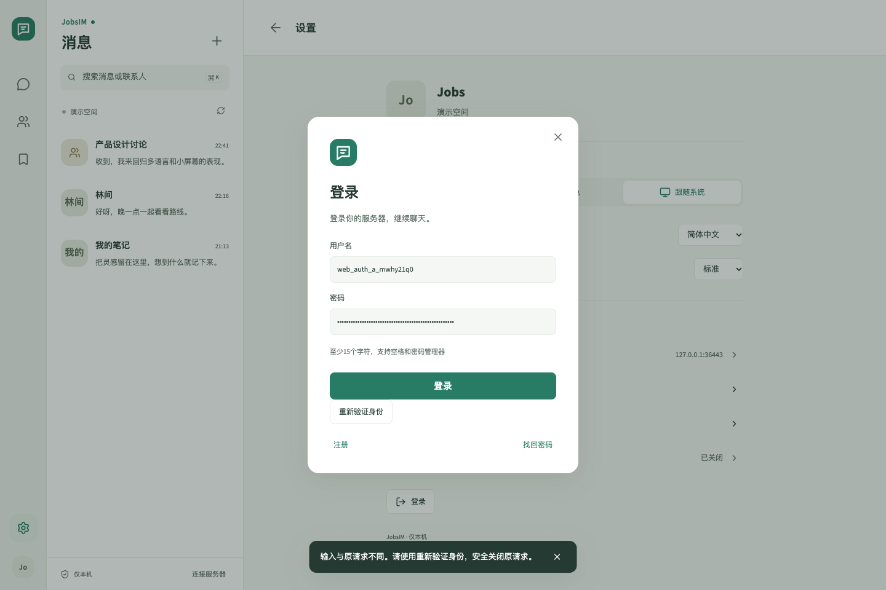
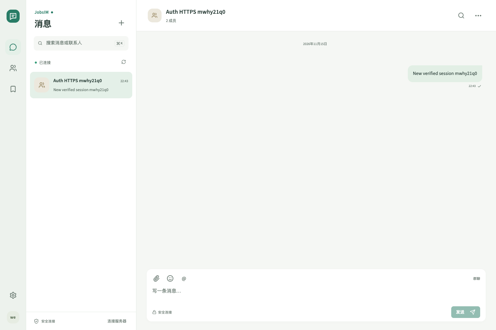

# Web 认证输入保护与续期专项

<!-- jobs-toc:start -->
<!-- jobs-toc:source {"v":2,"token":"[toc]"} -->

📚 目录（点击展开 / 收起）

- [一、结果与范围](#jobs-toc-heading-1)
- [二、已验证行为](#jobs-toc-heading-2)
- [三、复现与证据边界](#jobs-toc-heading-3)

<!-- jobs-toc:end -->

---

## 一、结果与范围 <a href="#前言">🔼</a> <a href="#🔚">🔽</a><!-- jobs-toc:heading-end -->

2026-11-15，当前生产构建的 8 组真实 HTTPS 认证联调通过，浏览器源码的 16 组模拟 BFF 协议测试通过，现有离线页面回归通过。三个结果分别记录，不相加为第一阶段功能覆盖率；未验收完整同步、全部浏览器或真实移动设备。

- [真实联调结果](真实联调结果.json)：生产 Dist、独立 PostgreSQL 运行环境与真实同源网关，访问令牌仅对测试新建的本人 Web family 调整期限；无服务重启、全局证书忽略或限流修改。
- [浏览器协议结果](浏览器协议结果.json)：真实 Chrome、Web Locks 与浏览器持久化，服务端响应由测试模拟；不能据此证明后端事务。
- [当前构建与证据快照](代码构建快照.json)：记录源码、生产包、脚本、结果及截图的 SHA-256。后端使用已验证的 `7ef53be2…` 认证基线，新同步候选不包含在本报告内。
- [离线页面回归](../执行记录/1794755667853-41809/)：演示发送、跨天与导航、Outbox 隔离、主题、字体、十种语言、桌面／移动布局及无脚本错误通过。

## 二、已验证行为 <a href="#前言">🔼</a> <a href="#🔚">🔽</a><!-- jobs-toc:heading-end -->

真实 HTTPS 验证双标签页只消费一次刷新凭据；提交后丢失刷新响应与页面重载停止自动重放；重新证明本人身份仅退休原 Web family，独立原生会话继续有效。旧设备的草稿、消息 body 与准入证明保留在原命名空间并冻结，新会话可以正常发送。只有不透明 Cookie 的冷启动可以先学习公开上下文，再续期同一家族一次。

认证表单等待另一标签页锁时，关闭表单会阻止稍后提交凭据。初始登录的真实响应丢失后保留原请求标识；改动原证明会在发送前拒绝，用户显式选择重新验证身份后，由服务端关联退休原家族。密码与刷新凭据不进入 JavaScript 持久化，原证明仅在当前页面内存中核对。

模拟 BFF 另外覆盖完整认证生命周期锁下的跨标签页意图保留、旧设备空队列迟到入队冻结、旧账号迟到响应隔离、存储失败先于刷新 POST，以及服务端关闭刷新或完整退休链能力后禁止绕行生成新登录请求。

## 三、复现与证据边界 <a href="#前言">🔼</a> <a href="#🔚">🔽</a><!-- jobs-toc:heading-end -->

复现入口分别为[浏览器协议脚本](../../../../../测试/前端/Web/auth-session.cjs/README.md)和[真实 HTTPS 脚本](../../../../../测试/前端/Web/auth-https.cjs/README.md)。执行前准备同源生产构建及工程外的专用测试 seed；密钥、数据库连接与 Cookie 不入库。

本目录保留最后一次成功运行的两张截图；已人工检查，登录密码遮蔽、错误提示与按钮可读，重新认证后聊天页显示真实发送结果。早先 6 组 HTTPS 和早期浏览器报告作为当时快照保留，不用当前源码哈希追认旧构建。

进入后续同步开发前，已从测试时生产 source map 逐字节归档七个[认证源码](认证源码基线/)并保存[生产包基线](生产包基线/)，均与原测试快照 SHA 相符。之后源码继续演进时，本报告仍只证明这份固定认证基线，不能自动证明后续构建。

<a id="🔚" href="#前言">回到首页</a>
