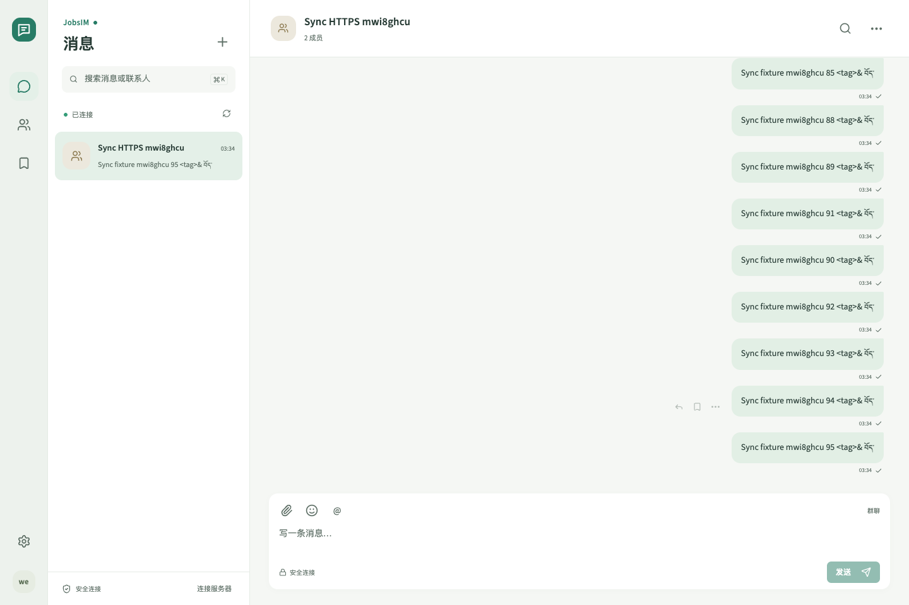
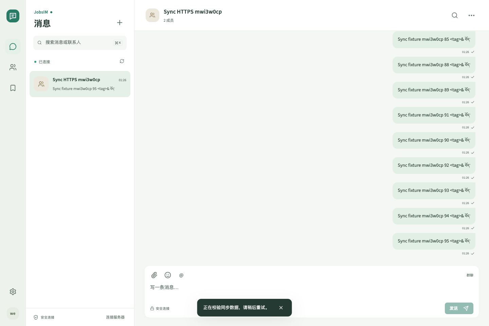
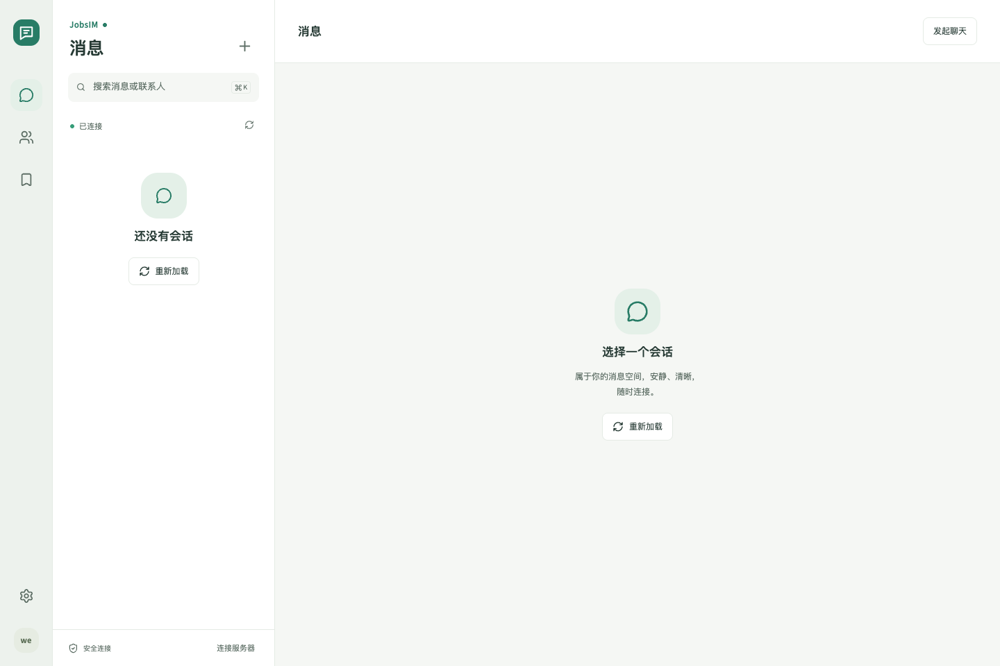

# Web 权威同步固定检查点

<!-- jobs-toc:start -->
<!-- jobs-toc:source {"v":2,"token":"[toc]"} -->

📚 目录（点击展开 / 收起）

- [一、当前固定检查点](#jobs-toc-heading-1)
- [二、先前固定构建与结果](#jobs-toc-heading-2)
- [三、先前已验证边界](#jobs-toc-heading-3)
- [四、先前视觉与共同未验范围](#jobs-toc-heading-4)

<!-- jobs-toc:end -->

---

## 一、当前固定检查点 <a href="#前言">🔼</a> <a href="#🔚">🔽</a><!-- jobs-toc:heading-end -->

当前生产包`index-DXdl9E2N`已构建，真实同步10组、认证真实HTTPS8组通过。52份源码／测试入口／配置与生产文件已按SHA封存，见[业务终态构建快照](业务终态构建快照.json)及[固定输入](业务终态固定输入/)。后端仍分别为固定57a867／44443及7ef／36443，没有用当前未编译S2源码替换它们。

| 本轮证据 | 实际范围 |
| --- | --- |
| [真实同步10组](../执行记录/sync-https-1794771241926-11632/真实同步结果.json) | 原9组边界继续通过；opaque32hex client ID、辅助只读查单503时真实global仍提交／原队列不变，创建POST仍只一次；503故障明确注入 |
| [真实认证8组](../执行记录/auth-https-1794771234829-11573/真实联调结果.json) | 新生产包的HttpOnly Cookie、同家族刷新、未知响应与退休链回归 |
| [业务终态9组](../执行记录/business-global-1794771094464-11141/业务终态结果.json) | 模拟业务API，真实Chrome／IDB；原路由／原client绑定、Set不别名、迟到forward／媒体、共享ledger重读、IDB失败与耐久重试 |
| [持久终态6组](../执行记录/global-facts-1794770422806-9398/结果.json) | 注入投影，真实IDB；已知scope的旧设备／epoch／archive／retained、guard及旧保存围栏；不删未知旧hash或其他来源 |
| [原队列10组](../执行记录/outbox-proof-1794770379428-9253/原请求队列结果.json) | proof明确注入；原route／完整body／最新队列CAS、opaque client ID与畸形200反例 |
| [投影16组](../执行记录/sync-view-1794770380088-9277/结果.json)／[存储12组](../执行记录/sync-store-1794770836951-10516/结果.json) | 新持久层下重跑；没有真实API，计数不相加 |
| [认证协议16组](../执行记录/auth-session-1794771096048-11164/浏览器协议结果.json)／[离线UI](../执行记录/1794771097899-11189/browser-result.json) | 明确模拟BFF；演示发送、三主题、字号、十语言、桌面手机溢出与JS异常回归 |

当前global业务DTO先核原路径和归属；即使本地事务失败，也先通知RAM持有者清理并限制云视图，耐久完成前不报成功。已知终态不能被迟到的更高版本正文重开；原Outbox不因相同client ID或global而被自动销账。附件字节完成前重读共享ledger，组件卸载取消显式下载。OS实际下载、崩溃／断电与全部客户端持有者仍未验收。

新真实多页截图已人工检查，旧同步提示已消失，尖括号和多语言文字正常；移动设置无横向溢出。一次开发模块回归失败原件保留：业务断言失败，随后同输入SHA重启Vite即通过8组；推断与HMR模块实例有关，未保存当时模块URL，不能断言唯一原因。最终9组使用重启后稳定服务，不用那次失败作为通过证据。

## 二、先前固定构建与结果 <a href="#前言">🔼</a> <a href="#🔚">🔽</a><!-- jobs-toc:heading-end -->

2026-11-16，生产包 `index-mqQfztei` 的权威同步真实 HTTPS 9 组通过，使用独立 44443 环境及后端固定 `57a86767…`。认证回归在同一生产包、独立 36443 认证环境通过 8 组真实 HTTPS；模拟 BFF 的 16 组另记。没有用原生设备、其他构建或全部 I 验收替代这些定向结果。

| 证据 | 实际范围 |
| --- | --- |
| [真实同步 9 组](../执行记录/sync-https-1794763568149-77618/真实同步结果.json) | 96 条本人夹具形成多页；中断第二页不提交、原请求恢复、完整安装、连续增量、未知 UI 消息只读查单、冷启动、空存储拒旧登记、撤权保留副本及后续 global 清理 |
| [协议 12 组](../执行记录/sync-protocol-1794759032661-29459/协议结果.json) | Node WebCrypto／既有 TypeScript CLI；原字节摘要、完整页、精确位置、版本与连续性，未请求 API |
| [存储 12 组](../执行记录/sync-store-20261115-170917-66499-proof-final/结果.json) | 真实 Chrome IndexedDB／WebLocks，API 明确模拟；事务回滚、原请求恢复、持久 guard、旧页面保存、global 多持有者清理 |
| [投影／proof 16 组](../执行记录/sync-view-1794762407428-64949/结果.json) | 真实浏览器本地模块与 IDB；同 ID 不直接 ACK、原 body／准入／路由／发送者、最新队列 CAS、未读、最小墓碑与 global 终态；未请求真实 API |
| [认证协议 16 组](../执行记录/auth-session-1794763568135-77619/浏览器协议结果.json) | 真实浏览器与模拟 BFF，原证明、跨标签页生命周期、退休链及同家族刷新门禁 |
| [认证真实 HTTPS 8 组](../执行记录/auth-https-1794763633166-78177/真实联调结果.json) | HttpOnly Cookie、单次刷新、丢响应、原证明保护、关联退休、原设备队列冻结和新会话发送 |

这些组数不相加为产品覆盖率。固定输入与生产包共 44 个文件已按 SHA-256 归档，见[构建快照](构建快照.json)及[固定输入](固定输入/)。之后源码继续加强旧历史接口兼容路径的原请求查单，不由本检查点自动追认。

## 三、先前已验证边界 <a href="#前言">🔼</a> <a href="#🔚">🔽</a><!-- jobs-toc:heading-end -->

全部快照页、原始 reference／body envelope、版本和最终权限校验通过后，取得第一次连续增量，再同 IndexedDB 严格事务安装视图和边界。缺页时没有可见云投影或游标；恢复重新取得所有页面，初次快照始终只有一个原请求 ID。

真实 UI 消息先由服务器提交，再故意丢掉响应。随后仅凭原完整 body 和原会话路由只读查单取得 200，并在本地事务再次比较原队列后收口；该消息创建 POST 实测仅一次。独立空浏览器仅复用本测试自己的不透明 Cookie 时，旧物理存储登记返回 409，未自动发送消息。

群成员失权后关闭云视图，保留原合法普通本地副本于隔离持有者；后续 global 墓碑仍可送达历史合法持有者并清除正文／媒体侧信。浏览器存储未包含测试密码、AT 或 RT；权威路径全程没有退回旧历史 GET。

早期投影测试曾出现 13／14 通过：迟到的精确转发读取会覆盖已知 global。该[失败原始结果](../执行记录/sync-view-1794760837505-53272/结果.json)保留，修复后扩展到 16 组全部通过；旧输入由唯一已知修改逆向恢复且 SHA 精确匹配后另记来源，不篡改失败结果。

## 四、先前视觉与共同未验范围 <a href="#前言">🔼</a> <a href="#🔚">🔽</a><!-- jobs-toc:heading-end -->

两张真实截图已人工检查：分页后的消息可读，尖括号／多语言文字正常显示；撤权后为空态并有重新加载入口。第一张仍有短暂的同步状态提示，它不代表尚未持久提交；后续界面修订另验。

尚不包含 qualified ACK、after_receipt、服务器已读、云草稿／偏好、附件字节持久收讫、正式导出、账号注销、普通迁移或全部第一阶段。iOS／Android 原生消费另在建，旧认证包不证明这些代码。后端底座与恢复范围见[后端报告](../../../后端/权威同步底座/README.md)，NATS 部署入口的原生边界见[部署报告](../../../部署/NATS/README.md)。

<a id="🔚" href="#前言">回到首页</a>
